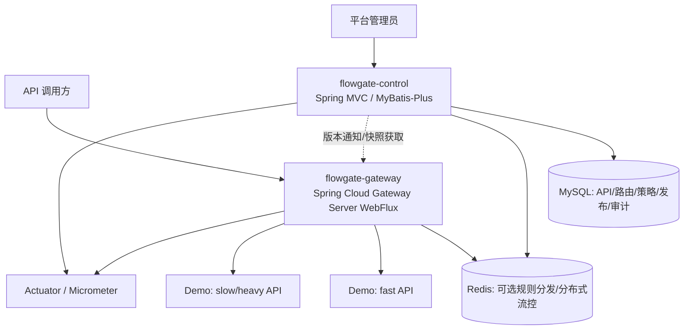

# FlowGate — 高并发 API 网关与流量治理平台

> **状态：业务设计和 4+1 开发方案已确认；功能块 0 待实现，细节逐块审查。**
>
> 更新：2026-11-04。审计基准：[`java-up-up/hmdp-plus@03594d1`](https://github.com/java-up-up/hmdp-plus/tree/03594d190275a32d151e5d8b45da24c0f4efbe14)。
>
> 阅读顺序：**本 README（定位、架构、业务目录与 4+1 开发计划） → [阶段 0 审计与完整业务设计](docs/stage-0-audit.md)（Plus 复用证据、B01–B13/E01–E03 细则、决策及测试边界）**。

## 1. 核心定位：复用技术，重构业务

FlowGate 不是在黑马点评 Plus 前面添加转发层，也不以原来的商户、秒杀、订单业务为长期核心。项目以 Plus 的 Java 后端技术实现为起点，**将业务领域重构为 API 网关、路由管理、准入与流量治理、服务保护、策略发布和运行监控**。

- **继承技术经验**：Java 17、Spring Boot、MVC 管理端、Redis/Lua 原子操作、缓存、MyBatis-Plus、Redisson、Kafka、幂等、监控等；逐项评估是否值得移植/重构。
- **替换原业务**：原商户、优惠券、秒杀、订单等业务代码仅作为可阅读的技术参考与迁移素材，不是交付目标；无需为了复用 Kafka/库存机制而保留无关业务。
- **独立核心贡献**：Gateway 数据面、路由/策略模型、认证、安全路由、多维限速与并发保护、热点隔离、规则版本化/分发、熔断/降级、监控和可重复压测。
- **最小验证环境**：提供普通快速查询 API 和可控的慢/重负载 API；它们是测试对象，不是新的大型业务系统。早期可同一 MVC 进程部署，验证资源隔离时须承认这种部署的局限，按需拆成独立进程。

**不做**：企业商业化/计费商城、通用库存/订单账本、每请求强制 Kafka、首版 Nacos/ES/K8s/分库分表、多个并行认证体系、无性能证据的自适应算法或不必要的管理前端。

## 2. 用户与总体业务

| 角色 | 要完成的业务 | 成功标志 |
|---|---|---|
| 平台管理员 | 注册 API、设定上游目标、绑定鉴权/限流/熔断规则、发布/回滚配置、查看指标与审计记录 | 规则经过校验和版本管理，可查看生效情况 |
| API 调用方 | 经统一入口访问获授权 API，遇到治理拒绝时得到确定的 HTTP 语义 | 不绕过授权，正常请求被安全透传 |
| 被代理的业务服务 | 通过网关保护自身容量，继续处理自己的业务与数据一致性 | 热点或慢请求不无约束地拖垮其他接口 |
| 开发/测试者 | 对照直连/只代理/启用治理三种状态压测和注入故障 | 原始数据、配置、脚本可复现 |

核心业务闭环（最终目标，**不表示阶段 1 就全部实现**）：

1. 管理员注册服务/API 与受约束的上游目标。
2. 配置路由、安全要求和策略作用域；控制面校验、生成不可变版本并发布。
3. Gateway 加载最近有效的本地规则快照，根据路径/方法匹配 API，并恢复调用方身份。
4. Gateway 做速率准入、在途并发许可、超时/熔断检查，然后通过 HTTP 转发；**绝不在 Netty 事件循环中直接执行 JDBC、同步 Redis 或同步 Redisson**。
5. Gateway 输出拒绝原因、错误、延迟/吞吐等指标；管理端查看规则版本和效果，可回滚配置。
6. 用“正常查询 + 人工慢/重负载”验证热点隔离，同时记录额外网关开销。

## 3. 架构与边界



**数据面 Gateway（独立进程）**：路由匹配、Header 清理、Trace ID、调用方认证与授权、流量准入、并发许可、超时/熔断/降级、HTTP 代理与低基数指标。无业务事务、无 MySQL/订单/Kafka 消费。使用非阻塞运行链路。

**控制面 Control（从 Plus MVC 技术重构）**：平台管理员身份/权限、API 与路由目录、上游目标白名单、策略配置和校验、发布版本、审计查询、管理 API。可以继续用同步 JDBC/Redis/Redisson，但不在 Gateway 请求热路径里调用其数据库。

**演示下游（最小可控负载）**：`GET /demo/fast/{id}` 为普通查询（可按需使用缓存），`GET /demo/slow?delayMs=...` 为有上限的可控慢调用。演示路由/方法是**提议接口**，不是已经存在的源码。压测隔离需要不同资源池/进程时再拆分。

**存储分工**：MySQL 持久化配置和审计；Redis 初期只在真实需要时用于限流/规则传播，不要求第一条静态代理链路依赖 Redis；Kafka 暂不作为网关前置依赖。可先使用内存不可变快照，后来根据多实例一致性要求引入 Redis 通知。

### 概念数据模型（后续按用例增量落表）

- `ApiDefinition`：稳定 API ID、所属服务、HTTP 方法与路径模板、状态、认证要求。
- `RouteDefinition`：API/路由关联、上游目标、重写规则、优先级、启停状态；目标必须受协议/主机/端口白名单约束。
- `PolicyDefinition`：类型（速率、并发、超时、熔断）、作用域（全局/服务/路由/调用方）、参数、失败模式、启用状态。
- `PolicyBinding`：策略和作用对象的绑定关系，规定优先级与冲突处理。
- `ConfigRelease`：单调递增版本、校验摘要、发布者、发布状态、回滚来源。
- `Principal` / `AuditLog`：管理员或调用方的安全主体、权限；变更操作的审计记录。

P0 先不建全套表。管理 API 的候选资源为 `/admin/apis`、`/admin/routes`、`/admin/policies`、`/admin/releases`、`/admin/metrics`，需在对应阶段细化契约；管理端点不能被注册为任意公开上游。

### 请求责任链

```text
客户端
  -> 可信代理边界 / 去除伪造身份头 / Trace ID
  -> Gateway 路由匹配
  -> 认证 (401) / 授权 (403)
  -> 速率准入 (429) / 在途并发许可 (429 或 503，按策略明确)
  -> 超时/熔断判断 (503/504 等)
  -> Netty HTTP 转发 -> 下游 API
  -> 释放并发许可 (包括出错、取消、超时)
  -> 指标与响应
```

*此为语义顺序；具体 Spring Cloud Gateway 的 Predicate/Filter 运行顺序应在编码阶段通过集成测试验证。* 用户身份来自可信凭证/验证结果，不来自客户端可伪造的 `X-User-Id`。业务请求默认不自动重试，尤其不重试有副作用的 POST。HTTP 401/403/429/502/503/504 分别定义清楚；下游业务 `200 + success:false` 不会被错误地当成网关的 5xx。

## 4. 完整业务目录与面试亮点

> **业务设计 V1.0：13 个正式业务 + 3 个条件扩展。** 方向已获准同步 GitHub，具体技术 ADR 仍待审核；**所有条目都是尚未实现的目标**。每个业务的场景、功能、实现边界、核心数据、面试亮点与验收标准，统一保存在 [阶段 0 审计及完整业务设计（第十节）](docs/stage-0-audit.md)。

### 正式业务 B01–B13

| ID | 业务模块 | 建设阶段 | 面试亮点 |
|---|---|---|---|
| B01 | 后端服务接入管理 | P0 | 上游地址解耦、SSRF 防护 |
| B02 | API 注册与动态路由 | P0 → P1 | 路由匹配、热更新、版本边界 |
| B03 | 管理员、调用方与认证授权 | P1 | Redis Token、RBAC、WebFlux 鉴权 |
| B04 | 统一请求代理与协议治理 | P0 | Reactor/Netty、请求透传 |
| B05 | 策略配置、版本发布与回滚 | P1 | 不可变快照、CAS、原子生效、回滚 |
| B06 | 多维分布式限速 | P1 | Redis Lua、多维配额原子性 |
| B07 | 并发控制与过载保护 | P1 | 在途并发、许可释放、租约恢复 |
| B08 | 热点识别与流量隔离 | P1 | 容量预算、热点隔离、对照实验 |
| B09 | 超时、熔断与降级恢复 | P1 | 熔断状态机、半开恢复 |
| B10 | 流量监控与运行分析 | P0 → P1 | Micrometer、P95/P99、标签基数 |
| B11 | 管理操作审计与幂等 | P1 | 唯一约束、乐观锁、幂等键 |
| B12 | 配置一致性与故障容错 | P1 | 节点版本收敛、漏通知补偿 |
| B13 | 真实负载模拟与压测验证 | P0 → P1 | 三组对照、故障注入、实验复现 |

### 条件扩展业务 E01–E03

| ID | 业务模块 | 面试亮点 | 触发条件 |
|---|---|---|---|
| E01 | 自适应流量准入 | AIMD、反馈控制、防震荡 | 固定策略有可信性能基线后 |
| E02 | API Key、应用配额与灰度发布 | 多租户隔离、稳定哈希分流 | 确有多应用或灰度需求 |
| E03 | 异步审计与统计任务 | Kafka、幂等消费、Outbox | 有真实异步解耦收益时 |

**重点技术主线**：① B02/B05/B11/B12：版本化策略发布、动态路由与配置一致性；② B06/B07：Redis Lua 多维限速与并发许可；③ B08/B09/B13：热点隔离、熔断、性能对照；④ B03/B04/B10/B13：WebFlux 响应式请求链路、身份安全与可观测性。

**贯穿业务演示**：管理员注册普通查询 API 与热点慢/计算 API → 配置路由和身份权限 → 发布规则 → 在明确共享容量的负载下对照“直连/只代理/启用治理” → 观察 P95/P99、吞吐、拒绝与资源消耗 → 注入超时/5xx 和断联故障 → 验证熔断、回滚及各节点版本状态。必须保留原始测试数据，不能将示例数值当成实测结果。

**原则**：复用 Plus 的 MVC、Redis/Lua、缓存、幂等、MyBatis-Plus 等技术实现/经验；Gateway 独立非阻塞，绝不以继续经营原商户/秒杀/订单业务为目标。基础限流、熔断优先评估 Gateway 现有框架能力，创新重点放在多维策略编排、热点保护、配置发布与可靠性验证。

## 5. 技术选择与引入理由

| 组件 | 用途及核心原理 | 选择理由 | 替代/暂缓方案 |
|---|---|---|---|
| Spring Cloud Gateway Server WebFlux | 基于 Reactor/Netty 的非阻塞 HTTP 代理与 Filter 链 | 项目主体就是 API 网关；规范化路由和过滤器 | MVC Gateway 可用但不符合当前数据面约束 |
| Spring MVC + MyBatis-Plus | 控制面 CRUD、事务和配置存储 | 可改造 Plus 熟悉的代码，学习成本低 | 后续拆服务或换持久化方式，现阶段无需 |
| Redis + Lua | Redis 单线程执行脚本完成分布式原子计数/令牌更新 | 延续 Plus 限流与原子操作的知识 | P0 可先本地或静态规则；不用同步 Redis Jar 挂 Gateway |
| Caffeine / 不可变本地快照 | 内存读取最近有效配置，原子替换版本 | 避免每次调用读控制面；已熟悉缓存机制 | P0 普通不可变 Map + AtomicReference 即可 |
| Redisson | 必要时做控制面协调/防重复执行 | Plus 有现成锁与幂等思路 | 首选 DB 唯一键、乐观锁/版本号，避免无必要分布式锁 |
| Kafka | 未来存在异步审计或异步任务需求时使用 | Plus 有生产/消费/补偿经验 | P0/P1 管理操作可先事务性 DB 审计；**不把普通代理变 MQ** |
| Micrometer/Actuator | 吞吐、错误、拒绝、延迟和规则版本指标 | 上游已有，减少重复学习 | 初期日志与基础 metrics；Prometheus 抓取按阶段配套 |

**开发版本基线（2026-11-04，设计锁定但实际构建待验证）**：Java 17、Spring Boot 4.0.9、Spring Cloud 2025.1.4、Spring Cloud Gateway Server WebFlux（Starter：spring-cloud-starter-gateway-server-webflux）；控制面拟用 MyBatis-Plus 3.5.18 的 Boot 4 Starter。上游 Plus 仍是 Boot 3.5.4；只选择性复用代码和算法，不复制旧 POM/Starter。官方依据：[Boot 4.0.9](https://spring.io/blog/2026/10/23/spring-boot-4-0-9-available-now/)、[Cloud 2025.1.4 配套 Boot 4.0.9](https://spring.io/blog/2026/10/23/spring-cloud-2025-1-4-has-been-released/)、[MyBatis-Plus Boot 4 Starter](https://baomidou.com/getting-started/install/)。Cloud 2025.0.x 的开源支持已于 2026-06-30 结束，不作为新项目默认基线；实际依赖解析和源码适配以功能块 0 的构建验证为准。

## 6. 开发执行方案 V1.0（2026-11-04 确认）

**执行方式：从零建立新工程，不整体复制 Plus；以 4 个功能开发块 + 1 个最终验收块推进。** B01—B13 归入这些完整业务闭环，E01—E03 只在需求明确时考虑。不要对每个 Controller、Mapper、Filter、脚本单独设开发阶段。

| 功能块 | 整块交付 | 对应业务 | 仅运行本块关联测试 |
|---|---|---|---|
| **0：基础网关与代理** | Maven 父工程、Gateway、Demo；静态路由、请求透传、Trace ID、基础指标 | B02/B04/B10/B13 最小部分 | 受影响模块编译；Gateway + Demo 启动；GET/POST Echo、参数/Header/状态码、Trace 与错误的定向测试 |
| **1：API 管理与动态发布** | MVC Control、服务/API/路由管理、管理员及调用方认证、策略配置、版本发布/回滚、基础审计与热更新 | B01/B02/B03/B05/B11/B12 | 管理 API/授权、版本冲突、发布/回滚、网关热更新与相关异常的定向测试 |
| **2：高并发流量治理** | Redis Lua 多维限速、服务/路由在途并发、过载拒绝、热点预算与隔离 | B06/B07/B08 | Lua 边界/TTL/Key 契约、相关 Gateway Filter、共享配额或作用域相关的局部多节点验证 |
| **3：故障保护与监控** | 超时/熔断/降级、控制面和 Redis 故障策略、多节点规则恢复、完整指标 | B09/B10/B12 | 新增超时/5xx/恢复、旧快照保留、补拉收敛、指标等定向测试 |
| **最终验收：统一大测试** | 完整构建、全量回归、跨模块集成、安全/故障/多实例/压测、交付和面试证据 | 完整 B01—B13，重点 B13 | **仅在这里执行全项目统一大测试与三组性能压测**；保留脚本、配置、原始结果和修复记录 |

**每块测试规则（已确认）：**

- 只测试本次新增、修改、直接受影响的组件与 API；不在每个功能块结束时执行所有历史测试，也不每次执行完整长时间压测。
- 需要编译当前及其受影响的 Maven 模块。共享契约变化会影响依赖方，这些直接受影响的调用者也必须做定向检查。
- 每个功能块保留一条最小端到端验证以及必要的异常路径；阻断性的编译错误、安全问题和本块业务错误必须在本块修复。
- 完整业务完成后，再统一运行全量回归、跨模块集成、权限安全、多节点和配置失联、Redis 故障、性能压测。最终测试发现的问题修复后，需按受影响范围做复测并重新完成必要的统一验收。
- 每块一次总结（功能、改动文件、Plus 代码复用与改造、测试命令/结果、风险），供负责人与 Codex 按**功能块粒度**检查，不进行大量零散审批。

**工程管理**：建议每功能块一个 feature 分支和 PR；一个块完成后再进入下一个。长期项目设计/交接仍维护本 README 与 docs/stage-0-audit.md 两份；程序文件、测试脚本及代码评审记录不视为新增长期设计文档。

**功能块 0 边界**：初期仅 Gateway + Demo，父工程以及真正需要时的共享 Contract。Control 在功能块 1 建立；不依赖数据库、Redis、Kafka；路由目标限定为明确可信的本地 Demo，不开放任意 URL 代理。

**授权和事实区分**：负责人已同意直接按功能块从零开始编码。本节只是已确定的执行方案；功能块 0 是否完成必须以源码与定向测试记录为证，不能以文档提交代替开发成果。

### 6.1 最小必要技术与中文注释规范（2026-11-04 确认）

**强制原则：业务关键、必要、熟悉、可验证；不为面试增加无关中间件。**

- **核心**：Java、Spring Boot、MVC Control、Spring Cloud Gateway WebFlux、Maven。WebFlux 是响应式网关本身的必要技术。
- **按需**：MySQL/MyBatis-Plus 用于控制面业务数据；Redis/Lua 用于分布式限流与会话；基础监控优先 Actuator/Micrometer；本地配置优先 JDK 不可变对象和原子引用。
- **默认暂缓**：Kafka、Redisson、Nacos、Sentinel、Elasticsearch、Kubernetes、复杂注册/配置中心、自研通用框架；熔断优先用 Gateway 官方集成，需要时才引入依赖；不强制上 Caffeine 或额外中间件。
- **复用**：能够安全兼容就选择性复用 Plus 类；原 Servlet、阻塞 Redis、点评业务耦合代码仅借鉴算法、作最小适配，不整包复制。

**中文注释硬性要求**：

1. 核心业务类、接口和重要方法使用准确中文注释，说明业务目的、参数/返回、异常及关键边界；重点解释并发、Lua 原子性、配置版本和失败恢复的设计理由。
2. **较长方法、较长代码块或多步骤业务流程，按 `// 1. ...`、`// 2. ...`、`// 3. ...` 中文分点注释**，必要时继续编号。每一点概述有意义的执行阶段，而非机械逐行注释。
3. Redis Lua 与关键配置也应有必要中文说明。简单 getter/setter 不机械堆注释；修改代码时同步更新注释，不保留旧点评业务的错误说明。

每功能块的评审检查新增依赖的必要性、中文注释质量和 Plus 复用边界；测试仍只覆盖新增、修改及直接受影响范围，项目末尾统一大测试。

### 6.2 ChatGPT 与本地 Codex 协作流程（2026-11-04 确认）

**固定分工**：ChatGPT 为每个完整功能块提供可执行的中文任务书、接口契约、技术边界与验收清单；本地 Codex 在项目实际工作目录阅读仓库文档、实现源码、运行本块定向测试并报告；项目负责人审查功能交付和风险，ChatGPT 基于 GitHub 分支/PR 的实际代码与运行记录复核。**一轮只实施一个功能块，不自动跳到下一块。**

**执行协议**：
1. Codex 开始时先检查工作目录、Git 远端、当前分支、未提交的修改及环境，不得覆盖现有用户工作；从最新 main 新建功能分支（建议本块为 `feat/block0-gateway-foundation`）。
2. 阅读本 README 和 [本文第十二节：功能块 0 完整 Codex 任务书](docs/stage-0-audit.md)，以本块目标为边界直接完成实现。涉及技术版本、既有框架兼容问题，先在本块范围验证并选择最小修正；不新增无关中间件。
3. 对本块新增、修改、直接受影响代码执行定向编译、单测及最小端到端验证；不逐轮全量回归、全链路故障测试或大规模压测，这些保留到最终统一验收。
4. 关键类、方法、业务流程有准确中文注释；长逻辑使用“// 1. ...、// 2. ...、// 3. ...”的分条中文注释。
5. 完成后整理文件清单、Git 提交、实际运行命令及通过/失败结果、未覆盖风险；可推送**独立功能分支**供复核，但不得直接修改/合并 main 或自行开启下个功能块。需要用户权限的远端操作按本地权限和用户授权处理。
6. ChatGPT 和负责人审核后的问题在**同一功能块**修复、做相关定向复测；审核通过才开启下一功能块。

**当前入口**：只执行 [第十二节任务书](docs/stage-0-audit.md)（功能块 0）。其余 B01—B13 的后续功能在当前回合均未授权实现。

## 7. 风险与未决定事项

阶段 0 确认的是静态源码事实，**没有实际编译、运行、测试或压测**。主要风险：Plus 原限流器使用同步 Redis 和 Servlet，不能直接放在 Gateway；原认证依赖 MVC `ThreadLocal`；原业务错误使用 HTTP 200 包装失败；一些原日志包含演示性质的验证码/令牌；原上游 ShardingSphere 有多数据源与配置敏感项，不可直接复制到公开仓库。

待审核的三项 ADR：① 控制面从 Plus MVC 选择性重构、网关单独 WebFlux；② 首版管理员/调用方凭证采用简化 Redis Token 还是其他协议；③ 动态规则发布采用 DB 版本 + 本地快照 + Redis 通知/轮询，Redis 限流如何演进。详见 [审计与 ADR](docs/stage-0-audit.md)。

## 8. 开源声明

上游来源：[java-up-up/hmdp-plus](https://github.com/java-up-up/hmdp-plus)，仓库中有 Apache License 2.0。当前文档只记录方案，**尚未移入上游源码**。将来如实际复制/修改受该许可证约束的代码，需要保留对应许可、版权声明与必要归属，检查 NOTICE 要求；不要提交原仓库中的敏感配置、凭证或测试数据。此事项属于阶段 1 的前置核对。
