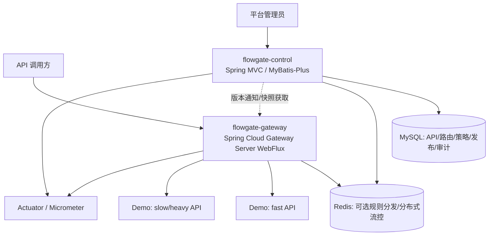

# FlowGate — 高并发 API 网关与流量治理平台

> **2026-11-08 V11-C（设计完成、尚未开始编码）**：已完成[Kafka/Outbox可靠投递和用量对账详细设计](docs/design/v11-c-async-execution.md)、[C0～C6任务](docs/progress/v11-c-async.md)、[本地Codex提示](CODEX_V11_C_EXEC_PROMPT.md)，计划只在Control中加入可选Kafka，默认`FLOWGATE_ASYNC_ENABLED=false`，新增ConsumedEvent/UsageDaily并以MySQL权威Ledger对账。**Kafka Worker/Consumer/用量页面尚未实施，不能说异步能力已完成**。B两项小修（旧订阅与冻结余额失败关闭、计量OFF紧急撤销APP Token）已经实际提交源码/前端/SQL/JUnit/B6脚本，但新补丁的真实Java/MySQL回归尚未执行；Codex必须先完成C0再编码C1～C6。旧PR/main不自动合并。


> **V11-B（2026-11-08）**：B0～B6的Java/SQL/Gateway计量、MySQL余额/Ledger/Outbox、独立APP Token、正式产品页与Codex隔离测试**均已远端交付**；Codex记录57项JUnit及20组双Gateway真实HTTP场景（Free5/100并发恰好5Grant/95拒绝）。ChatGPT源码复审建议补齐**存量A同月订阅预检与冻结余额核验**、**计量功能OFF时允许紧急撤销已签发凭证**。详见[审核报告](docs/reviews/v11-b-static-review-2026-11-08.md)和[Codex定向修复](CODEX_V11_B_REVIEW_FIX_PROMPT.md)。上述小修尚未编码/重测，V1/V11真人浏览器验收与主线合并未完成；Kafka属于V11-C，不在B中。


> **V1.1-A管理域已在功能分支实现并完成定向验证，复审缺口已迁入B0**：客户、应用、不可变额度套餐、UTC串行订阅及正式产品页面。A历史交付不启用应用Token、额度扣减或Kafka；B在独立分支增量实现，C/D未编码。**V1仍待负责人最终人工验收，main未合并，不能将A称为V1.1全版本完成。**
>
> 入口：[V11-A真实实施与验证](docs/progress/v11-a-business.md#a-08-2026-11-07-codex真实实施与定向结果) · [产品使用指南第8节](docs/guides/product-console-guide.md#openapi) · [阶段路线](docs/progress/v11-roadmap.md)。本机已有数据库尚未迁移，首次使用需按指南执行增量SQL，再重启Control，打开 `/console/` 的“客户与应用”“套餐与订阅”。

> **当前：Block4正式产品后台 `/console/` 的Java/JS/CSS已远端提交，定向Java10项和产品真实HTTP64条有Codex证据，ChatGPT源码静态复审已完成；Caller旧记录缺少安全列表、负责人1280px/375px与键盘实际浏览器体验、产品后全量回归仍待收口。Block4/V1没有最终验收，PR均Draft，main未合并。**
>
> 更新：2026-11-06。审计基准：[`java-up-up/hmdp-plus@03594d1`](https://github.com/java-up-up/hmdp-plus/tree/03594d190275a32d151e5d8b45da24c0f4efbe14)。
>
> 使用入口：**http://127.0.0.1:8081/console/** · [产品操作指南](docs/guides/product-console-guide.md)（页面自带离线帮助）。开发合同：[产品设计与实施记录](docs/design/product-console-v1.md)、[Block4进度](docs/progress/block-4-acceptance.md)。旧 `/test-console/` 保留为开发工具。

## 1. 核心定位：复用技术，重构业务

FlowGate 不是在黑马点评 Plus 前面添加转发层，也不以原来的商户、秒杀、订单业务为长期核心。项目以 Plus 的 Java 后端技术实现为起点，**将业务领域重构为 API 网关、路由管理、准入与流量治理、服务保护、策略发布和运行监控**。

- **继承技术经验**：Java 17、Spring Boot、MVC 管理端、Redis/Lua 原子操作、缓存、MyBatis-Plus、Redisson、Kafka、幂等、监控等；逐项评估是否值得移植/重构。
- **替换原业务**：原商户、优惠券、秒杀、订单等业务代码仅作为可阅读的技术参考与迁移素材，不是交付目标；无需为了复用 Kafka/库存机制而保留无关业务。
- **独立核心贡献**：Gateway 数据面、路由/策略模型、认证、安全路由、多维限速与并发保护、热点隔离、规则版本化/分发、熔断/降级、监控和可重复压测。
- **最小验证环境**：提供普通快速查询 API 和可控的慢/重负载 API；它们是测试对象，不是新的大型业务系统。早期可同一 MVC 进程部署，验证资源隔离时须承认这种部署的局限，按需拆成独立进程。

**不做**：企业商业化/计费商城、通用库存/订单账本、每请求强制 Kafka、首版 Nacos/ES/K8s/分库分表、多个并行认证体系、无性能证据的自适应算法或不必要的管理前端。

## 2. 用户与总体业务

| 角色 | 要完成的业务 | 成功标志 |
|---|---|---|
| 平台管理员 | 注册 API、设定上游目标、绑定鉴权/限流/熔断规则、发布/回滚配置、查看指标与审计记录 | 规则经过校验和版本管理，可查看生效情况 |
| API 调用方 | 经统一入口访问获授权 API，遇到治理拒绝时得到确定的 HTTP 语义 | 不绕过授权，正常请求被安全透传 |
| 被代理的业务服务 | 通过网关保护自身容量，继续处理自己的业务与数据一致性 | 热点或慢请求不无约束地拖垮其他接口 |
| 开发/测试者 | 对照直连/只代理/启用治理三种状态压测和注入故障 | 原始数据、配置、脚本可复现 |

核心业务闭环（最终目标，**不表示阶段 1 就全部实现**）：

1. 管理员注册服务/API 与受约束的上游目标。
2. 配置路由、安全要求和策略作用域；控制面校验、生成不可变版本并发布。
3. Gateway 加载最近有效的本地规则快照，根据路径/方法匹配 API，并恢复调用方身份。
4. Gateway 做速率准入、在途并发许可、超时/熔断检查，然后通过 HTTP 转发；**绝不在 Netty 事件循环中直接执行 JDBC、同步 Redis 或同步 Redisson**。
5. Gateway 输出拒绝原因、错误、延迟/吞吐等指标；管理端查看规则版本和效果，可回滚配置。
6. 用“正常查询 + 人工慢/重负载”验证热点隔离，同时记录额外网关开销。

## 3. 架构与边界



**数据面 Gateway（独立进程）**：路由匹配、Header 清理、Trace ID、调用方认证与授权、流量准入、并发许可、超时/熔断/降级、HTTP 代理与低基数指标。无业务事务、无 MySQL/订单/Kafka 消费。使用非阻塞运行链路。

**控制面 Control（从 Plus MVC 技术重构）**：平台管理员身份/权限、API 与路由目录、上游目标白名单、策略配置和校验、发布版本、审计查询、管理 API。可以继续用同步 JDBC/Redis/Redisson，但不在 Gateway 请求热路径里调用其数据库。

**演示下游（最小可控负载）**：`GET /demo/fast/{id}` 为普通查询（可按需使用缓存），`GET /demo/slow?delayMs=...` 为有上限的可控慢调用。演示路由/方法是**提议接口**，不是已经存在的源码。压测隔离需要不同资源池/进程时再拆分。

**存储分工**：MySQL 持久化配置和审计；Redis 初期只在真实需要时用于限流/规则传播，不要求第一条静态代理链路依赖 Redis；Kafka 暂不作为网关前置依赖。可先使用内存不可变快照，后来根据多实例一致性要求引入 Redis 通知。

### 概念数据模型（后续按用例增量落表）

- `ApiDefinition`：稳定 API ID、所属服务、HTTP 方法与路径模板、状态、认证要求。
- `RouteDefinition`：API/路由关联、上游目标、重写规则、优先级、启停状态；目标必须受协议/主机/端口白名单约束。
- `PolicyDefinition`：类型（速率、并发、超时、熔断）、作用域（全局/服务/路由/调用方）、参数、失败模式、启用状态。
- `PolicyBinding`：策略和作用对象的绑定关系，规定优先级与冲突处理。
- `ConfigRelease`：单调递增版本、校验摘要、发布者、发布状态、回滚来源。
- `Principal` / `AuditLog`：管理员或调用方的安全主体、权限；变更操作的审计记录。

P0 先不建全套表。管理 API 的候选资源为 `/admin/apis`、`/admin/routes`、`/admin/policies`、`/admin/releases`、`/admin/metrics`，需在对应阶段细化契约；管理端点不能被注册为任意公开上游。

### 请求责任链

```text
客户端
  -> 可信代理边界 / 去除伪造身份头 / Trace ID
  -> Gateway 路由匹配
  -> 认证 (401) / 授权 (403)
  -> 速率准入 (429) / 在途并发许可 (429 或 503，按策略明确)
  -> 超时/熔断判断 (503/504 等)
  -> Netty HTTP 转发 -> 下游 API
  -> 释放并发许可 (包括出错、取消、超时)
  -> 指标与响应
```

*此为语义顺序；具体 Spring Cloud Gateway 的 Predicate/Filter 运行顺序应在编码阶段通过集成测试验证。* 用户身份来自可信凭证/验证结果，不来自客户端可伪造的 `X-User-Id`。业务请求默认不自动重试，尤其不重试有副作用的 POST。HTTP 401/403/429/502/503/504 分别定义清楚；下游业务 `200 + success:false` 不会被错误地当成网关的 5xx。

## 4. 完整业务目录与面试亮点

> **业务设计 V1.0：13 个正式业务 + 3 个条件扩展。** 方向已获准同步 GitHub，具体技术 ADR 仍待审核；**所有条目都是尚未实现的目标**。每个业务的场景、功能、实现边界、核心数据、面试亮点与验收标准，统一保存在 [阶段 0 审计及完整业务设计（第十节）](docs/stage-0-audit.md)。

### 正式业务 B01–B13

| ID | 业务模块 | 建设阶段 | 面试亮点 |
|---|---|---|---|
| B01 | 后端服务接入管理 | P0 | 上游地址解耦、SSRF 防护 |
| B02 | API 注册与动态路由 | P0 → P1 | 路由匹配、热更新、版本边界 |
| B03 | 管理员、调用方与认证授权 | P1 | Redis Token、RBAC、WebFlux 鉴权 |
| B04 | 统一请求代理与协议治理 | P0 | Reactor/Netty、请求透传 |
| B05 | 策略配置、版本发布与回滚 | P1 | 不可变快照、CAS、原子生效、回滚 |
| B06 | 多维分布式限速 | P1 | Redis Lua、多维配额原子性 |
| B07 | 并发控制与过载保护 | P1 | 在途并发、许可释放、租约恢复 |
| B08 | 热点识别与流量隔离 | P1 | 容量预算、热点隔离、对照实验 |
| B09 | 超时、熔断与降级恢复 | P1 | 熔断状态机、半开恢复 |
| B10 | 流量监控与运行分析 | P0 → P1 | Micrometer、P95/P99、标签基数 |
| B11 | 管理操作审计与幂等 | P1 | 唯一约束、乐观锁、幂等键 |
| B12 | 配置一致性与故障容错 | P1 | 节点版本收敛、漏通知补偿 |
| B13 | 真实负载模拟与压测验证 | P0 → P1 | 三组对照、故障注入、实验复现 |

### 条件扩展业务 E01–E03

| ID | 业务模块 | 面试亮点 | 触发条件 |
|---|---|---|---|
| E01 | 自适应流量准入 | AIMD、反馈控制、防震荡 | 固定策略有可信性能基线后 |
| E02 | API Key、应用配额与灰度发布 | 多租户隔离、稳定哈希分流 | 确有多应用或灰度需求 |
| E03 | 异步审计与统计任务 | Kafka、幂等消费、Outbox | 有真实异步解耦收益时 |

**重点技术主线**：① B02/B05/B11/B12：版本化策略发布、动态路由与配置一致性；② B06/B07：Redis Lua 多维限速与并发许可；③ B08/B09/B13：热点隔离、熔断、性能对照；④ B03/B04/B10/B13：WebFlux 响应式请求链路、身份安全与可观测性。

**贯穿业务演示**：管理员注册普通查询 API 与热点慢/计算 API → 配置路由和身份权限 → 发布规则 → 在明确共享容量的负载下对照“直连/只代理/启用治理” → 观察 P95/P99、吞吐、拒绝与资源消耗 → 注入超时/5xx 和断联故障 → 验证熔断、回滚及各节点版本状态。必须保留原始测试数据，不能将示例数值当成实测结果。

**原则**：复用 Plus 的 MVC、Redis/Lua、缓存、幂等、MyBatis-Plus 等技术实现/经验；Gateway 独立非阻塞，绝不以继续经营原商户/秒杀/订单业务为目标。基础限流、熔断优先评估 Gateway 现有框架能力，创新重点放在多维策略编排、热点保护、配置发布与可靠性验证。

## 5. 技术选择与引入理由

| 组件 | 用途及核心原理 | 选择理由 | 替代/暂缓方案 |
|---|---|---|---|
| Spring Cloud Gateway Server WebFlux | 基于 Reactor/Netty 的非阻塞 HTTP 代理与 Filter 链 | 项目主体就是 API 网关；规范化路由和过滤器 | MVC Gateway 可用但不符合当前数据面约束 |
| Spring MVC + MyBatis-Plus | 控制面 CRUD、事务和配置存储 | 可改造 Plus 熟悉的代码，学习成本低 | 后续拆服务或换持久化方式，现阶段无需 |
| Redis + Lua | Redis 单线程执行脚本完成分布式原子计数/令牌更新 | 延续 Plus 限流与原子操作的知识 | P0 可先本地或静态规则；不用同步 Redis Jar 挂 Gateway |
| Caffeine / 不可变本地快照 | 内存读取最近有效配置，原子替换版本 | 避免每次调用读控制面；已熟悉缓存机制 | P0 普通不可变 Map + AtomicReference 即可 |
| Redisson | 必要时做控制面协调/防重复执行 | Plus 有现成锁与幂等思路 | 首选 DB 唯一键、乐观锁/版本号，避免无必要分布式锁 |
| Kafka | 未来存在异步审计或异步任务需求时使用 | Plus 有生产/消费/补偿经验 | P0/P1 管理操作可先事务性 DB 审计；**不把普通代理变 MQ** |
| Micrometer/Actuator | 吞吐、错误、拒绝、延迟和规则版本指标 | 上游已有，减少重复学习 | 初期日志与基础 metrics；Prometheus 抓取按阶段配套 |

**开发版本基线（2026-11-04，设计锁定但实际构建待验证）**：Java 17、Spring Boot 4.0.9、Spring Cloud 2025.1.4、Spring Cloud Gateway Server WebFlux（Starter：spring-cloud-starter-gateway-server-webflux）；控制面拟用 MyBatis-Plus 3.5.18 的 Boot 4 Starter。上游 Plus 仍是 Boot 3.5.4；只选择性复用代码和算法，不复制旧 POM/Starter。官方依据：[Boot 4.0.9](https://spring.io/blog/2026/10/23/spring-boot-4-0-9-available-now/)、[Cloud 2025.1.4 配套 Boot 4.0.9](https://spring.io/blog/2026/10/23/spring-cloud-2025-1-4-has-been-released/)、[MyBatis-Plus Boot 4 Starter](https://baomidou.com/getting-started/install/)。Cloud 2025.0.x 的开源支持已于 2026-06-30 结束，不作为新项目默认基线；实际依赖解析和源码适配以功能块 0 的构建验证为准。

## 6. 开发执行方案 V1.0（2026-11-04 确认）

**执行方式：从零建立新工程，不整体复制 Plus；以 4 个功能开发块 + 1 个最终验收块推进。** B01—B13 归入这些完整业务闭环，E01—E03 只在需求明确时考虑。不要对每个 Controller、Mapper、Filter、脚本单独设开发阶段。

| 功能块 | 整块交付 | 对应业务 | 仅运行本块关联测试 |
|---|---|---|---|
| **0：基础网关与代理** | Maven 父工程、Gateway、Demo；静态路由、请求透传、Trace ID、基础指标 | B02/B04/B10/B13 最小部分 | 受影响模块编译；Gateway + Demo 启动；GET/POST Echo、参数/Header/状态码、Trace 与错误的定向测试 |
| **1：API 管理与动态发布** | MVC Control、服务/API/路由管理、管理员及调用方认证、策略配置、版本发布/回滚、基础审计与热更新 | B01/B02/B03/B05/B11/B12 | 管理 API/授权、版本冲突、发布/回滚、网关热更新与相关异常的定向测试 |
| **2：高并发流量治理** | Redis Lua 多维限速、服务/路由在途并发、过载拒绝、热点预算与隔离 | B06/B07/B08 | Lua 边界/TTL/Key 契约、相关 Gateway Filter、共享配额或作用域相关的局部多节点验证 |
| **3：故障保护与监控** | 超时/熔断/降级、控制面和 Redis 故障策略、多节点规则恢复、完整指标 | B09/B10/B12 | 新增超时/5xx/恢复、旧快照保留、补拉收敛、指标等定向测试 |
| **最终验收：统一大测试** | 完整构建、全量回归、跨模块集成、安全/故障/多实例/压测、交付和面试证据 | 完整 B01—B13，重点 B13 | **仅在这里执行全项目统一大测试与三组性能压测**；保留脚本、配置、原始结果和修复记录 |

**每块测试规则（已确认）：**

- 只测试本次新增、修改、直接受影响的组件与 API；不在每个功能块结束时执行所有历史测试，也不每次执行完整长时间压测。
- 需要编译当前及其受影响的 Maven 模块。共享契约变化会影响依赖方，这些直接受影响的调用者也必须做定向检查。
- 每个功能块保留一条最小端到端验证以及必要的异常路径；阻断性的编译错误、安全问题和本块业务错误必须在本块修复。
- 完整业务完成后，再统一运行全量回归、跨模块集成、权限安全、多节点和配置失联、Redis 故障、性能压测。最终测试发现的问题修复后，需按受影响范围做复测并重新完成必要的统一验收。
- 每块一次总结（功能、改动文件、Plus 代码复用与改造、测试命令/结果、风险），供负责人与 Codex 按**功能块粒度**检查，不进行大量零散审批。

**工程管理**：建议每功能块一个 feature 分支和 PR；一个块完成后再进入下一个。长期项目设计/交接仍维护本 README 与 docs/stage-0-audit.md 两份；程序文件、测试脚本及代码评审记录不视为新增长期设计文档。

**功能块 0 边界**：初期仅 Gateway + Demo，父工程以及真正需要时的共享 Contract。Control 在功能块 1 建立；不依赖数据库、Redis、Kafka；路由目标限定为明确可信的本地 Demo，不开放任意 URL 代理。

**授权和事实区分**：负责人已同意直接按功能块从零开始编码。本节只是已确定的执行方案；功能块 0 是否完成必须以源码与定向测试记录为证，不能以文档提交代替开发成果。

### 6.1 最小必要技术与中文注释规范（2026-11-04 确认）

**强制原则：业务关键、必要、熟悉、可验证；不为面试增加无关中间件。**

- **核心**：Java、Spring Boot、MVC Control、Spring Cloud Gateway WebFlux、Maven。WebFlux 是响应式网关本身的必要技术。
- **按需**：MySQL/MyBatis-Plus 用于控制面业务数据；Redis/Lua 用于分布式限流与会话；基础监控优先 Actuator/Micrometer；本地配置优先 JDK 不可变对象和原子引用。
- **默认暂缓**：Kafka、Redisson、Nacos、Sentinel、Elasticsearch、Kubernetes、复杂注册/配置中心、自研通用框架；熔断优先用 Gateway 官方集成，需要时才引入依赖；不强制上 Caffeine 或额外中间件。
- **复用**：能够安全兼容就选择性复用 Plus 类；原 Servlet、阻塞 Redis、点评业务耦合代码仅借鉴算法、作最小适配，不整包复制。

**中文注释硬性要求**：

1. 核心业务类、接口和重要方法使用准确中文注释，说明业务目的、参数/返回、异常及关键边界；重点解释并发、Lua 原子性、配置版本和失败恢复的设计理由。
2. **较长方法、较长代码块或多步骤业务流程，按 `// 1. ...`、`// 2. ...`、`// 3. ...` 中文分点注释**，必要时继续编号。每一点概述有意义的执行阶段，而非机械逐行注释。
3. Redis Lua 与关键配置也应有必要中文说明。简单 getter/setter 不机械堆注释；修改代码时同步更新注释，不保留旧点评业务的错误说明。

每功能块的评审检查新增依赖的必要性、中文注释质量和 Plus 复用边界；测试仍只覆盖新增、修改及直接受影响范围，项目末尾统一大测试。

### 6.2 ChatGPT 与本地 Codex 协作流程（2026-11-04 确认）

**固定分工**：ChatGPT 为每个完整功能块提供可执行的中文任务书、接口契约、技术边界与验收清单；本地 Codex 在项目实际工作目录阅读仓库文档、实现源码、运行本块定向测试并报告；项目负责人审查功能交付和风险，ChatGPT 基于 GitHub 分支/PR 的实际代码与运行记录复核。**一轮只实施一个功能块，不自动跳到下一块。**

**执行协议**：
1. Codex 开始时先检查工作目录、Git 远端、当前分支、未提交的修改及环境，不得覆盖现有用户工作；从最新 main 新建功能分支（建议本块为 `feat/block0-gateway-foundation`）。
2. 阅读本 README 和 [本文第十二节：功能块 0 完整 Codex 任务书](docs/stage-0-audit.md)，以本块目标为边界直接完成实现。涉及技术版本、既有框架兼容问题，先在本块范围验证并选择最小修正；不新增无关中间件。
3. 对本块新增、修改、直接受影响代码执行定向编译、单测及最小端到端验证；不逐轮全量回归、全链路故障测试或大规模压测，这些保留到最终统一验收。
4. 关键类、方法、业务流程有准确中文注释；长逻辑使用“// 1. ...、// 2. ...、// 3. ...”的分条中文注释。
5. 完成后整理文件清单、Git 提交、实际运行命令及通过/失败结果、未覆盖风险；可推送**独立功能分支**供复核，但不得直接修改/合并 main 或自行开启下个功能块。需要用户权限的远端操作按本地权限和用户授权处理。
6. ChatGPT 和负责人审核后的问题在**同一功能块**修复、做相关定向复测；审核通过才开启下一功能块。

**当前入口**：Codex首先执行 [CODEX_PRODUCT_CONSOLE_PROMPT.md](CODEX_PRODUCT_CONSOLE_PROMPT.md) 和 [产品设计合同](docs/design/product-console-v1.md)，在已建 test/block4-final-acceptance 分支完成 /console/，保留 /test-console/ 仅供开发验收。UI完成后再执行 [Block4完整验收](CODEX_BLOCK4_PROMPT.md)，不自动合并main。

### 6.3 按功能块管理任务与开发进度（2026-11-04 新约定）

**文件组织已由“长期只维护两份文档”调整为“总览/审计文档 + 每个功能块 1 份任务兼进度文件 + 1 份长期前端同步规范 + 当前块 Codex 提示词”。** 这是负责人新授权的开发进度记录方式，不应再按旧“两份文档上限”阻止新增阶段文件。

| 阶段文件 | 包含的开发内容 | 当前实际进度 |
|---|---|---|
| [功能块 0：基础网关与代理](docs/progress/block-0-gateway.md) | 双进程、静态路由、三类 Demo API、Trace/指标与定向测试 | **源码静态审查通过，待负责人验收；提交已在 main、无 PR** |
| [功能块 1：管理、身份、动态发布](docs/progress/block-1-control.md) | Control、身份、API/路由、CAS 版本发布与回滚、动态鉴权、简易测试前端 | **后端及五区测试台已实现，本地定向验证通过，待人工验收与代码审核** |
| [功能块 2：限流、并发与热点隔离](docs/progress/block-2-traffic.md) | Lua 单 Key 限速、分级配额语义、本机许可、热点小实验 | **功能代码及 Codex 定向验证记录已交付；PR #3 Draft，遗留 R1/R2 与真人浏览器 UX 待收口** |
| [功能块 3：可靠性与监控](docs/progress/block-3-resilience.md) | 超时/熔断/降级、配置与 Redis 故障模式、指标 | **代码与 Codex 定向测试证据已交付；PR #4 Draft，ChatGPT 静态复审完成，真人浏览器/最终综合验收待执行** |
| [最终验收 / 功能块 4](docs/progress/block-4-acceptance.md) | 产品后台P0、跨模块回归、安全/故障/多实例、三组对照与交付 | **新产品编码和定向验证完成，待负责人浏览器/复审；旧基线实验保留，尚未完成新版最终验收** |

**权威顺序**：README 负责目标与进度索引；`docs/stage-0-audit.md` 负责源码证据、业务设计、历史技术决策；**当前阶段的 `docs/progress/...` 文件优先于旧任务书**，是 Codex 应直接执行的唯一功能块实施契约。

**每阶段交接工作流**：ChatGPT 写好目标、目录/类名、接口、数据结构、关键算法/流程、测试命令和完成判定 → Codex 只执行当前文件并写代码、做本块定向测试 → Codex 在**对应阶段文件的进度节**回填分支、SHA、测试实况、问题和风险 → ChatGPT/负责人审核 → 通过后更新 README 状态、细化下一阶段文件并授权实施。**不能自行跨阶段或在 main 直接交付未审核代码。**

**本地 Codex 不承担开放式系统设计**：若当前功能块文件已有明确实现方案，不自行换技术栈、改架构、扩展需求；若实际编译、框架版本或安全问题与任务书冲突，只做最小可验证修正并在进度文件中记录。无论如何不能虚报测试成功。长方法/代码块中文注释遵循 1、2、3 分点原则。

### 6.4 功能块 0 接口的动态路由迁移

fast GET、echo POST、slow GET 的路径与返回语义保持不变；Gateway 已移除原 `/api/demo/**` 通配静态路由。当前分支必须先在 Control 注册并发布三个公共 API，首次无可信快照时业务路径返回 404。块 0 的 `scripts/block0-smoke.py` 是静态路由历史脚本，**不用于当前动态路由分支**；由下面的 Block 1 冒烟包含对应最小回归。

### 6.5 功能块 1 本地运行与首次手动验收

需要 JDK 17、Maven 3.9+、MySQL 8 和 Redis；前端是 Control 自带的原生 HTML/CSS/JS，无 npm。先构建：

```bash
export JAVA_HOME=$(/usr/libexec/java_home -v 17)
mvn -B -ntp -pl flowgate-control,flowgate-gateway,flowgate-demo -am package
cp -n .env.example .env
chmod 600 .env
```

编辑未跟踪的 `.env`，填写实际 JDK 路径、数据库密码、Redis 密码、管理员哈希和内部密钥。推荐使用 `compose.local.yml`：独立的 MySQL 8.4 / Redis 7 容器、持久化数据卷，默认仅绑定 `127.0.0.1:13307` / `127.0.0.1:16380`，不占用其他项目的 3306/6379。MySQL 的 root 密码由 `FG_MYSQL_ROOT_PASSWORD` 配置，应用使用 `flowgate` 用户；容器首次创建数据卷时自动执行 `sql/flowgate-init.sql`。

配置完成后，可一条命令启动 Docker 依赖及三个 JVM：

```bash
python3 scripts/run-local.py start
python3 scripts/run-local.py status
# 重启/停止本脚本管理的 JVM，均不删除数据库数据卷。
python3 scripts/run-local.py restart
python3 scripts/run-local.py stop
# 单独停止 Docker 依赖（数据卷保留）。
docker compose -f compose.local.yml stop
```

脚本自动读取根目录 `.env`，只管理经过 PID/Jar 路径核对的本项目进程；日志在 `.local/run/`（已忽略）。修改 Java 代码后先重新 Maven package，再 restart。Docker Desktop 需保持运行；数据库卷已存在时，修改 `.env` 不会自动重置 MySQL 账号密码，不要通过删除数据卷处理配置变更。

如果不用 Compose 而是自行维护 MySQL，需要创建专用数据库及有权限的应用账号，并执行 DDL（端口使用 `.env` 的实际值）：

```bash
source .env
mysql -h 127.0.0.1 -P "${FG_MYSQL_PORT:-3306}" -u root -p -e 'CREATE DATABASE IF NOT EXISTS flowgate CHARACTER SET utf8mb4'
mysql -h 127.0.0.1 -P "${FG_MYSQL_PORT:-3306}" -u "$FG_MYSQL_USERNAME" -p flowgate < sql/flowgate-init.sql
```

`sh scripts/hash-password.sh` 隐藏读取管理员密码并输出 BCrypt 哈希，将结果填写到 `.env` 的 `FG_BOOTSTRAP_ADMIN_BCRYPT`（使用单引号保留 `$`）；同时设置用户名。内部密钥可本机运行 `openssl rand -hex 32` 生成，填写 `FLOWGATE_INTERNAL_KEY`；Control/Gateway 必须使用相同的至少 32 字符密钥。不要提交 `.env`、密码或生成结果。初始化只在 ADMIN 不存在时运行，绝不覆盖已有账号；不提供默认密码。

若不使用上述一键脚本，也可在三个终端分别 `source .env` 后启动（两种方式选一种，避免端口冲突）：

```bash
"$JAVA_HOME/bin/java" -jar flowgate-demo/target/flowgate-demo-0.0.1-SNAPSHOT.jar
```

```bash
"$JAVA_HOME/bin/java" -jar flowgate-control/target/flowgate-control-0.0.1-SNAPSHOT.jar
```

```bash
"$JAVA_HOME/bin/java" -jar flowgate-gateway/target/flowgate-gateway-0.0.1-SNAPSHOT.jar
```

默认三个应用仅监听回环地址。端口分别由 `DEMO_PORT`、`CONTROL_PORT`、`GATEWAY_PORT` 覆盖；修改端口后同步调整 `FLOWGATE_CONTROL_URI`、`FLOWGATE_ALLOWED_UPSTREAMS`、`FLOWGATE_DEMO_STATUS_URI`、`FLOWGATE_CONSOLE_ORIGIN` 和测试台 Gateway 地址。默认只允许 `http://127.0.0.1:8085`；管理地址不得注册成上游。

打开 **http://127.0.0.1:8081/test-console/**，依次：

1. 探测三服务/依赖 → 管理员登录 → “初始化公共 Demo 草稿”。
2. 发布 expectedVersion=0 得 V1；点击节点查看实际 `appliedVersion=1`。`PERSISTED` 只表示事务提交成功，应用通常在下一次 5 秒轮询完成。
3. 测试 GET fast 200、POST echo 201、slow 200/400、Trace ID 和框架指标。
4. “添加私有 Demo 草稿”，expectedVersion=1 发布 V2。无 Token 请求私有 API 为 401；创建 `other:read` Caller 得 403，创建 `demo:read` Caller 得 200；吊销后不再放行。
5. expectedVersion=2，来源版本=1 回滚得 V3；私有路径恢复 404，公共三个 API 仍可用；查看节点、历史和审计。

若已有版本，从“当前持久化版本”读取实际数字，不重复使用示例 expectedVersion。回滚只替换已发布配置，不覆盖草稿。页面凭证仅保存在内存，刷新/退出清空；浏览器没有内部密钥。历史块1/2 PENDING 保护策略不因升级自动激活；新发布 Block2 速率/并发及 Block3 TIMEOUT/熔断按对应 ENFORCED 标记、网关节点实际应用后执行。

本块测试命令：

```bash
mvn -B -ntp -pl flowgate-control,flowgate-gateway,flowgate-demo -am test package
mvn -B -ntp -pl flowgate-gateway -am dependency:tree
node --check flowgate-control/src/main/resources/static/test-console/app.js
# 自动联调使用专用测试 MySQL（TCP 13306 + 对应 socket），不要指向正式库。
# 脚本新建随机临时库、自行启动隔离 Redis 和三 JVM；默认结束时清理自身进程/库。
FG_SMOKE_MYSQL_SOCKET=/path/to/test-mysql.sock python3 scripts/block1-smoke.py
```

Python 脚本使用标准库，另需本机 mysql/redis-server/redis-cli 程序；固定使用回环 MySQL 13306，socket 用户由 `FG_SMOKE_MYSQL_USER` 指定（默认仅适用于无密码的隔离测试 MySQL root，不是应用默认凭证）。`FG_SMOKE_KEEP=1` 可保留成功的三服务 Demo，脚本会打印权限 0600 的临时登录文件位置。真实结果、技术差异和人工检查入口见[功能块 1 进度记录](docs/progress/block-1-control.md#12-codex-原地回填请仅填真实情况)。尚未执行统一压测/最终验收。

### 6.6 功能块2实现与前端整改（2026-11-06）

负责人已明确授权开始块2。块1R1缓存恢复修复已定向验证；块2实现与证据见任务书第12节。Block1/Block2均不自动合并main，浏览器人工验收待完成。

- [功能块 2 可执行设计](docs/progress/block-2-traffic.md)：直接对齐现有 Control 的 `capacity/refillPerSecond`、`maxConcurrent` 策略及 `Snapshot` 实际协议，不新造数据表与中间件。
- [测试台易用性改造规范](docs/standards/test-console-ux-v2.md)：首屏五步引导、独立结果卡、版本状态、错误码帮助、可读配置表单和原生 JS 保留全部旧功能。
- [当前测试台中文使用指南](docs/guides/test-console-guide.md)：对应新版分区导航、策略向导、发布和回滚，附IDEA环境文件路径与预期状态码。
- [Block2 Codex 预备提示词](CODEX_BLOCK2_PROMPT.md)：记录授权门槛与固定实施顺序，不自动进入块3。

从 Block2 开始，前端可用性不是附属外观，而是每次功能块的**强制验收项**：普通使用者应能在中文帮助下独立完成 Demo，并能分辨“草稿”“PERSISTED”“节点已应用”“策略真正执行”。

### 6.7 功能块 3 交付与审核入口（2026-11-06，已实现待最终验收）

开发分支：`feat/block3-resilience-observability`，基于远端 Block2 代码创建。**这不是独立空工程**，请 Codex 优先读取根目录 `AGENTS.md` 和 `CODEX_BLOCK3_PROMPT.md`，而不是照旧的 Block2 提示重新开发已完成的限速/并发。

- [功能块 3 V2.0 全量任务书](docs/progress/block-3-resilience.md)：先修 Block2 两项遗留，再在既有路由快照上落地 TIMEOUT、CIRCUIT_BREAKER、GET-only 静态降级、恢复和监控。明确 504、503、GET fallback 的区分、版本/回滚安全和小范围定向验证。
- [本地 Codex 执行提示词](CODEX_BLOCK3_PROMPT.md)：按 B3-00 至 B3-06 顺序编码，复杂流程中文编号注释，仅运行直接受影响的测试；代码和前端随阶段同步提交到 Block3 feature 分支。
- [功能块 3 中文故障演示操作指南](docs/guides/block3-fault-testing.md)：从配置/发布到超时、开路、半开恢复、降级、Redis/Control 故障的步骤与真实联调说明。Codex 有自动化实测记录，但**真人浏览器操作待负责人执行**。
- [测试台现有完整使用指南](docs/guides/test-console-guide.md)：继续保留 Block0/1/2 的 fast/echo/slow、身份/路由、限流/并发测试；新增故障保护页签及清晰的状态/错误说明。

**审核现状**：Block2 静态审查 R1/R2 已在本分支实现修复并有定向测试；用户浏览器可用性仍需真实体验。Block1/2/3 各 PR 仍 Draft；不合并 main、不把 Codex 定向测试当成最终统一性能压测。

### 6.8 Block3 远端静态复审与最终验收计划（2026-11-06）

- [Block3 源码复核报告](docs/reviews/block-3-static-review-2026-11-06.md)：确认功能块 3 真实源码和 192 条 HTTP 证据存在，主要业务闭环已交付；ChatGPT 未独立执行本地 Maven/浏览器，真实页面体验及跨阶段统一回归待执行。
- [最终综合验收计划](docs/acceptance/final-acceptance-plan.md)：全工程回归、两 Gateway/故障恢复、直连/仅代理/启用治理三组对照、真人业务页面验收、历史版本兼容及 Git stacked PR 顺序交付。**这是待执行的验收设计，不是测试已通过报告。**
- 代码审核入口 [PR #4](https://github.com/Felix0410/FlowGate/pull/4)，仍为 Draft；不要跳过 PR #1–#3 的依赖关系直接合并到 main。

### 6.9 功能块 4：统一验收与 V1 交付（2026-11-06）

- [Block4 详细实施契约](docs/progress/block-4-acceptance.md)：完整 Java17/Maven 回归、隔离双Gateway故障、安全/历史版本、三组真实性能对照及验收判定，严格区分“工具交付”与“实际通过”。
- [本地 Codex 执行提示](CODEX_BLOCK4_PROMPT.md)：按 B4-00..06 运行真实命令、记录证据、修复回归问题；不自行选型或合并 main。
- [统一验收原有大纲](docs/acceptance/final-acceptance-plan.md)：保留完整矩阵；真实结果写 `docs/acceptance/final-results.md`（执行后创建）。
- [三组对照 Python 脚本](scripts/block4-performance.py) 与 [统计单测](scripts/test-block4-performance.py)：仅使用隔离 Docker、随机端口和现有 Demo/Gateway；DIRECT 直连、PROXY 纯代理、GOVERNED 治理慢请求，报告业务成功 RPS、fast 成功 P95/P99、拒绝和客户端发送失败。原始样本先存本地 `.local/acceptance/`，**不预先填写任何性能收益**。
- 本地业务页面新增 `http://127.0.0.1:8081/test-console/acceptance.html` 说明入口；不在浏览器触发压测或显示假成绩。原有全部业务操作及离线手册继续保留。
- 所有 PR 保持 Draft；`test/block4-final-acceptance` 只作为审核分支。项目 V1 必须等真实回归、三组对照、人工 UX 和负责人 Git 审批完毕才能宣布最终完成。

### 6.10 V1 产品管理后台重建设计（2026-11-06，P0）

负责人明确反馈旧测试台“乱七八糟、只有开发者看得懂”，要求V1必须拥有真正可操作的管理后台。该要求覆盖了之前简易测试前端作为最终交付面的最低标准。

- **正式入口（Codex待实现）**：http://127.0.0.1:8081/console/，产品级登录、工作台、服务/API/路由真实列表与新建编辑、四类治理、发布中心、Caller、监控审计。普通操作员不必填写JSON/内部数字ID或理解HTTP调试。
- **旧开发入口（继续保留）**：http://127.0.0.1:8081/test-console/，继续包含原有HTTP测试、故障演示与离线指南，但不再作为用户日常工作台。
- [V1产品UI详细设计与后端契约](docs/design/product-console-v1.md)：信息架构、视觉规范、完整业务流程、RBAC、绑定查询接口缺口、响应式和真实验收。
- [本地Codex产品化编码任务](CODEX_PRODUCT_CONSOLE_PROMPT.md)：PC-00至PC-06，按序实现并定向测试，负责人负责真实浏览器体验。
- 前端长期规范已更新：[前端同步规范](docs/standards/frontend-sync-rule.md)。**目前只完成产品化设计和交接，新产品UI源码尚未实现**；必须先完成这个P0目标，再继续正式Block4全工程回归与长对照。

## 7. 风险与未决定事项

阶段 0 确认的是静态源码事实，**没有实际编译、运行、测试或压测**。主要风险：Plus 原限流器使用同步 Redis 和 Servlet，不能直接放在 Gateway；原认证依赖 MVC `ThreadLocal`；原业务错误使用 HTTP 200 包装失败；一些原日志包含演示性质的验证码/令牌；原上游 ShardingSphere 有多数据源与配置敏感项，不可直接复制到公开仓库。

待审核的三项 ADR：① 控制面从 Plus MVC 选择性重构、网关单独 WebFlux；② 首版管理员/调用方凭证采用简化 Redis Token 还是其他协议；③ 动态规则发布采用 DB 版本 + 本地快照 + Redis 通知/轮询，Redis 限流如何演进。详见 [审计与 ADR](docs/stage-0-audit.md)。

## 8. 开源声明

上游来源：[java-up-up/hmdp-plus](https://github.com/java-up-up/hmdp-plus)，仓库中有 Apache License 2.0。块2仅参考令牌补充数学、Redis TIME与拒绝分支思路，独立适配Lua，不复制旧Servlet/同步Redis业务链路。来源、改动及许可文本见[第三方说明](THIRD_PARTY_NOTICES.md)。未引入Plus依赖模块或敏感配置。

### 功能块 2 本地实现（2026-11-06，待审核）

- 实现分支：`feat/block2-traffic-governance`；块1缓存超时/迟到事件恢复前置修复基线为`6a3e038`。
- 新发布 RATE_LIMIT/CONCURRENCY 通过 Route 同版元数据实际执行；新发布 TIMEOUT/CIRCUIT_BREAKER 已在 Block3 代码中接入官方 Gateway/Resilience4j，历史 PENDING 策略仍不自动激活。限速是 Reactive Redis 单 Key 原子令牌桶，并发上限仅单个 Gateway；源码和联调记录已提交，最终统一验收待执行。
- 测试台默认五步引导，支持分区结果、策略向导、有界请求、真实版本与节点对照；[操作指南](docs/guides/test-console-guide.md)。浏览器人工可用性验收尚未执行。
- 定向命令与真实结果见[块2进度第12节](docs/progress/block-2-traffic.md)。`scripts/block2-smoke.py`、`scripts/block2-hotspot.py`使用独立临时容器和随机端口，退出清理自己的资源。


### 功能块3业务入口与定向交付

- 当前分支`feat/block3-resilience-observability`，基于远端块2实现；先独立提交`fe0f391`关闭已有策略目标误导和取消恢复竞态。
- 复用官方Gateway路由超时及Reactor Resilience4j CircuitBreaker；新发布ENFORCED_BLOCK3执行，旧PENDING快照不自动执行。OPEN拒绝与GET静态不可用提示均明确503，主动超时504。
- 页面仍为`http://127.0.0.1:8081/test-console/`，默认业务概览；服务/API关联下拉、保存草稿、发布、流量策略和故障保护均使用真实API，原始响应折叠，便于抽查，不建设复杂验收平台。
- 页面顶部“完整使用手册”打开同源离线说明：`http://127.0.0.1:8081/test-console/guide.html`。14章覆盖启动、首次调用、全部字段/按钮、身份、目录、发布回滚、限速并发、超时熔断、结果解释、常见错误及恢复；每个业务页也有就地说明。修改[权威Markdown手册](docs/guides/test-console-guide.md)后运行`python3 scripts/build-console-guide.py`同步网页，`--check`检查一致性。更新资源后重新构建并重启Control，再刷新页面。
- 正常启动不增加必填配置。仅演示`/demo/fault`时，在Demo的IDEA环境或本机`.env`显式设`FLOWGATE_DEMO_FAULT_ENABLED=true`；默认关闭。不覆盖现有`.env`、密码或Docker数据。
- 实际命令/结果/差异见[块3进度第11节](docs/progress/block-3-resilience.md)，[业务前端指南](docs/guides/test-console-guide.md)、[故障保护指南](docs/guides/block3-fault-testing.md)。自动HTTP证据为`docs/progress/evidence/block3-smoke.json`，不含认证头、密码、Token或请求Body。

### 产品后台源码静态复审（2026-11-06）

[产品后台审核报告](docs/reviews/product-console-static-review-2026-11-06.md)：确认实际独立产品入口/业务列表/策略/发布/Caller/监控源码和64条HTTP证据；建议补全历史Caller安全只读列表与按行吊销，待负责人真实浏览器体验；最终全工程回归、性能确认及PR合并均未完成。

### 原验收基线的本机记录

获知产品化新门槛前，Codex按df00937任务书运行了Java34项、隔离HTTP/容量与三组两轮对照，见[历史基线报告](docs/acceptance/final-results.md)。这些结果不含新产品后台，不能作为新版Block4完成的依据。当前先执行产品化合同。


### V11-B 本地部署与抽查（默认不激活计量）

代码完成不等于用户持久环境已部署。先备份目标库并核对分支；现有V1库在维护窗口执行`sql/flowgate-v11.sql`（含A五表与B五表，只有CREATE IF NOT EXISTS，不会修改已有旧表）。容器初始脚本只建V1表，重启已有容器不会自动补这些新表。执行示例（运行者自行确认目标库）：

```bash
source .env
docker compose -f compose.local.yml exec -T mysql sh -c 'MYSQL_PWD="$MYSQL_PASSWORD" mysql -u "$MYSQL_USER" flowgate' < sql/flowgate-v11.sql
mvn -B -ntp -pl flowgate-control,flowgate-gateway,flowgate-demo -am test package
```

IDEA继续使用原三个Application运行配置并加载根`.env`；Control为MVC，Gateway为WebFlux，JDK17，不改主类或额外引框架。Demo/Control/Gateway端口默认8085/8081/8080，启动前停止自己重复运行的旧实例。内部密钥必须在Control/Gateway完全相同；本轮未修改用户`.env`。

计量部署需要B完整二进制、上述表、所有接流节点更新后显式配置（由部署负责人确认，不在仓库默认开启）：

- Control：`FLOWGATE_QUOTA_ACTIVATION_ENABLED=true`，`FLOWGATE_QUOTA_TRAFFIC_NODES=local-gateway`（多副本填写完整、逗号分隔的实际节点名）。缺名单/旧节点/心跳过期/版本校验和不一致会拒绝签发和计量发布。
- Gateway：每副本不同的`FLOWGATE_NODE_ID`，与完整接流名单一致；共用同一Control、MySQL、Redis环境和内部密钥。先发布非计量V1路由让全部新节点确认能力，再签发App Token和发布计量规则。旧普通Caller用于非计量私有路由，App Token只用于计量私有路由。
- 浏览器：`http://127.0.0.1:8081/console/`，按[中文指南](docs/guides/product-console-guide.md)的“客户→应用→订阅→签发→计量发布→第六次429→账本”操作。只读角色不能签发/变更业务管理记录。没有余额行不是余额0；授权成功即消耗，业务失败也不退款。

隔离验收使用`source .env`后运行`python3 scripts/v11-b-smoke.py`。脚本需Docker，可执行Java17，并先构建当前三个模块。混合版本用例还需从A基线构建独立历史夹具（不切换当前分支）：

```bash
mkdir -p .local/v11-a-legacy-binary
git archive befc5d0586fa578d9fe6db398363132d4de3e480 | tar -x -C .local/v11-a-legacy-binary
mvn -B -ntp -f .local/v11-a-legacy-binary/pom.xml -pl flowgate-gateway -am package -DskipTests
python3 scripts/v11-b-smoke.py
```

历史夹具的`-DskipTests`只是生成旧版本网关二进制，不代表重测A。脚本只创建/清理独立随机端口容器及进程，不操作原持久卷；原始脱敏结果在`.local/acceptance/`，仓库证据在`docs/progress/evidence/`。负责人真实浏览器1280px/375px/键盘验收仍待执行。
