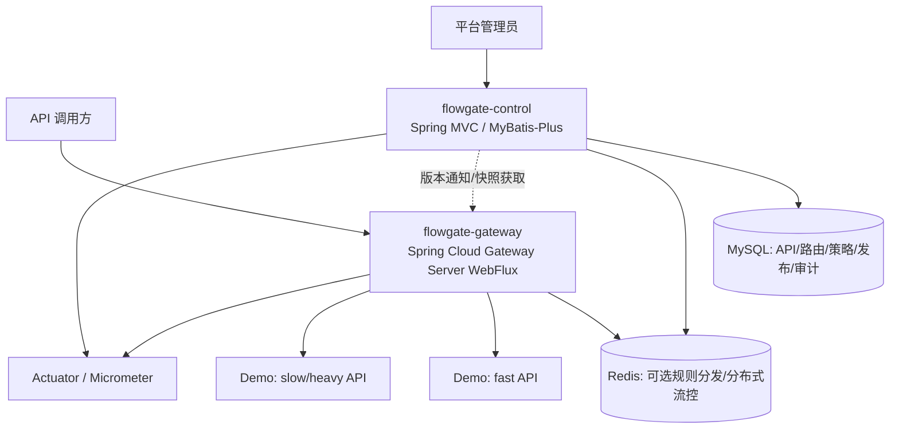

# FlowGate — 高并发 API 网关与流量治理平台

> **状态：总体设计草案 / 阶段 0 审查完成，待项目负责人及 Codex 审核。尚未开始功能开发。**
>
> 更新：2026-11-04。审计基准：[`java-up-up/hmdp-plus@03594d1`](https://github.com/java-up-up/hmdp-plus/tree/03594d190275a32d151e5d8b45da24c0f4efbe14)。
>
> 阅读顺序：**本 README（项目目标、业务和架构） → [阶段 0 审计和决策记录](docs/stage-0-audit.md)（源码证据、风险、待审核事项）**。

## 1. 核心定位：复用技术，重构业务

FlowGate 不是在黑马点评 Plus 前面添加转发层，也不以原来的商户、秒杀、订单业务为长期核心。项目以 Plus 的 Java 后端技术实现为起点，**将业务领域重构为 API 网关、路由管理、准入与流量治理、服务保护、策略发布和运行监控**。

- **继承技术经验**：Java 17、Spring Boot、MVC 管理端、Redis/Lua 原子操作、缓存、MyBatis-Plus、Redisson、Kafka、幂等、监控等；逐项评估是否值得移植/重构。
- **替换原业务**：原商户、优惠券、秒杀、订单等业务代码仅作为可阅读的技术参考与迁移素材，不是交付目标；无需为了复用 Kafka/库存机制而保留无关业务。
- **独立核心贡献**：Gateway 数据面、路由/策略模型、认证、安全路由、多维限速与并发保护、热点隔离、规则版本化/分发、熔断/降级、监控和可重复压测。
- **最小验证环境**：提供普通快速查询 API 和可控的慢/重负载 API；它们是测试对象，不是新的大型业务系统。早期可同一 MVC 进程部署，验证资源隔离时须承认这种部署的局限，按需拆成独立进程。

**不做**：企业商业化/计费商城、通用库存/订单账本、每请求强制 Kafka、首版 Nacos/ES/K8s/分库分表、多个并行认证体系、无性能证据的自适应算法或不必要的管理前端。

## 2. 用户与总体业务

| 角色 | 要完成的业务 | 成功标志 |
|---|---|---|
| 平台管理员 | 注册 API、设定上游目标、绑定鉴权/限流/熔断规则、发布/回滚配置、查看指标与审计记录 | 规则经过校验和版本管理，可查看生效情况 |
| API 调用方 | 经统一入口访问获授权 API，遇到治理拒绝时得到确定的 HTTP 语义 | 不绕过授权，正常请求被安全透传 |
| 被代理的业务服务 | 通过网关保护自身容量，继续处理自己的业务与数据一致性 | 热点或慢请求不无约束地拖垮其他接口 |
| 开发/测试者 | 对照直连/只代理/启用治理三种状态压测和注入故障 | 原始数据、配置、脚本可复现 |

核心业务闭环（最终目标，**不表示阶段 1 就全部实现**）：

1. 管理员注册服务/API 与受约束的上游目标。
2. 配置路由、安全要求和策略作用域；控制面校验、生成不可变版本并发布。
3. Gateway 加载最近有效的本地规则快照，根据路径/方法匹配 API，并恢复调用方身份。
4. Gateway 做速率准入、在途并发许可、超时/熔断检查，然后通过 HTTP 转发；**绝不在 Netty 事件循环中直接执行 JDBC、同步 Redis 或同步 Redisson**。
5. Gateway 输出拒绝原因、错误、延迟/吞吐等指标；管理端查看规则版本和效果，可回滚配置。
6. 用“正常查询 + 人工慢/重负载”验证热点隔离，同时记录额外网关开销。

## 3. 架构与边界



**数据面 Gateway（独立进程）**：路由匹配、Header 清理、Trace ID、调用方认证与授权、流量准入、并发许可、超时/熔断/降级、HTTP 代理与低基数指标。无业务事务、无 MySQL/订单/Kafka 消费。使用非阻塞运行链路。

**控制面 Control（从 Plus MVC 技术重构）**：平台管理员身份/权限、API 与路由目录、上游目标白名单、策略配置和校验、发布版本、审计查询、管理 API。可以继续用同步 JDBC/Redis/Redisson，但不在 Gateway 请求热路径里调用其数据库。

**演示下游（最小可控负载）**：`GET /demo/fast/{id}` 为普通查询（可按需使用缓存），`GET /demo/slow?delayMs=...` 为有上限的可控慢调用。演示路由/方法是**提议接口**，不是已经存在的源码。压测隔离需要不同资源池/进程时再拆分。

**存储分工**：MySQL 持久化配置和审计；Redis 初期只在真实需要时用于限流/规则传播，不要求第一条静态代理链路依赖 Redis；Kafka 暂不作为网关前置依赖。可先使用内存不可变快照，后来根据多实例一致性要求引入 Redis 通知。

### 概念数据模型（后续按用例增量落表）

- `ApiDefinition`：稳定 API ID、所属服务、HTTP 方法与路径模板、状态、认证要求。
- `RouteDefinition`：API/路由关联、上游目标、重写规则、优先级、启停状态；目标必须受协议/主机/端口白名单约束。
- `PolicyDefinition`：类型（速率、并发、超时、熔断）、作用域（全局/服务/路由/调用方）、参数、失败模式、启用状态。
- `PolicyBinding`：策略和作用对象的绑定关系，规定优先级与冲突处理。
- `ConfigRelease`：单调递增版本、校验摘要、发布者、发布状态、回滚来源。
- `Principal` / `AuditLog`：管理员或调用方的安全主体、权限；变更操作的审计记录。

P0 先不建全套表。管理 API 的候选资源为 `/admin/apis`、`/admin/routes`、`/admin/policies`、`/admin/releases`、`/admin/metrics`，需在对应阶段细化契约；管理端点不能被注册为任意公开上游。

### 请求责任链

```text
客户端
  -> 可信代理边界 / 去除伪造身份头 / Trace ID
  -> Gateway 路由匹配
  -> 认证 (401) / 授权 (403)
  -> 速率准入 (429) / 在途并发许可 (429 或 503，按策略明确)
  -> 超时/熔断判断 (503/504 等)
  -> Netty HTTP 转发 -> 下游 API
  -> 释放并发许可 (包括出错、取消、超时)
  -> 指标与响应
```

*此为语义顺序；具体 Spring Cloud Gateway 的 Predicate/Filter 运行顺序应在编码阶段通过集成测试验证。* 用户身份来自可信凭证/验证结果，不来自客户端可伪造的 `X-User-Id`。业务请求默认不自动重试，尤其不重试有副作用的 POST。HTTP 401/403/429/502/503/504 分别定义清楚；下游业务 `200 + success:false` 不会被错误地当成网关的 5xx。

## 4. 功能优先级

| 级别 | 业务能力 | 验收重点 |
|---|---|---|
| P0 / 最短主线 | 两类演示 API、静态路由、HTTP 透传、Trace ID、错误语义、基础请求与耗时指标；后续补基础 Token 验证与单维限流 | 不失真地转发、两类请求可达、网关自身开销可量化 |
| P1 / 平台能力 | 管理 API、动态路由及版本发布、路由/调用方等多维限速、在途并发限制、热点隔离、超时/熔断/降级、规则审计 | 控制面故障时最近有效规则可继续生效，热点压测保护其他 API |
| P2 / 条件触发 | 反馈式自适应准入、灰度规则、多实例增强、丰富管理 UI、API Key/多租户公平调度、必要的异步审计 Kafka | 有真实性能或业务需求才引入，不堆栈 |

**注意**：限速（某时间窗请求数量）与并发（同时在途数）是不同约束；单机 semaphore 只代表单实例限制，不能声称跨节点全局容量控制。若 P1 需要真正全局并发，必须设计 Redis 租约/过期补偿与取消释放，再证明正确性。

## 5. 技术选择与引入理由

| 组件 | 用途及核心原理 | 选择理由 | 替代/暂缓方案 |
|---|---|---|---|
| Spring Cloud Gateway Server WebFlux | 基于 Reactor/Netty 的非阻塞 HTTP 代理与 Filter 链 | 项目主体就是 API 网关；规范化路由和过滤器 | MVC Gateway 可用但不符合当前数据面约束 |
| Spring MVC + MyBatis-Plus | 控制面 CRUD、事务和配置存储 | 可改造 Plus 熟悉的代码，学习成本低 | 后续拆服务或换持久化方式，现阶段无需 |
| Redis + Lua | Redis 单线程执行脚本完成分布式原子计数/令牌更新 | 延续 Plus 限流与原子操作的知识 | P0 可先本地或静态规则；不用同步 Redis Jar 挂 Gateway |
| Caffeine / 不可变本地快照 | 内存读取最近有效配置，原子替换版本 | 避免每次调用读控制面；已熟悉缓存机制 | P0 普通不可变 Map + AtomicReference 即可 |
| Redisson | 必要时做控制面协调/防重复执行 | Plus 有现成锁与幂等思路 | 首选 DB 唯一键、乐观锁/版本号，避免无必要分布式锁 |
| Kafka | 未来存在异步审计或异步任务需求时使用 | Plus 有生产/消费/补偿经验 | P0/P1 管理操作可先事务性 DB 审计；**不把普通代理变 MQ** |
| Micrometer/Actuator | 吞吐、错误、拒绝、延迟和规则版本指标 | 上游已有，减少重复学习 | 初期日志与基础 metrics；Prometheus 抓取按阶段配套 |

**版本候选**：上游 Java 17 + Spring Boot 3.5.4；Gateway 使用 Spring Cloud `2025.0.x`（与 Boot 3.5.x 配套），对应 Gateway 4.3 系列，Starter：`spring-cloud-starter-gateway-server-webflux`。具体补丁版本与兼容性须在阶段 1 构建验证后锁定。参考 [Spring Cloud 官方版本矩阵](https://spring.io/projects/spring-cloud/) 与 [Gateway 4.3 官方 Starter 文档](https://docs.spring.io/spring-cloud-gateway/reference/4.3/spring-cloud-gateway-server-webflux/starter.html)。

## 6. 迭代与阶段审核门槛

| 阶段 | 主要任务 | 交付/停止条件 |
|---|---|---|
| **0（当前）** | 阅读 Plus 源码、核对复用边界、设计新的 FlowGate 业务/架构；记录证据与风险 | **本 README + [阶段 0 审计](docs/stage-0-audit.md)；待人工/Codex 审核** |
| 1：最小代理闭环 | 建立新模块；用最少控制面/演示 API 跑通两类请求、Trace/指标 | 不依赖点评业务；记录构建与启动证明 |
| 2：管理与安全 | 管理员认证、API/路由定义、规则校验、版本发布和热更新 | 精确授权、防 SSRF、版本冲突/回滚验证 |
| 3：限流与热点隔离 | Redis 非阻塞多维速率准入、并发许可、隔离策略 | 在固定负载下有对照压测与拒绝语义 |
| 4：服务保护与故障 | 超时、熔断、降级、Redis/控制面故障模式、多实例规则同步 | 故障注入有预期、恢复策略和证据 |
| 5：性能/交付 | 基线、资源成本、可选自适应治理、部署文档 | 直连/代理/治理三组可复现对照 |

**开发纪律**：每项新技术先说明用途、核心原理、引入理由和替代方案；每阶段先走最小端到端，再补边界/异常/测试/优化；阶段收尾需检查、总结，并等项目负责人和 Codex 审核通过，**不自动进入下一阶段**。本次只授权写两份设计/审计文档，不授权修改业务源码、启动服务或压测。

## 7. 风险与未决定事项

阶段 0 确认的是静态源码事实，**没有实际编译、运行、测试或压测**。主要风险：Plus 原限流器使用同步 Redis 和 Servlet，不能直接放在 Gateway；原认证依赖 MVC `ThreadLocal`；原业务错误使用 HTTP 200 包装失败；一些原日志包含演示性质的验证码/令牌；原上游 ShardingSphere 有多数据源与配置敏感项，不可直接复制到公开仓库。

待审核的三项 ADR：① 控制面从 Plus MVC 选择性重构、网关单独 WebFlux；② 首版管理员/调用方凭证采用简化 Redis Token 还是其他协议；③ 动态规则发布采用 DB 版本 + 本地快照 + Redis 通知/轮询，Redis 限流如何演进。详见 [审计与 ADR](docs/stage-0-audit.md)。

## 8. 开源声明

上游来源：[java-up-up/hmdp-plus](https://github.com/java-up-up/hmdp-plus)，仓库中有 Apache License 2.0。当前文档只记录方案，**尚未移入上游源码**。将来如实际复制/修改受该许可证约束的代码，需要保留对应许可、版权声明与必要归属，检查 NOTICE 要求；不要提交原仓库中的敏感配置、凭证或测试数据。此事项属于阶段 1 的前置核对。
