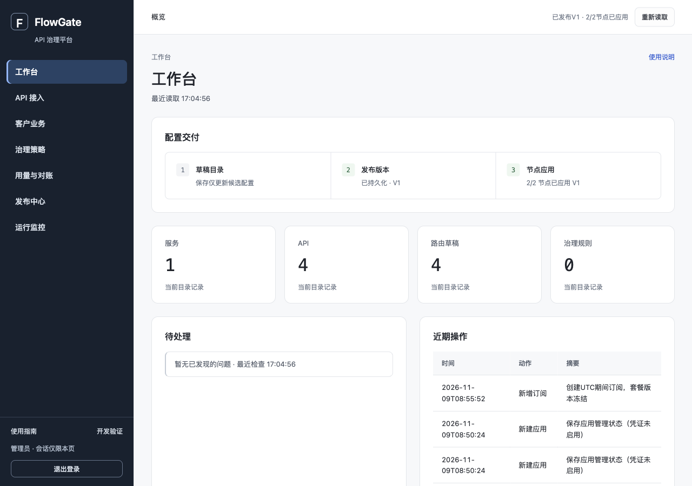
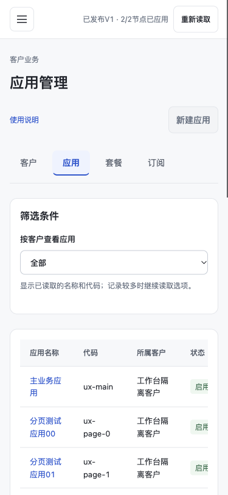

# V1.1 工作台UX重构实施

基线：设计分支 `docs/v11-console-workbench-redesign` / `3f5ea8d`；原实现 `a02e68a`。工作分支 `feat/v11-console-workbench`。当前合同 `CODEX_CONSOLE_WORKBENCH_UX_PROMPT.md` 和 `docs/design/v11-console-workbench-ux-rework.md`。

## UX-0：契约及完整能力映射

已阅读全部console模块、现有7个Node入口、业务手册、前后端同步规范及新设计。旧20项能力按下表完整保留；新分组不改变API、RBAC或写事务。

| 一级菜单 | 页内入口（旧key） |
| --- | --- |
| 工作台 | 概览 dashboard |
| API接入 | 服务 services、API apis、路由 routes、旧调用方凭证 callers |
| 客户业务 | 客户 developers、应用 apps、套餐 plans、订阅 subscriptions |
| 治理策略 | 限速 rate、并发 concurrency、故障保护 protection、计量规则 quota-policy |
| 用量与对账 | 余额与账本 quota、用量统计 usage、对账结果 reconciliation |
| 发布中心 | 当前版本/发布/历史/节点应用 releases |
| 运行监控 | 网关节点 monitoring、异步事件 async-events、操作审计 audits |

不支持的能力不伪造：逐对象发布差异、全量旧Caller列表、历史Token查询、绑定移动/删除、订阅任意区间修改、套餐额度编辑、未完整读取的关联集合统计。目录完整集合可本地过滤；客户关联应用、订阅按服务端游标分页。

安全：URL仅白名单业务ID/筛选；不放凭证/账号密码/完整响应。APP和旧Caller不混用；敏感回执离页销毁。MySQL余额、异步用量、对账三种事实独立。真实HTTP仅隔离Lab，浏览器夹具与真人验收分开。

本阶段只读审计与任务映射；未运行Java/浏览器/HTTP，不记通过。`git diff --check`通过。

## 阶段进度

- UX-0：契约与映射完成；提交SHA见本文件Git历史。
- UX-1～UX-5：开发与本轮定向自动验证完成，负责人真人体验待验收。

## UX-1：业务外壳

7个一级业务域及20个页内入口已接入；旧Caller只在API接入，APP凭证仍在应用业务。深色高对比侧栏、独立滚动正文、小屏抽屉和横向二级导航沿用原生控件；登录缩减为账号与操作区。`navigation.js`集中维护映射及后续路由字段白名单，不增加后端。

修改app/index/style/navigation及产品Node适配。`node scripts/product-console-test.mjs`退出0，`git diff --check`通过。Java/真HTTP/1280与375浏览器留UX-5，尚未运行本阶段浏览器，不标体验通过。

## UX-2：对象详情与业务上下文

服务详情使用完整目录确认API，API详情确认关联路由；从详情新建时预选服务/API。客户详情按正式API分页读取客户应用，应用详情含独立APP凭证/订阅/配额与用量分区，新增应用/订阅预选来源对象。旧Caller仍在API接入。列表名称/查看进入详情，编辑移到详情；套餐额度/订阅区间限制不变。业务列表保存实际游标与筛选，返回后重新读取同页，不用旧行冒充当前结果。

修改catalog/openapi-business/ui、对应旧产品/A测试，并新增workbench-console-test。`node scripts/workbench-console-test.mjs`、`product-console-test.mjs`、`v11-b-console-test.mjs`、`v11-c-review-console-test.mjs`退出0；`git diff --check`通过。旧A断言从不再准确的固定“尚未启用”改为实际保存反馈，权限断言移到真实详情编辑按钮，没有取消RBAC检查。Java/真实HTTP/浏览器留UX-5；尚未负责人验收。

## UX-3：策略与共享查询

策略统一搜索/草稿状态筛选/单主操作；从目录详情携带目标后只按正式绑定筛选，读取失败明确未知，新建预选可支持的真实目标，既有绑定不可移动。故障保护通过规则类型选择保留超时与熔断。规则参数的实质帮助保留，高级原理折叠。

余额/用量/对账共用内存中的应用与UTC日期选择：月余额按起始月，显式改月才调整日报范围；同月读取不覆盖既有范围。对账截止昨日并明确说明调整；应用来源上下文自动查询。条件改变立即清旧结果，不冒充0或旧应用结果。异步操作只在运行监控分区，FAILED重试与SENT补投和确认/RBAC原样保留。发布三阶段仍使用真实版本与节点状态。

新增report-context并修改governance/quota/usage/navigation及测试。工作台、B、C复审Node退出0；新增跨月/月契约/共享选择断言通过；`git diff --check`通过。Java/真HTTP/浏览器在UX-5实际执行。

## UX-4：路由与操作态工作台

同源hash地址支持20叶子页与安全对象详情，旧#apis等地址规范化；未知地址回工作台。初次登录/刷新恢复非敏感页，popstate/hashchange去重处理前进后退，全部导航均销毁一次性回执；地址只接受ID/目标/日期/月/详情分区白名单，删除Token/password/任意响应。筛选替换当前地址，不产生每次输入的历史条目。退出清空页面内存筛选和敏感内容。

首页改为真实发布/节点、目录记录、待核查问题、近期实际审计及业务入口；健康折叠。仅完整核心目录读取成功且全空才展示接入引导；已有服务/API不重复教学。登录无口号和介绍流程，页脚重复宣传已去除，日常标题缩短；异步延迟、不可逆操作、权限和错误事实保留。

修改app/catalog/quota/usage/operations及工作台测试。`node scripts/workbench-console-test.mjs`退出0，真实入口注入浏览器适配器验证地址直达/登录恢复/回退前进/刷新空会话/敏感参数清理；产品及C复审Node通过。`git diff --check`通过；Java、真实HTTP和真实浏览器将于UX-5执行，不冒充真人验收。

## UX-5：最终定向验证与交付

阶段本地提交：UX-0 `d958312`，UX-1 `64b5f46`，UX-2 `24c22f6`，UX-3 `9b7c872`，UX-4 `a478f78`；UX-5提交SHA见本文件Git历史。若原生Git推送403而通过GitHub应用交付，应用可能生成不同SHA但必须逐阶段核对同一源码树；原本地提交保留，不重写共享历史。最终远端交付另行实证，不以“已提交本地”冒充已推送。

### 实际命令和结果

- Java17.0.18：`mvn -B -ntp -pl flowgate-control -am test package`，最终退出0；Contract10+Control30=40项，失败0、错误0、跳过0。只运行直接受影响模块。途中仅为更新资源运行过`package -DskipTests`，不计测试通过；最后已重新实际执行40项test/package。
- 8个Node入口全部退出0：`node scripts/product-console-test.mjs`、`workbench-console-test.mjs`、`v11-a-console-test.mjs`、`v11-b-console-test.mjs`、`v11-c-console-test.mjs`、`v11-c-review-console-test.mjs`、`block2-console-test.js`、`block3-console-test.js`（后7项同样在scripts目录）。新增七域/20能力映射、详情关联与预选、UTC共享筛选、深链接/历史/刷新、安全参数、回执清除、真实close队列时序、迟到详情和加载期间移除旧操作断言。旧权限/CAS/计量/重投边界未移除。
- `python3 scripts/build-console-guide.py --product --check`退出0，完整指南及同源HTML同步，旧20项平铺导航与侧栏查找说明已改成7域/分区及详情流程。
- Java17下`FLOWGATE_ASYNC_ENABLED=false FLOWGATE_QUOTA_ACTIVATION_ENABLED=false python3 scripts/product-console-smoke.py`退出0。独立MySQL8.4/Redis7、Demo/Control/双Gateway；33个Lab HTTP记录+33个真实产品模块请求，创建/完整编辑PUT/真实绑定只读/RBAC/发布双节点/Caller吊销/409不重试/回滚通过。旧/test-console/和产品资源保持200，新增navigation/report-context资源纳入检查。原始本机证据`.local/acceptance/product-console-20261109T085853058994.json`。
- 真实浏览器Lab：`JAVA_HOME=<Java17> python3 scripts/workbench-browser-lab.py`；使用随机端口、自有MySQL/Redis/JVM，计量/异步明确OFF，不读取.env、不接用户Kafka。此Lab以Spring MVC file资源位置读取本次静态源码，独立正式API/SQL真实执行；另外上述HTTP脚本验证打包Jar资源。
- ego-browser真实Chromium：1280px和375px各逐页打开全部20项能力，单页一个h1、无整页横向溢出；手机宽表格在区域内滚动。抽屉工作区inert、首次焦点、Shift+Tab回环、Escape回焦点通过。真实客户→应用→订阅预选、应用→配额/用量/对账自动查询、日期与UTC封账截止、前进后退、刷新重新登录恢复、无效/旧地址规范化均实际通过。
- 真实浏览器在独立库创建1条订阅成功，再提交相同UTC月真实409，表单保留且无自动重试；计量OFF时APP凭证未签发、不展示假Token。21条应用验证分页后进详情、返回仍同页；仅浏览器fetch注入503，显示读取失败而非空/0，恢复后重新查询成功。没有向用户数据库注入故障。
- 真实VIEWER/OPERATOR登录：客户应用编辑、旧Caller签发等按钮按权限禁用。浏览器存储存在工具SDK元数据键，不能把数量非零当作应用凭证泄露；在页面内部比较实际认证值，未发现写入localStorage/sessionStorage，未输出认证值或存储值。原有真实HTTP另验证后端403。
- 深色导航普通字/选中/次级字对比度分别12.39/10.09/8.86，均大于4.5。最终Jar的14项console资源与源码逐字一致；`git diff --check`通过。无新增框架/依赖/DDL/后端语义，关键逻辑保留中文编号注释。

### 实际缺陷与收尾

真实Chromium复现了原生dialog先close再show时，排队旧close事件清空新表单，模拟DOM未揭示；改为同一模态内替换内容、不发close，保留初始焦点，新增队列回归并在真实规则类型选择复验。手机正文独立滚动时保留旧偏移会遮住新标题，已在导航完成后归零自身滚动并防止焦点再次滚动，真实375px标题位置复验通过。详情读取增加离页序号保护；最终又以Node受控慢响应检查加载阶段移除旧编辑操作和aria-busy，未将该最后的Node检查冒称额外浏览器故障复现。

旧Node曾依赖列表内编辑按钮或固定“尚未启用”/教学文案，按新合同改为详情编辑、真实保存反馈和有数据无新手引导断言；权限和真实路径断言仍在，不是删除失败测试。浏览器数据全部为本轮独立真实Lab创建的数据，未使用静态成功夹具。

证据：`docs/progress/evidence/console-workbench.json`；真实截图：

浏览器检查覆盖迭代中的20项界面及最终关键路径；最后详情加载保护另有Node慢响应和最终Jar检查。浏览器任务、临时认证配置、测试容器/JVM均已结束，用户原MySQL/Redis/Kafka、.env及IDE未改。

### 负责人手测清单（未执行）

- [ ] 1280px，不读帮助找到API接入→服务/API/路由详情→策略→发布→节点确认。
- [ ] 客户业务→客户详情→应用→订阅预选与APP凭证；确认旧Caller只在API接入，不能混用。
- [ ] 从应用详情进入配额、用量、对账，不重填ID；改日期/月份后核对月度与日报口径。
- [ ] 列表第二页进详情再返回，筛选与页保留；前进/后退、刷新登录恢复、无效地址回退。
- [ ] 375px菜单/分区/宽表格、Tab/Shift+Tab/Escape/Enter、确认框及输入错误可理解可操作。
- [ ] 使用自己的ADMIN/OPERATOR/VIEWER检查真实权限、空/失败恢复及不可逆操作提示。

未运行：负责人真人验收、全项目Java回归、Kafka故障链路重跑、V11-D压测/10万级SQL优化。不能标“工作台体验通过”；本次开发和定向自动验证完成，等待ChatGPT复审及负责人手测。不合并main或旧PR，不进入D。

## 远端分段交付核验

本次原生 `git push -u origin feat/v11-console-workbench` 实际返回HTTP403。随后通过已连接且具有写权限的GitHub应用创建下列六个分段提交，保持原设计分支为基线，不重写共享历史、不推main。每个远端提交的文件树均与对应本地已验证提交逐字一致，最后代码树为 `9f52b2259dbd08a59007c82157929dea6d72c47b`，包含两张真实PNG截图。原本地六段提交将保留于本地 `feat/v11-console-workbench-local-99088e1`，不推送归档分支。

| 阶段 | 本地已验证SHA | GitHub同树SHA |
| --- | --- | --- |
| UX-0 | `d9583127df956661a2e466cae76ac18192a1e59c` | `a6d5b83bc1ac8f643c8f6ae5e842befbc725fc6f` |
| UX-1 | `64b5f46444dbe5d5eb2f25be719a9c273cf8a41b` | `24216a5cd34ad36a8f19ed8427bb9afa9f62b876` |
| UX-2 | `24c22f6ee791d8bdf7b4d73416627cbb92ee4d23` | `f90194273f720df01b0dafc90c49d7bb5c83ae9c` |
| UX-3 | `9b7c872379d7b2b71f34e74d20ca6a40bbb6e807` | `773b2c9bdeb58136481958df4f48c7dccad1875b` |
| UX-4 | `a478f7835aa264a7557dec5d3d9edfb227106ab5` | `b63865f66848e3f0f83e2299dbd64c54abc53f99` |
| UX-5 | `99088e1a936b50f506a932b2bd65981c481b8230` | `3778e2c24d0a46a42e9c2b57dc10c599f3d99727` |

本节另作交付说明提交，只有这一份进度文档不同于已测代码树；功能分支引用及Draft PR状态最终由create-branch返回、git ls-remote和PR信息核实。只创建当前新功能分支和新Draft PR，不更改旧PR base、不合并。开发及自动验证已完成，负责人真人体验仍待验收。
