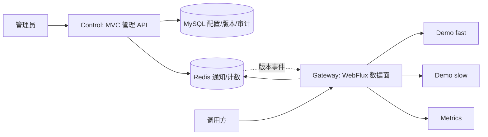

# FlowGate 阶段 0 — 上游源码审计、改造清单与架构决策

> **性质**：只读静态源码审计 + 面向新业务的架构核对，供项目负责人/Codex 审阅；不表示设计已批准或功能已经实现。
>
> 日期：2026-11-04；审计上游：[`java-up-up/hmdp-plus@03594d190275a32d151e5d8b45da24c0f4efbe14`](https://github.com/java-up-up/hmdp-plus/commit/03594d190275a32d151e5d8b45da24c0f4efbe14)（2026-10-27）；目标仓库起始时为空，默认分支 main。
>
> **方向修正（优先级最高）**：2026-11-04 用户明确要求 **“改造为 FlowGate 自身的业务内容，尽量保留原技术实现、降低学习成本”**。因此早期规划中的“长期保留点评商户/秒杀/订单作为主要下游”以及此前“在 Plus 前加 Gateway”的建议**已失效**。历史交接文件仍可参考其技术目标、协作要求、性能验收方法，但业务边界以本次新决定为准。总体蓝图见 [README](../README.md)。

## 一、审计口径与结论

| 标识 | 含义 |
|---|---|
| **[源码确认]** | 已读取对应仓库文件/方法/脚本，可说明它在代码中怎样实现 |
| **[文档宣称]** | 上游 README 叙述，但本次未验证完整运行效果 |
| **[尚未验证]** | 未执行 Maven 构建、应用启动、真实 Redis/Kafka/MySQL、自动化测试、网络或压测 |

**总体结论**：Plus 是 Spring Boot 3.5.4 / Java 17 的 Maven 多模块项目，能够提供大量有价值的**MVC 管理端、缓存、Redis Lua、锁、Kafka、幂等与监控实现参考**。它不是可直接启动的 FlowGate，也未包含动态网关/治理配置面。Gateway 采用独立 Spring Cloud Gateway WebFlux 运行时，**不能把原 Servlet、同步 Redis/Redisson/JDBC 框架整包依赖到网关**。Control 则可利用原 MVC/数据库开发习惯，逐步将原商户/券/订单领域替换为 API/路由/策略/版本/审计领域。

## 二、上游模块事实与依赖

[根 POM](https://github.com/java-up-up/hmdp-plus/blob/03594d190275a32d151e5d8b45da24c0f4efbe14/pom.xml) 中聚合模块：`hmdp-common`、`hmdp-sharding`、`hmdp-core-service`、`hmdp-redisson-framework`、`hmdp-redis-tool-framework`、`hmdp-id-generator-framework`、`hmdp-mq-framework`、`hmdp-parameter`。另有 `hmdp-vue3`、`sql` 目录（非根 Maven 聚合模块）。

```text
hmdp-core-service (唯一现成 Spring Boot MVC 主业务进程)
 ├─ hmdp-sharding ── hmdp-common
 ├─ hmdp-redis-framework ── hmdp-redis-common-framework
 ├─ hmdp-redis-rate-limit-framework ── hmdp-redis-framework
 ├─ hmdp-service-lock / bloom-filter / repeat-execute-limit / delay-queue
 ├─ hmdp-id-generator-framework
 ├─ hmdp-mq-producer-framework / hmdp-mq-consumer-framework
 ├─ hmdp-parameter
 └─ MyBatis-Plus / Spring MVC / Spring Kafka / Actuator / Micrometer
```

- [核心 POM](https://github.com/java-up-up/hmdp-plus/blob/03594d190275a32d151e5d8b45da24c0f4efbe14/hmdp-core-service/pom.xml) **[源码确认]**：`spring-boot-starter-web`、MyBatis-Plus、ShardingSphere、Spring Kafka、Actuator、Prometheus registry，以及上述内部模块。不是 WebFlux 应用。
- [Redis 框架 POM](https://github.com/java-up-up/hmdp-plus/blob/03594d190275a32d151e5d8b45da24c0f4efbe14/hmdp-redis-tool-framework/hmdp-redis-framework/pom.xml) **[源码确认]**：带 `spring-boot-starter-web` 和 `spring-boot-starter-data-redis`；Redis 封装用 `StringRedisTemplate`，同步调用。
- [MQ 框架 POM](https://github.com/java-up-up/hmdp-plus/blob/03594d190275a32d151e5d8b45da24c0f4efbe14/hmdp-mq-framework/pom.xml) **[源码确认]**：common、producer、consumer 三个子模块。
- [Redisson 框架聚合](https://github.com/java-up-up/hmdp-plus/blob/03594d190275a32d151e5d8b45da24c0f4efbe14/hmdp-redisson-framework/pom.xml) **[源码确认]**：分布式锁、Bloom Filter、重复执行限制、延迟队列等子模块。
- [应用配置](https://github.com/java-up-up/hmdp-plus/blob/03594d190275a32d151e5d8b45da24c0f4efbe14/hmdp-core-service/src/main/resources/application.yml) **[源码确认]**：默认 MVC 服务端口 8085、Redis、Kafka、ShardingSphere JDBC、Prometheus endpoint。其 [ShardingSphere 配置](https://github.com/java-up-up/hmdp-plus/blob/03594d190275a32d151e5d8b45da24c0f4efbe14/hmdp-core-service/src/main/resources/shardingsphere.yaml) 定义 **ds_0、ds_1**；仓库包含 `sql/hmdp_0.sql` 和 `sql/hmdp_1.sql`。没有发现现成 Docker Compose / CI 工作流，**不等于已证实无法运行**。
- [LICENSE](https://github.com/java-up-up/hmdp-plus/blob/03594d190275a32d151e5d8b45da24c0f4efbe14/LICENSE) **[源码确认]**：Apache License 2.0。未来真正复制/改造源码时保留许可、版权及必要 NOTICE/修改说明。

## 三、已经读到的实现证据（不等于运行验证）

| 能力 / 类与路径 | 源码证据 | 对 FlowGate 的价值 |
|---|---|---|
| [`ShopController`](https://github.com/java-up-up/hmdp-plus/blob/03594d190275a32d151e5d8b45da24c0f4efbe14/hmdp-core-service/src/main/java/org/javaup/controller/ShopController.java)、[`ShopServiceImpl`](https://github.com/java-up-up/hmdp-plus/blob/03594d190275a32d151e5d8b45da24c0f4efbe14/hmdp-core-service/src/main/java/org/javaup/service/impl/ShopServiceImpl.java) | **[源码确认]** `GET /shop/{id}` → `queryByIdV4` → Redis/布隆过滤器/空值缓存/Redisson 双检锁/MyBatis；V1–V3 在当前调用处被注释 | 参考热点缓存和防击穿模式；**不必保留商户表/商户 API** |
| [`VoucherOrderController`](https://github.com/java-up-up/hmdp-plus/blob/03594d190275a32d151e5d8b45da24c0f4efbe14/hmdp-core-service/src/main/java/org/javaup/controller/VoucherOrderController.java) | **[源码确认]** `/voucher-order/seckill/token/{id}` 与 `/voucher-order/seckill/{id}` 分别触发 `RateLimitHandler.execute` 和一次性业务令牌检查 | 区分入口流控与业务资格；**不迁移秒杀接口作为核心业务** |
| [`RedisRateLimitHandler`](https://github.com/java-up-up/hmdp-plus/blob/03594d190275a32d151e5d8b45da24c0f4efbe14/hmdp-redis-tool-framework/hmdp-redis-rate-limit-framework/src/main/java/org/javaup/execute/RedisRateLimitHandler.java) | **[源码确认]** 按 IP/用户/券 ID 构造键、调用滑动窗口或令牌桶 Lua，并支持白名单与惩罚策略；依赖 `ServletRequestAttributes` 获取请求 IP | **重用算法/错误模型思路，WebFlux 端重写请求上下文与非阻塞 Redis 调用** |
| [`tokenBucket.lua`](https://github.com/java-up-up/hmdp-plus/blob/03594d190275a32d151e5d8b45da24c0f4efbe14/hmdp-redis-tool-framework/hmdp-redis-rate-limit-framework/src/main/resources/lua/tokenBucket.lua)、[`rateLimitSliding.lua`](https://github.com/java-up-up/hmdp-plus/blob/03594d190275a32d151e5d8b45da24c0f4efbe14/hmdp-redis-tool-framework/hmdp-redis-rate-limit-framework/src/main/resources/lua/rateLimitSliding.lua) | **[源码确认]** Redis `TIME`、原子令牌补充或 ZSET 窗口计数，返回 IP/用户拒绝码 | 参考计数逻辑；按服务/路由/调用方维度重新设计键、作用域和 TTL |
| [`SeckillAccessTokenServiceImpl`](https://github.com/java-up-up/hmdp-plus/blob/03594d190275a32d151e5d8b45da24c0f4efbe14/hmdp-redis-tool-framework/hmdp-redis-rate-limit-framework/src/main/java/org/javaup/service/impl/SeckillAccessTokenServiceImpl.java)、[`seckill_access_token.lua`](https://github.com/java-up-up/hmdp-plus/blob/03594d190275a32d151e5d8b45da24c0f4efbe14/hmdp-redis-tool-framework/hmdp-redis-rate-limit-framework/src/main/resources/lua/seckill_access_token.lua) | **[源码确认]** 短 TTL 一次性令牌，Lua 比较后 `DEL`；当前令牌签发有明文日志 | 可参考短期凭证/一次性管理操作思路，**不能把业务秒杀令牌当成平台登录 Token** |
| [`UserServiceImpl`](https://github.com/java-up-up/hmdp-plus/blob/03594d190275a32d151e5d8b45da24c0f4efbe14/hmdp-core-service/src/main/java/org/javaup/service/impl/UserServiceImpl.java)、[`RefreshTokenInterceptor`](https://github.com/java-up-up/hmdp-plus/blob/03594d190275a32d151e5d8b45da24c0f4efbe14/hmdp-core-service/src/main/java/org/javaup/utils/RefreshTokenInterceptor.java)、[`UserHolder`](https://github.com/java-up-up/hmdp-plus/blob/03594d190275a32d151e5d8b45da24c0f4efbe14/hmdp-core-service/src/main/java/org/javaup/utils/UserHolder.java) | **[源码确认]** 登录产生随机 opaque Token → Redis Hash → MVC 拦截器恢复用户到 `ThreadLocal` 并刷新 TTL | 控制面可参考 Redis opaque Token；Gateway 需要独立响应式鉴权实现，用户上下文放 exchange/Reactor Context |
| [`MvcConfig`](https://github.com/java-up-up/hmdp-plus/blob/03594d190275a32d151e5d8b45da24c0f4efbe14/hmdp-core-service/src/main/java/org/javaup/config/MvcConfig.java) | **[源码确认]** 通过 Servlet `HandlerInterceptor` 登录校验；整个 `/shop/**`、`/voucher/**` 被排除，包括写接口 | **不可照搬白名单**；FlowGate 按明确的管理/数据权限和 HTTP Method 做授权 |
| [`VoucherOrderServiceImpl`](https://github.com/java-up-up/hmdp-plus/blob/03594d190275a32d151e5d8b45da24c0f4efbe14/hmdp-core-service/src/main/java/org/javaup/service/impl/VoucherOrderServiceImpl.java)、[`seckillVoucher.lua`](https://github.com/java-up-up/hmdp-plus/blob/03594d190275a32d151e5d8b45da24c0f4efbe14/hmdp-core-service/src/main/resources/lua/seckillVoucher.lua) | **[源码确认]** 当前 `seckillVoucher()` 走 V2；Lua 原子校验时间/库存/用户集合，记录流水；之后 Kafka 异步发消息；旧 Redis Stream 代码存在但非生效主线 | 参考 Lua 原子性与异步解耦设计，**不能按名字重用库存与订单语义** |
| [`SeckillVoucherProducer`](https://github.com/java-up-up/hmdp-plus/blob/03594d190275a32d151e5d8b45da24c0f4efbe14/hmdp-core-service/src/main/java/org/javaup/kafka/producer/SeckillVoucherProducer.java)、[`SeckillVoucherConsumer`](https://github.com/java-up-up/hmdp-plus/blob/03594d190275a32d151e5d8b45da24c0f4efbe14/hmdp-core-service/src/main/java/org/javaup/kafka/consumer/SeckillVoucherConsumer.java)、[`AbstractProducerHandler`](https://github.com/java-up-up/hmdp-plus/blob/03594d190275a32d151e5d8b45da24c0f4efbe14/hmdp-mq-framework/hmdp-mq-producer-framework/src/main/java/org/javaup/AbstractProducerHandler.java) | **[源码确认]** `CompletableFuture` 发送、成功/失败回调、手动 ACK、业务落库；发/消费失败关联 Redis 回滚 | 可参考可靠消息、去重和重试，但控制面优先事务性 DB 审计，不在网关 HTTP 热路径引 Kafka |
| [`RedisVoucherData`](https://github.com/java-up-up/hmdp-plus/blob/03594d190275a32d151e5d8b45da24c0f4efbe14/hmdp-core-service/src/main/java/org/javaup/kafka/redis/RedisVoucherData.java)、[`ReconciliationTaskServiceImpl`](https://github.com/java-up-up/hmdp-plus/blob/03594d190275a32d151e5d8b45da24c0f4efbe14/hmdp-core-service/src/main/java/org/javaup/service/impl/ReconciliationTaskServiceImpl.java) | **[源码确认]** Lua 回滚重试与失败日志、对账方法；[`seckillVoucherRollBack.lua`](https://github.com/java-up-up/hmdp-plus/blob/03594d190275a32d151e5d8b45da24c0f4efbe14/hmdp-core-service/src/main/resources/lua/seckillVoucherRollBack.lua) 会删除库存键 | 可借鉴失败恢复和版本对账思路，**不是网关可直接复用的恢复算法** |
| [`SeckillVoucherLocalCache`](https://github.com/java-up-up/hmdp-plus/blob/03594d190275a32d151e5d8b45da24c0f4efbe14/hmdp-core-service/src/main/java/org/javaup/cache/SeckillVoucherLocalCache.java)、[`SeckillVoucherCacheInvalidationPublisher`](https://github.com/java-up-up/hmdp-plus/blob/03594d190275a32d151e5d8b45da24c0f4efbe14/hmdp-core-service/src/main/java/org/javaup/cache/SeckillVoucherCacheInvalidationPublisher.java) | **[源码确认]** Caffeine 本地缓存、Redis 删除和 Kafka 缓存失效通知 | 可参考本地快照+通知模式，但规则必须带版本/校验/补拉，不能把消息到达等同一致性 |
| [`RepeatExecuteLimitAspect`](https://github.com/java-up-up/hmdp-plus/blob/03594d190275a32d151e5d8b45da24c0f4efbe14/hmdp-redisson-framework/hmdp-redisson-service-framework/hmdp-repeat-execute-limit-framework/src/main/java/org/javaup/repeatexecutelimit/aspect/RepeatExecuteLimitAspect.java) | **[源码确认]** 本地锁 + Redisson 锁 + 防重复标记 | 控制面可参考幂等；规则发布优先采用 DB 唯一约束/版本 CAS，不额外依赖分布式锁 |
| [`WebExceptionAdvice`](https://github.com/java-up-up/hmdp-plus/blob/03594d190275a32d151e5d8b45da24c0f4efbe14/hmdp-core-service/src/main/java/org/javaup/config/WebExceptionAdvice.java)、[`Result`](https://github.com/java-up-up/hmdp-plus/blob/03594d190275a32d151e5d8b45da24c0f4efbe14/hmdp-core-service/src/main/java/org/javaup/dto/Result.java) | **[源码确认]** 业务异常包装 `Result.fail`，多数方法没有显式设置 HTTP 4xx/5xx | FlowGate 要保留 HTTP 错误语义，不能以业务 JSON 失败率代替真实 HTTP 错误率 |
| [Actuator/Micrometer POM](https://github.com/java-up-up/hmdp-plus/blob/03594d190275a32d151e5d8b45da24c0f4efbe14/hmdp-core-service/pom.xml) | **[源码确认]** 包含 Actuator + Prometheus registry，代码也有业务 counter | 可复用指标开发习惯，Gateway 必须有独立请求/限流/熔断指标，标签限制基数 |

**[文档宣称而未充分验证]**：上游 README 提到可靠 Outbox、本地消息表、自动补偿、高并发收益与完整监控闭环；本次静态阅读看到 Kafka 回调、回滚、日志、对账等具体实现，但**没有证明**其端到端 exactly-once、一致性无遗漏、定时修复实际触发或压测收益。不要在 FlowGate 文档中把宣传结论改写成已验收事实。

## 四、明确复用、重构、淘汰边界

| 对象 | 处理方式 | 理由 / 下一步 |
|---|---|---|
| Java 17 / Boot 3.5.x / Maven 聚合结构 | **延用/校验** | 降低迁移成本；阶段 1 需实际依赖解析 |
| MyBatis-Plus、MVC Controller/Service 模式 | **控制面选择性复用** | 改写领域对象为 API/Route/Policy/Release/Audit；无需迁移原 Shop/Order 表 |
| Redis Key、缓存工具、Lua 算法 | **按用途改造** | 业务语义重构；Gateway 调用使用 reactive Redis |
| Caffeine 缓存 | **复用思路，可用库** | 规则使用不可变快照/原子替换优先；初期不强行加复杂缓存框架 |
| `hmdp-redis-rate-limit-framework` 整包 | **不直接依赖 Gateway** | Servlet `RequestContextHolder` + 同步 Redis，与 Reactor 热路径不匹配 |
| MVC `LoginInterceptor`、`RefreshTokenInterceptor`、`UserHolder` | **控制面重构；Gateway 重写** | Servlet/ThreadLocal 模型不适用 WebFlux，白名单不安全 |
| Redisson 锁与幂等切面 | **控制面按需复用** | 不进 Gateway event loop；优先 DB 版本/唯一约束 |
| Kafka 生产/消费封装 | **保留源码参考；条件引入** | 没有真正异步审计/任务需求时不增加组件 |
| ID 生成 | **按真实唯一 ID 需求评估** | 管理表可用数据库 ID/UUID，不必强制复用 Snowflake |
| ShardingSphere JDBC 与双库表结构 | **不直接搬入新控制面** | 原分片服务于点评数据，控制面可简单 MySQL；需保留源码和许可参考 |
| 商户、博客、关注、优惠券、秒杀、订单、原 Vue 页面 | **不作为 FlowGate 交付模块** | 原业务已被新定位取代 |
| Gateway、策略发布、版本同步、非阻塞鉴权、熔断等 | **新增 FlowGate 自身能力** | 上游无等价可直接迁移的网关业务实现 |

**迁移策略**：不要把整个旧工程原样搬到 FlowGate 的 `main` 再大规模删改；优先在阶段分支按模块选择性导入经审计可复用代码。必要时用上游 SHA、提交记录和文件路径保留可追溯性。任何代码复制前检查许可证与配置内容。

## 五、关键安全/正确性风险（均未运行复现）

| 等级 | 事实 / 风险 | 需要的措施 |
|---|---|---|
| **高** | [`MvcConfig`](https://github.com/java-up-up/hmdp-plus/blob/03594d190275a32d151e5d8b45da24c0f4efbe14/hmdp-core-service/src/main/java/org/javaup/config/MvcConfig.java) 排除整个 `/shop/**` 与 `/voucher/**`，其中还有 POST/PUT 修改接口 | 重新建基于资源与方法的精确授权；管理接口与公共 API 分离 |
| **高** | [`UserServiceImpl`](https://github.com/java-up-up/hmdp-plus/blob/03594d190275a32d151e5d8b45da24c0f4efbe14/hmdp-core-service/src/main/java/org/javaup/service/impl/UserServiceImpl.java) 演示验证码出现在日志/返回；[`SeckillAccessTokenServiceImpl`](https://github.com/java-up-up/hmdp-plus/blob/03594d190275a32d151e5d8b45da24c0f4efbe14/hmdp-redis-tool-framework/hmdp-redis-rate-limit-framework/src/main/java/org/javaup/service/impl/SeckillAccessTokenServiceImpl.java) 记录原始令牌 | 不复制原有凭证输出/日志行为；管理员凭证、API Token 永不入日志 |
| **高** | [`RedisRateLimitHandler`](https://github.com/java-up-up/hmdp-plus/blob/03594d190275a32d151e5d8b45da24c0f4efbe14/hmdp-redis-tool-framework/hmdp-redis-rate-limit-framework/src/main/java/org/javaup/execute/RedisRateLimitHandler.java) 读取最左侧 `X-Forwarded-For` / `X-Real-IP` | 只采信可信代理，过滤伪造 Header |
| **高** | 动态上游 URL 带 SSRF、内网访问、绕过管理面与权限校验风险 | 精确协议/域名/IP 段/端口允许列表；禁止任意 `file:`/本地地址/元数据地址；限制管理权限 |
| **高** | [`RedisCacheImpl`](https://github.com/java-up-up/hmdp-plus/blob/03594d190275a32d151e5d8b45da24c0f4efbe14/hmdp-redis-tool-framework/hmdp-redis-framework/src/main/java/org/javaup/redis/RedisCacheImpl.java) 同步 Redis；Redisson/JDBC 亦同步 | 数据面不在 Netty event loop 调用；保留控制面同步代码 |
| **中高** | [`tokenBucket.lua`](https://github.com/java-up-up/hmdp-plus/blob/03594d190275a32d151e5d8b45da24c0f4efbe14/hmdp-redis-tool-framework/hmdp-redis-rate-limit-framework/src/main/resources/lua/tokenBucket.lua) 先扣 IP 令牌，再扣用户令牌；用户拒绝时 IP 令牌可能已经被扣减 | FlowGate 需明确“拒绝是否计入其他维度额度”，不能未经说明原样复制 |
| **中高** | [`seckillVoucherRollBack.lua`](https://github.com/java-up-up/hmdp-plus/blob/03594d190275a32d151e5d8b45da24c0f4efbe14/hmdp-core-service/src/main/resources/lua/seckillVoucherRollBack.lua) 通过删除库存键交给后续重建；消费延迟/失败回滚时序复杂 | 原有业务机制不等于新平台的规则回滚机制；新规则采用版本化发布 |
| **中** | [`VoucherOrderServiceImpl`](https://github.com/java-up-up/hmdp-plus/blob/03594d190275a32d151e5d8b45da24c0f4efbe14/hmdp-core-service/src/main/java/org/javaup/service/impl/VoucherOrderServiceImpl.java) 发送 Kafka 异步消息后返回订单 ID；投递/消费/落库有不同成功阶段 | 设计 FlowGate 时区分“配置受理/发布/各节点生效”；不能把受理等于最终成功 |
| **中** | [`Result`](https://github.com/java-up-up/hmdp-plus/blob/03594d190275a32d151e5d8b45da24c0f4efbe14/hmdp-core-service/src/main/java/org/javaup/dto/Result.java) 用 body 的 success/errorMsg 表达错误，未规定 HTTP 状态 | 明确 401/403/429/502/503/504 和指标含义 |
| **中** | 原 `shardingsphere.yaml` 涉及数据库连接配置；项目面向公开 GitHub | 不照搬真实密码/私网地址，使用脱敏示例及本地环境变量 |

## 六、整体目标架构（审核用）



### 核心领域与职责

1. **API/service 目录**：API ID、所属逻辑服务、HTTP 方法、匹配路径、暴露状态、是否需授权。路由不是任意转发的字符串。
2. **路由与绑定**：Route 定义转发目标/前缀/谓词；Policy 定义作用域/参数/失败模式；Binding 定义匹配与冲突决策。
3. **策略及控制**：草稿校验 → 乐观锁/版本冲突检查 → 持久化发布 → 生成带 checksum 的只读快照 → 通知 Gateway → 各节点确认/观测生效版本。旧版本可回滚。Redis 通知只加速，不应是唯一可信来源。
4. **认证和授权**：平台管理员与 API 调用方是不同角色；P0 只配置受控演示 API，随后优先复用随机 opaque Token + Redis Session 的原理，Gateway 非阻塞校验、控制面使用 MVC 对等逻辑。API Key/OAuth2 在需求明确后考虑。
5. **速率与并发**：按全局/服务/路由/用户等作用域进行令牌桶/窗口控制；在途并发在请求结束/失败/取消/超时都释放。单机限并发和多实例全局限并发不同，不声称前者全局有效。
6. **热点隔离**：选择普通快速查询及可控慢/重载测试 API；对热点路由施加自身预算/并发上限，观察普通接口的 P95/P99 和拒绝比。若两者共享进程/线程池而无资源隔离，必须注明实验局限，不虚报完全隔离。
7. **可观测**：gateway 请求总量、限流/并发拒绝、上游 5xx、超时/熔断、P50/P95/P99、路由与策略版本、CPU/内存、下游负载；标签使用 routeId、policyType、outcome 等有限枚举，绝不使用用户 ID/路径原始参数作为高基数标签。
8. **故障模式**：控制面不可用时继续服务已验证快照；Redis 限流不可用时按管理 API/普通公开读等接口风险区别 fail-closed / fail-open 并记录指标，不能一个兜底规则覆盖全部路由。首次启动没有有效快照时不可默认开放任意动态目标。

### 阶段 1 最小闭环（不是现在编码）

```text
GET /api/demo/fast/{id}   -> Gateway 静态路由 -> MVC Demo fast
GET /api/demo/slow?delayMs=100 -> Gateway 静态路由 -> MVC Demo slow
                                -> Trace ID -> HTTP 响应与基础指标
```

具体路径是候选契约；部署最初只需 **Gateway + 最小 MVC Demo** 两个进程。控制面可先是一个轻量框架/骨架或与 Demo 同进程，后续再分离；若合并，必须严格禁止通过网关转发到 `/admin/**`。此阶段不需要点评业务、订单表或 Kafka；**不意味着将来可以宣称 Kafka、缓存/幂等已经复用成功**。其后的阶段 2 才增加安全管理、动态规则和版本回滚，阶段 3 再完善 Redis 限速/并发治理。

## 七、拟定 ADR：待负责人/Codex 确认

### ADR-001：Plus 技术的重构方法

- **方案 A（推荐，未批准）**：独立 `flowgate-gateway`（WebFlux），按需将 Plus 的 MVC/MyBatis-Plus/缓存/幂等类选择性改造成 `flowgate-control`；另有轻量 `flowgate-demo`。
- 方案 B：完整复制 Plus，再一次性删除点评领域，风险是分片依赖、自动配置、路径/包名耦合导致迁移工作量大。
- 方案 C：完全重写所有代码，学习与开发成本高，浪费已有技术积累。
- **取舍**：A 避免无意义的保留和大规模重构，但抽取时需逐类管理传递依赖、版权与测试。
- **验证**：Gateway 无 Servlet/JDBC/MVC 依赖；新控制面不依赖点评表；简单 Demo 可通过网关访问。

### ADR-002：身份模型

- **方案 A（推荐，未批准）**：首版管理端与 API 调用方使用单一体系的随机 opaque Token + Redis 映射，区分 role/scope，控制面 MVC 校验，网关用 reactive Redis 校验；避免复用短信验证码演示安全缺陷。
- 方案 B：JWT 自校验；减少每请求 Redis 依赖，但撤销/权限实时性和密钥轮换复杂，不能无理由引入。
- 方案 C：完整 OAuth2 / Keycloak；面向企业对接时有价值，当前范围过重。
- **注意**：P0 静态代理可先只暴露明确允许的测试 API；完整令牌验证在阶段 2。不能靠不受信的 `X-User-Id` 头实现鉴权。

### ADR-003：动态策略发布与限流存储

- **方案 A（推荐，未批准）**：DB 是权威配置存储；发布产生不可变版本快照；Gateway 原子替换本地快照；Redis Pub/Sub 或其他轻量通知仅用于加速，启动/漏通知通过定期拉取对账；分布式速率控制使用非阻塞 Redis Lua。
- 方案 B：Gateway 每请求直接读取 DB/控制面配置；高并发热路径耦合、故障放大，不推荐。
- 方案 C：直接使用 Nacos/Sentinel 等集中治理套件；能够更快获得部分能力，但增加生态与学习成本，不满足当前“最少依赖、体现独立设计贡献”的偏好。
- **取舍**：版本快照有传播延迟，需要定义生效语义、回滚和节点版本观测；跨节点全局并发许可还需租约与故障恢复方案，不能与 Redis QPS 限速混为一谈。

### 阶段 0 审核点

- [ ] 确认“替换点评业务、复用技术实现”作为唯一目标口径。
- [ ] 确认以网关 + MVC 控制面 + 最小 Demo 为总体边界，不保留完整 Plus 业务。
- [ ] 确认 ADR-001/002/003 或给出修改建议。
- [ ] 确认阶段 1 只实施最小路由/指标主线，评审通过前不扩展高级治理。

## 八、尚未完成的验证与阶段纪律

**[尚未验证]**：
- 整体 Maven 编译和各模块单测、依赖冲突（旧工程的自动配置等）、新工程实际 Boot/Gateway 版本解析。
- Redis Lua 在多维规则、超时、并发、高冲突及可选 Redis Cluster 下的正确性。
- Kafka/Outbox/补偿完整实现或可靠性；不可复制上游 README 的吞吐/一致性宣传数字。
- Control/Gateway 运行、双 MySQL ShardingSphere 原服务可启动性。
- 规则热更新、一致性传播、多实例失联/恢复、调用方身份及 SSRF 测试。
- 原始直连、只经网关、开启治理三种状态的 P50/P95/P99、429、5xx、CPU/内存、Redis 开销与下游负载。

**后续阶段开工前**：冻结已批准的 ADR、选择具体依赖版本、检查 Apache-2.0 许可与代码归属、脱敏配置；阶段 1 才可建立功能代码，先证明简单主线。每阶段以检查清单和 Codex 审核为停止门槛。

## 九、源码/官方资料索引

- [上游仓库（审计 SHA）](https://github.com/java-up-up/hmdp-plus/tree/03594d190275a32d151e5d8b45da24c0f4efbe14)
- [上游 README（宣传说明，不代表完成验证）](https://github.com/java-up-up/hmdp-plus/blob/03594d190275a32d151e5d8b45da24c0f4efbe14/README.md)
- [上游 LICENSE](https://github.com/java-up-up/hmdp-plus/blob/03594d190275a32d151e5d8b45da24c0f4efbe14/LICENSE)
- [Spring Cloud Boot 兼容矩阵](https://spring.io/projects/spring-cloud/)：Boot 3.5.x ↔ Cloud 2025.0.x
- [Gateway Server WebFlux 4.3 引入文档](https://docs.spring.io/spring-cloud-gateway/reference/4.3/spring-cloud-gateway-server-webflux/starter.html)：`spring-cloud-starter-gateway-server-webflux`；需 Netty/WebFlux，不能按传统 Servlet WAR 应用方式部署。
- [Spring Cloud 2025.0 迁移说明](https://github.com/spring-cloud/spring-cloud-release/wiki/Spring-Cloud-2025.0-Release-Notes)：新 starter 命名和 `spring.cloud.gateway.server.webflux.*` 属性前缀。

---

## 十、完整业务设计 V1.0：13 个正式业务 + 3 个条件扩展

> **同步状态**：2026-11-04，项目负责人认可整体业务方向，授权更新 GitHub 文档。**业务功能是目标设计，不代表已实现或已通过 ADR 审核**。沿用已有两份文档，不增加第三份。
>
> **项目整体定义**：FlowGate 是“统一 API 接入 + 动态路由配置 + 调用方身份治理 + 多维流量准入 + 热点与故障保护 + 运行监控 + 配置发布”的高并发 API 网关与流量治理平台。业务对象是服务、API、路由、调用方、策略、发布版本和运行指标；不延续商户/券/订单领域。

### 10.1 用户、业务痛点与端到端闭环

| 角色 | 用户场景 | 价值/成功判据 |
|---|---|---|
| 平台管理员 | 注册后端服务/API、发布路由、设置限制、查看治理效果与回滚 | 修改通过校验、版本可追溯、无需重启可生效 |
| 运维/只读观察者 | 观察各节点、路由和策略生效情况，排查慢请求/故障 | 只读权限隔离、能复现治理前后差异 |
| API 调用方/应用 | 使用统一网关入口访问被授权 API | 身份安全、HTTP 语义正确、超额被明确拒绝 |
| 被代理后端服务 | 控制自身的 QPS、在途负载和故障传播 | 高负载 API 不无限占用其他 API 的容量 |
| 开发测试者 | 可控地制造正常请求、热点、慢服务和故障 | 有负载脚本、原始观测和可重复对照 |

**完整业务链路**：注册服务和 API → 配路由、身份权限、限流/并发/熔断策略 → 校验并发布不可变版本 → Gateway 原子加载配置 → 调用方认证与流量准入 → 非阻塞代理下游 → 记录监控与审计 → 看指标调整/回滚策略。**初期里程碑是这个链路的最小子集，不需要一次完成所有能力。**

### 10.2 模块目录与分期

| ID | 业务 | 进度 | 面试深度 | 依赖 |
|---|---|---|---|---|
| B01 | 后端服务接入管理 | P0 | 基础架构 | 控制面基础、服务模型 |
| B02 | API 注册与动态路由 | P0 静态 / P1 动态 | 高 | B01、B05 |
| B03 | 管理员、调用方与认证授权 | P1 | 高 | B01/B02、身份模型 |
| B04 | 统一请求代理与协议治理 | P0 | 高 | B02 最简路由 |
| B05 | 策略配置、版本发布与回滚 | P1 | **核心** | B02、B11、B12 |
| B06 | 多维分布式限速 | P1 | **核心** | B03、B05、Redis |
| B07 | 并发控制与过载保护 | P1 | **核心** | B05、B04 |
| B08 | 热点识别与流量隔离 | P1 | **核心** | B06、B07、B10、B13 |
| B09 | 超时、熔断与降级恢复 | P1 | 高 | B04、B05 |
| B10 | 流量监控与运行分析 | P0 基础 / P1 完整 | 高 | B04、B05 |
| B11 | 管理操作审计与幂等 | P1 | 中高 | 控制面、MySQL |
| B12 | 配置一致性与故障容错 | P1 | **核心** | B05、B10 |
| B13 | 真实负载模拟与压测验证 | P0 基础 / P1 完整 | **核心** | B04 起，贯穿全程 |
| E01 | 自适应流量准入 | P2 / 条件触发 | 高（需实验支持） | B08/B10/B13 |
| E02 | API Key、应用配额与灰度发布 | P2 / 条件触发 | 中高 | B03/B05/B06/B12 |
| E03 | 异步审计与统计任务 | P2 / 条件触发 | 中 | B10/B11 |

“模块”是**业务能力域，不代表 16 个 Maven 模块、部署服务或独立数据库**。

### 10.3 正式业务详细设计

#### B01 — 后端服务接入管理

- **场景/价值**：一个团队已有查询服务和计算服务，希望接入统一入口，无需改写原服务业务代码。
- **用例与规则**：管理员创建逻辑服务、设置环境与负责人、配置一个或多个上游端点、手动启停、检查端点健康/可用性。第一版手动维护实例，不引入注册中心。
- **核心数据**：\`ServiceDefinition(id,name,environment,status)\`、\`UpstreamEndpoint(serviceId,address,enabled)\`；同一服务可关联多个端点，但健康探测不等于完整服务发现。
- **安全边界**：管理端和运行时都必须约束允许的协议、域名/IP、端口、解析后地址；防 SSRF、DNS 重绑定及指向网关管理网络；不直接接受外部调用方任意 URL。
- **技术/复用**：MVC Controller + MyBatis-Plus 可选择性改造；静态端点可结合 SCG 已有路由/负载均衡接口，不预设 Nacos。
- **面试亮点**：逻辑服务与物理节点解耦、静态实例与服务发现权衡、目标白名单/SSRF、健康探测设计。
- **验收证据**：注册后允许的端点可被正确代理；地址变更后新请求去正确目标；本地/私网/元数据/禁止端口等未授权目标被拒绝。

#### B02 — API 注册与动态路由

- **场景/价值**：新 API 上线或下游地址迁移时，无需修改客户端入口，也无需重启 Gateway。
- **用例与规则**：创建 \`Method + Path\` 的 API、配置对外路径和目标路径、转发优先级、启停、前缀重写；检测路径冲突、方法冲突、未授权目标。
- **核心数据**：\`ApiDefinition(serviceId,method,path,status)\`、\`RouteDefinition(apiId,upstream,priority,rewrite)\`，快照归属 \`ConfigRelease\`。
- **请求流程**：管理端保存草稿 → B05 校验并发布路由配置 → B12 各网关原子更新 → 新请求按生效版本匹配并代理。
- **技术/复用**：使用 Spring Cloud Gateway Server WebFlux 的 Predicate/Filter/动态 RouteDefinition 能力，新增控制面及版本关联；不能声称 Plus 已有动态网关代码。
- **面试亮点**：动态路由原理、路由匹配与优先级、并发请求新旧规则边界、路由冲突与目标安全。
- **验收证据**：不重启更新路由；老的在途请求不被强制篡改；没有路径或未授权目标时给出确定响应。

#### B03 — 管理员、调用方与认证授权

- **场景/价值**：管理员可修改策略、观察者只能查看，API 调用方仅可访问授权资源。
- **用例与规则**：管理员登录退出、角色授权、调用方身份创建、随机 opaque Token 签发/过期/撤销、API scope 校验。首版角色建议 Admin、Operator、Viewer、API Caller；管理/调用接口不能共用宽松白名单。
- **核心数据**：\`Principal\`、\`Role/Scope\`、\`CredentialSession\`（Redis 映射）；敏感密钥只存哈希/安全形式。
- **调用流程**：取可信 Authorization → 非阻塞验证 Token/权限/有效期 → 401（未认证）、403（无权限）、放行；清理客户端可伪造身份头。
- **技术/复用**：借鉴 Plus \`UserServiceImpl\` 的 Redis opaque Token 思路，Control 仍可 MVC 同步；Gateway 要采用 WebFlux ReactiveRedis/Reactor Context，**不复用 Servlet Interceptor 或 ThreadLocal**。拒绝将 Plus 演示验证码及 Token 明文日志迁入。
- **面试亮点**：Opaque Token vs JWT、Token 撤销、身份与角色模型、Servlet/WebFlux 线程上下文差异、安全 Header 传递。
- **验收证据**：无凭证 401、越权 403、撤销/过期失效、伪造用户 Header 失败、无敏感凭证日志。

#### B04 — 统一请求代理与协议治理

- **场景/价值**：调用方只访问 FlowGate 一个入口，不关心内部服务地址。
- **用例与规则**：GET/POST/PUT 等方法、请求参数/请求体/必要 Header/响应码透传；生成/传递 Trace ID；处理未匹配路由、目标断连、超时、取消；控制受信代理 Header。
- **技术/复用**：SCG WebFlux/Reactor/Netty 非阻塞链路；不要在 Netty Event Loop 使用 JDBC、同步 \`StringRedisTemplate\`、同步 Redisson 或 Kafka 阻塞发送。普通代理请求不应进入管理数据库。
- **风险边界**：不把下游 \`200 + success:false\` 当网关 5xx；不可自动重试有副作用 POST；限制请求体、Header 大小及上游连接参数，避免代理成为资源放大器。
- **面试亮点**：Event Loop、背压、Reactive API、Gateway Filter 链与 Servlet 差异、状态码与响应透传。
- **验收证据**：方法/Body/Header/状态准确透传，出错返回合理 502/503/504；直连/纯代理性能对比记录中间层开销。

#### B05 — 策略配置、版本发布与回滚【核心】

- **场景/价值**：管理员修改限流/超时/熔断规则，不重启网关且能回滚。
- **用例与规则**：规则草稿创建/编辑、类型和作用域绑定、参数合法性、冲突/优先级检查、版本发布、生效查询、回滚。区分“DB 已提交”、“通知已发出”、“网关已生效”三种状态。
- **核心数据**：\`PolicyDefinition(type,scope,params,failureMode)\`、\`PolicyBinding(target)\`、\`ConfigRelease(version,checksum,createdBy,status)\`、\`ReleaseNodeStatus\`。
- **发布流程**：草稿 → 校验 → MySQL 事务创建单调递增版本 → 生成完整不可变配置快照 → 通知/拉取 → 网关校验后原子替换 → 节点回报版本。**回滚是重新发布历史内容为新版本，不应倒退版本号**。
- **技术/复用**：借鉴 Plus 缓存失效与管理 CRUD，MyBatis-Plus/乐观锁及 Caffeine/不可变快照可选；不把 Kafka 消费成功当配置原子生效。
- **面试亮点**：版本控制、CAS、不可变快照、配置热更新、并发发布冲突、回滚语义、数据面与控制面解耦。
- **验收证据**：并发修改有版本冲突；非法规则无法发布；部分节点暂失联可定位；旧有效快照保留；回滚后效果与历史快照相符。

#### B06 — 多维分布式限速【核心】

- **场景/价值**：接口突发流量过高或某用户抢占服务额度，影响其他调用方。
- **用例与规则**：支持全局、逻辑服务、API/Route、调用方四种主要作用域；设置容量、补充速率、启停和拒绝理由；按规则绑定计算复合限流决策，返回 429 与可选 \`Retry-After\`。
- **关键正确性**：多维检查+扣减语义必须定义清楚。若用户配额失败，是否扣掉服务配额？若不能允许部分消耗，要在**可共址的一组 Redis Key 上做原子检查与提交**，或者明确其他一致性方案；Redis Cluster 跨 Slot 脚本限制必须设计。不要直接复制 Plus 先扣 IP 再扣用户的顺序。
- **技术/复用**：原 \`tokenBucket.lua\`、\`rateLimitSliding.lua\` 的原子算法可参考，Gateway 使用 \`ReactiveStringRedisTemplate\`/非阻塞 Lua。Spring Cloud Gateway 自带基础 \`RequestRateLimiter\`，先评估其能力，自定义重点为**多维编排、作用域、版本、拒绝语义与正确性**，而非重复造单维限流器。
- **面试亮点**：Redis Lua 原子性、令牌桶/滑动窗口差异、时间与 TTL、分布式共享额度、多维限流冲突和 Redis Cluster。
- **验收证据**：2+ 网关实例的共享配额可复现；拒绝无下游业务副作用；多维计数符合文档，不发生不可解释的“部分扣减”。

#### B07 — 并发控制与过载保护【核心】

- **场景/价值**：慢请求 QPS 不高但累计在途数多，使下游队列与资源池持续膨胀。
- **用例与规则**：服务级/路由级最大在途数，超额立即拒绝（429 或 503 的具体语义在策略中明确），限制等待队列，确保完成、异常、超时、客户端取消时释放许可。
- **迭代边界**：第一版可做**Gateway 单节点并发限制**，不能宣称全局；跨节点总并发预算需独立设计 Redis 许可租约、标识/续期/过期、释放幂等、节点崩溃恢复和时钟问题。
- **技术/复用**：Reactor \`doFinally\` 等取消信号相关机制结合许可释放；Redis Lua 可作为跨节点租约原子操作的参考，但不是库存扣减原脚本的简单改名。
- **面试亮点**：Little's Law、QPS vs In-flight、资源许可生命周期、异常/取消释放、分布式信号量与租约泄漏。
- **验收证据**：固定延迟压力下在途数不超标；正常/异常/取消场景都不永久泄漏；单节点/多节点限额范围标注准确。

#### B08 — 热点识别与流量隔离【核心】

- **场景/价值**：热点慢 API 被突发请求淹没，普通 API 被争抢共享容量而尾延迟恶化。
- **用例与规则**：管理员为热点路由设置独立的限速与在途并发预算；为普通 API 保留准入空间；按 routeId 统计请求量、拒绝、P95/P99；自动热点识别放 P2。
- **具体演示设计**：例如一个共同受限的下游资源总预算为 100，热点 API 准入上限 20、普通 API 预留 80（**纯示例，非生产建议或压测结果**）。真实实验要构造共享的线程池/连接池/CPU/服务容量竞争；如果两个下游完全独立，就不能声称“热点隔离有效”。
- **技术/复用**：B06 多维限速 + B07 并发配额 + B10 指标，必要时不同资源池/进程隔离；先固定预算，后考虑动态自适应。
- **面试亮点**：服务容量预算、热点流量识别、隔离 vs 限流、共享资源竞争、低延迟/吞吐/拒绝率三者取舍。
- **验收证据**：同样负载和资源条件下，记录隔离前后普通请求 P95/P99、成功吞吐、热点拒绝率以及系统开销，保留原始脚本/数据；没有收益不能宣称完成目标。

#### B09 — 超时、熔断与降级恢复

- **场景/价值**：下游持续高延迟或 5xx，网关若不断转发会加剧故障扩散。
- **用例与规则**：按服务/路由配置连接/响应超时、熔断错误率/慢调用率/窗口/最小样本数、状态查询、半开探测、自动恢复；对允许的**只读**接口提供受控降级响应。
- **实现优先级**：优先集成 SCG \`CircuitBreaker\` Filter + Resilience4j 而不是自写基础熔断器；重点实现策略版本、监控、故障语义和组合逻辑。不可在有副作用的 POST 上无条件重试或返回伪造成功。
- **面试亮点**：Closed/Open/Half-Open 状态机、误判与最小样本、慢请求统计、重试风暴、熔断/超时/降级取舍。
- **验收证据**：下游注入故障触发熔断、拒绝继续压垮下游、半开有限探测、恢复后逐步放行；网关 502/503/504 与业务失败有明确区别。

#### B10 — 流量监控与运行分析

- **场景/价值**：管理员需要知道各路由的吞吐、失败、拒绝、耗时，并判断某个规则版本是否起作用。
- **用例与规则**：网关总览、服务/路由指标、状态码、拒绝原因、限流/并发许可、熔断状态、超时、P50/P95/P99、Gateway 版本与生效规则版本；查询时间范围并对比发布前后。
- **技术/复用**：Plus 已有 Micrometer/Actuator/Prometheus registry 的使用经验；Gateway 复用框架基础指标，再增业务专用 Counter/Timer/Gauge；需历史可视化时再增加 Prometheus/Grafana。Actuator 管理端点必须受控。
- **指标纪律**：\`routeId\`、\`policyType\`、\`outcome\` 等低基数标签；**绝不**把原始 Token、用户 ID、动态路径、完整 URL 直接作为 Metric label。
- **面试亮点**：P95/P99 与平均耗时区别、Histogram、基数爆炸、监控开销、错误率来源与版本相关性。
- **验收证据**：通过压测与故障注入可在指标中对应看到事件；数据来源说明充分，样本量和采集窗口明确。

#### B11 — 管理操作审计与幂等

- **场景/价值**：管理人员重复点击发布或两人并发修改同一规则，可能造成版本覆盖与重复记录。
- **用例与规则**：记录操作者、动作、对象、版本、结果、时间与差异摘要；幂等键防重复发布，数据库唯一约束及乐观锁处理重复与冲突，敏感字段脱敏。
- **技术/复用**：借鉴 Plus \`RepeatExecuteLimitAspect\` 及订单防重复思路；最初优先 DB 事务+唯一索引+版本 CAS，确需跨资源协调时才考虑 Redisson 锁。
- **面试亮点**：幂等与分布式锁差异、幂等键重用冲突、MySQL 唯一索引/事务边界、审计数据完整性。
- **验收证据**：相同幂等键相同请求不会重复发布；相同键不同内容有明确冲突；并发更新返回版本不匹配且操作留痕。

#### B12 — 配置一致性与故障容错【核心】

- **场景/价值**：控制面发布 V2 时，部分 Gateway 实例可能短暂离线，需要知道各节点版本且不能丢失已生效的有效规则。
- **用例与规则**：启动加载可信快照、校验 checksum/版本、通知刷新、漏消息定期补拉、节点生效状态回报、历史版本回滚；路由/鉴权/治理规则作为兼容整体切换。
- **发布逻辑**：DB 权威版本 → 通知只起加速作用 → Gateway 拉取/校验完整快照 → 原子替换 → 记录当前生效版本。**无法验证新版本时继续使用旧有效版本**；首次启动无有效快照时不可默认放开所有动态目标。
- **故障语义**：控制面不可用 ≠ 所有数据面不可用；Redis 限流不可用需按 API 风险分类 fail-closed/fail-open、生成指标与告警，不得一律静默放行；要明确配置传播有延迟，不宣称强一致。
- **技术/复用**：参考 Plus 的 Caffeine 本地缓存、Kafka 缓存失效通知思想，但为网关构造版本化快照、周期对账和失效处理；不强制引入 Kafka。
- **面试亮点**：最终一致性、双版本切换、配置快照、控制面/数据面故障隔离、fail-safe、丢通知恢复。
- **验收证据**：2+ 节点分别记录生效版本；断联保留 V1、恢复追平 V2；错误快照无法生效；旧版本回滚行为可复现。

#### B13 — 真实负载模拟与压测验证【核心】

- **场景/价值**：以可重复数据证明网关代理开销、热点隔离收益和故障保护，不靠口头描述“高并发”。
- **场景 API**：普通快速查询（可选择少量缓存）、可控慢/计算任务、可控 5xx 或超时、最小 POST Echo。**这四个是设计接口，不是 Plus 原有业务**。
- **实验组**：①直连下游；②经 Gateway 但不开治理；③启用匹配治理策略。固定机器资源、连接数、到达模型和压测时长；保留完整脚本/环境/原始数据。
- **观测项**：请求率、成功吞吐、429、5xx、超时、P50/P95/P99、CPU/内存、Redis 成本、下游忙碌程度。必须区分负载生成器饱和与服务端瓶颈。
- **面试亮点**：开放与封闭负载、尾延迟、容量估计、故障注入、测量误差、性能取舍和可复现对照实验。
- **验收证据**：在共享容量实验里再现热点影响；限流/隔离后普通请求改善可测；故障触发熔断并恢复；对网关额外延迟和拒绝成本诚实披露。

### 10.4 条件扩展业务详细设计（不是 V1 必须实现）

#### E01 — 自适应流量准入（P2）

- **场景**：下游实际容量随运行时压力变化，固定并发上限会过严或过松。
- **候选方案**：基于延迟/错误/在途反馈用 AIMD 等简单控制律缓增快减，带阈值、最小/最大预算、冷却期、滞回与人工覆盖。
- **面试亮点**：反馈控制、AIMD、防振荡、可观测噪声、固定阈值与自适应性能对照。
- **启用条件/验收**：B08/B13 的固定容量实验已有稳定基线；新增算法在明确负载下可证明改善，否则保留固定策略，不将实验功能宣称为成熟智能调度。

#### E02 — API Key、应用配额与灰度发布（P2）

- **场景**：团队有不同应用身份、调用限额和新规则试点需要。
- **候选方案**：App/Key 关联、密钥哈希/轮转、应用级配额；按稳定调用方标识进行确定性灰度分组，在发布层绑定部分流量。
- **面试亮点**：多租户隔离、密钥安全、规则优先级、稳定哈希分桶、灰度回滚。
- **启用条件/验收**：存在多个可区分的 API 调用方及真实灰度需求，确认首版 RBAC/Token 已正确；测试灰度分组稳定和未授权不可越界。

#### E03 — 异步审计与统计任务（P2）

- **场景**：持久化高量审计/离线统计真正影响控制面时，需要异步解耦。
- **候选方案**：控制面事务写入必要审计/Outbox（需要时）→ Kafka 发布事件 → 幂等消费者/重试与死信处理 → 统计/归档；区别操作完成与事件投递完成。
- **面试亮点**：Kafka 至少一次交付、幂等消费、投递失败重试、Outbox 与最终一致性。
- **启用条件/验收**：确有异步量级或隔离需求，先证明没有 MQ 不足以满足目标；**普通 API 代理热路径不做每请求 Kafka 落库**。

### 10.5 业务关系与数据模型

\`\`\`mermaid
erDiagram
  SERVICE ||--o{ UPSTREAM : connects
  SERVICE ||--o{ API : contains
  API ||--o{ ROUTE : exposes
  POLICY ||--o{ POLICY_BINDING : has
  ROUTE ||--o{ POLICY_BINDING : may_use
  RELEASE ||--o{ RELEASE_NODE_STATUS : applied_on
  PRINCIPAL ||--o{ AUDIT_LOG : performs
  SERVICE { bigint id PK
            string name
            string status }
  API { bigint id PK
        bigint service_id FK
        string method
        string path }
  UPSTREAM { bigint id PK
             bigint service_id FK
             string address }
  ROUTE { bigint id PK
          bigint api_id FK
          int priority }
  POLICY { bigint id PK
           string type
           string scope }
  POLICY_BINDING { bigint id PK
                   bigint policy_id FK
                   string target_type
                   bigint target_id }
  RELEASE { bigint id PK
            bigint version
            string checksum }
  RELEASE_NODE_STATUS { bigint release_id FK
                        string node_id
                        string status }
  PRINCIPAL { bigint id PK
              string type }
  AUDIT_LOG { bigint id PK
              bigint principal_id FK
              string operation }
\`\`\`

这张 ER 图是**逻辑领域关系**，不是经审核的 DDL：例如全局策略可能没有具体 Route ID；历史快照、版本生效记录、权限关系需结合实际事务场景补充。B01/B02/B03 的管理资源必须跟 Gateway 可对外代理的目标严格隔离。

### 10.6 端到端演示业务与压测叙事

以“某个热点计算 API 拖慢同一共享容量下的普通查询”为贯穿业务，而不是 13 个零散工具 Demo：

1. 创建两个逻辑服务：CatalogQuery（普通查询）与 HeavyTask（受控慢/重负载）；注册对应 API，演示环境明确共享的受限资源在哪里。
2. 在 Control 配置路由及调用方授权，Gateway 透传带 Trace ID 的请求。
3. 不启用治理，持续向 HeavyTask 施加热点负载，记录 CatalogQuery 的延迟/吞吐/失败。
4. 发布路由级速率和并发隔离策略，Gateway 不重启热更新并上报版本。
5. 保持**同样**负载重复压测，展示 CatalogQuery 的 P95/P99、成功吞吐、热点 429/503 和新增网关开销。
6. 注入 HeavyTask 的固定慢调用、超时、5xx；验证熔断、半开恢复、无虚假成功；执行版本回滚。
7. 断开部分网关与控制面/Redis 的连接，观察缓存规则和失败模式，最终恢复版本一致。

**不可在没有共享容量竞争的实验里宣称流量隔离效果；不可只展示“某次吞吐高于预期”而不提供环境与原始数据。**

### 10.7 面试亮点主线与原技术映射

| 核心可深入追问的亮点 | 对应业务 | 需要拿出的证据 | 主要技术来源 |
|---|---|---|---|
| **动态发布与一致性**：版本、热更新、CAS、漏消息修复和回滚 | B02/B05/B11/B12 | 两节点生效版本、并发发布冲突、断联追平 | Plus 本地缓存/消息失效思路、MyBatis-Plus、Redis |
| **Redis 多维限速/并发**：Lua 原子性、作用域、跨节点共享与许可恢复 | B06/B07 | 多实例超额拒绝与配额无重复/泄漏测试 | Plus \`tokenBucket.lua\`、\`rateLimitSliding.lua\`、Lua/锁机制 |
| **热点隔离与故障保护**：容量预算、可复现收益、熔断状态机 | B08/B09/B13 | 三组对照、P95/P99、熔断/恢复证据 | Plus 限流算法经验 + SCG/Resilience4j |
| **响应式网关与可观测**：Event Loop、非阻塞 Redis、Filter、监控成本 | B03/B04/B10/B13 | 依赖检查、请求透传、Trace/低基数指标、代理开销 | Spring Cloud Gateway + Plus Micrometer/Actuator 基础 |

只将**实际写出源码、通过测试且保留可复核数据**的能力作为“已完成的面试亮点”。目前这些均属于候选设计。

> **执行计划更新提醒**：本节以下表格记录业务 V1.0 初始的细分阶段想法；2026-11-04 起，正式开发节奏以 [README 第 6 节](../README.md) 和下方 **第十一节 4+1 功能块开发方案** 为准。旧表仅作为历史设计参考，不再作为实际阶段门槛。

### 10.8 开发分期和阶段审核

| 阶段 | 范围 | 最小可核验交付 |
|---|---|---|
| **0 — 当前** | B01–B13、E01–E03 的业务设计、总体架构、代码复用和风险审计 | 仅有两份 GitHub 文档；等待负责人/Codex 审核 |
| 1 — 最小网关闭环 | B01/B02/B04/B13 的最简部分，B10 基础指标 | Gateway → Demo 快/慢 API；Trace、状态码与代理开销 |
| 2 — 管理与配置 | B03/B05/B11，B12 的版本生效基本路径 | 安全管理 API、持久化草稿/发布、原子更新和回滚 |
| 3 — 流量治理 | B06/B07/B08 + B10/B13 | Redis 非阻塞多维限速、并发保护、热点对照压测 |
| 4 — 故障与一致性 | B09/B12 完整版 | 熔断/恢复、控制面与 Redis 故障演练、多实例收敛 |
| 5 — 监控完善/交付 | B10/B13 完整版 | 可复现脚本、原始指标、故障记录、部署与技术总结 |
| 可选 P2 | E01/E02/E03 | 有独立收益验证及新技术引入说明后才启动 |

**技术引入门槛**：每次引入新的第三方组件，先写明要解决的业务痛点、技术原理、与既有 Plus 实现的兼容性、替代方案和预期收益。不得为了“用到某项中间件”而制造不必要业务。

### 10.9 本次业务设计审核重点

- [x] 新业务定位：替换点评业务、复用 Plus 技术经验（项目负责人方向确认）。
- [x] 已整理 13 个正式业务和 3 个可选业务，附场景、技术落点、面试亮点与验收方式（授权同步到 GitHub）。
- [ ] 阶段边界与模块颗粒度需负责人/Codex 最终审核。
- [ ] ADR-001/002/003 仍待最终确认；V1 方案不代表业务代码可直接开工。
- [ ] 具体 HTTP API、DDL、权限矩阵、Redis Key/脚本、规则优先级、故障模式、性能目标必须在对应阶段具体化并测试。

---

## 十一、开发执行方案 V1.0（2026-11-04 已确定）

### 11.1 范围与原则

负责人已明确批准：**从零建立 FlowGate 新项目，按完整功能块逐步实现；每块仅做新增、修改和直接受影响内容的定向测试；项目完成后再做统一全量回归和大规模故障/性能压测。**

- 此次不是“从 Plus 复制整个工程再大规模删改”，而是绿地建立 Gateway、Control 与 Demo；Plus 作为技术/源码参考，按需要选择性移植已审计的代码。
- 只使用 4 个功能开发块 + 1 个最终验收块；不为每个 API/类单独建阶段。每功能块产出一个可运行的业务闭环、对应改动和最少验证记录。
- B01—B13 为 V1 目标；E01—E03 为条件扩展，不强制加入正式验收。
- **评审粒度**：每功能块有一次负责人/Codex 的审查和总结，不要求每修改一个类就执行全项目测试。未完成本块必要验证的功能不能标记完成。
- 项目仍保留两份长期文档：README（入口与进度）+ 本文（审计、业务与技术决策）。代码、自动化测试和负载脚本不属于额外长期文档。

### 11.2 技术基线与 Plus 复用边界

**新项目拟锁定版本组合（需要功能块 0 实际 Maven 验证）**：

| 组件 | 新项目方案 | 来源 / 说明 |
|---|---|---|
| 语言 | Java 17 | 保持 Plus 基本语言级别，Boot 4 支持 Java 17 |
| Spring Boot | **4.0.9** | 2026-10-23 正式稳定发行，避免直接从已 EOL 的 Boot3.5/Cloud2025.0 组合起步 |
| Spring Cloud | **2025.1.4** | 2026-10-23 正式发行，官方明确与 Boot 4.0.9 配套 |
| Gateway | Spring Cloud Gateway Server WebFlux | 独立 Netty 进程，Starter：spring-cloud-starter-gateway-server-webflux，使用 BOM 管理版本 |
| 控制面 | Spring MVC + MyBatis-Plus 3.5.18 Boot 4 Starter | 继续熟悉的 MVC/MyBatis 思路，不迁移原点评业务 |
| Redis | Spring Data Redis Reactive（Gateway）/ 按需同步 Redis（Control） | 热路径没有阻塞 Redis；Lua 算法从上游审计后适配 |
| MySQL | Control 持久化 API、路由、策略、版本、审计 | 不继承点评 ShardingSphere 双库表结构 |
| Kafka / Redisson | **默认不引入**；真实异步需求或控制面锁场景出现时再评估 | 避免为复用而增加服务、启动负担与测试面 |

官方参考：
- [Spring Boot 4.0.9 发布说明](https://spring.io/blog/2026/10/23/spring-boot-4-0-9-available-now/)
- [Spring Cloud 2025.1.4 发布说明](https://spring.io/blog/2026/10/23/spring-cloud-2025-1-4-has-been-released/)（基于 Boot 4.0.9，也支持 Boot 4.1.2）
- [MyBatis-Plus Boot 4 Starter 官方安装文档](https://baomidou.com/getting-started/install/)（3.5.13 起支持 Boot 4）
- [Cloud 2025.0.3 最后开源版本公告](https://spring.io/blog/2026/06/11/spring-cloud-2025-0-3-aka-northfields-has-been-released/)（2026-06-30 停止开源支持）

**诚实风险**：Plus 源码基于 Boot 3.5.4 / MyBatis-Plus 3.5.7；升级到 Boot 4 会涉及 Starter、自动配置及部分 Spring API 变更。方案之所以可行，是**不照搬旧的 Starter/Servlet 自动配置，而重用 MVC 开发模式、Redis Lua 数学逻辑及经挑选的通用代码**；构建验证后如有不兼容，按具体模块修正，不能未经测试宣称已完全兼容。

### 11.3 宏观功能块（最新正式顺序）

| 块 | 用户可感知的完整交付 | 主要范围 | 新增、修改、直接影响测试 |
|---|---|---|---|
| **0 网关基础代理** | 客户端能经 Gateway 访问最小演示接口，看到 Trace 和指标 | 从零创建 Maven 父工程、Gateway、Demo；静态受控路由、HTTP 透传、请求出错语义、基础观测 | 相关 Maven 编译；Gateway + Demo 启动；GET、POST Echo、Header/Query/Body/状态码、上游断连/未匹配、Trace |
| **1 控制面与动态发布** | 管理员能认证、管理 API/路由、发布新版本并在不重启 Gateway 的情况下查看/回滚 | MVC Control、MyBatis-Plus、API/服务/路由管理、最简管理员与调用方权限、策略草稿、版本发布、Gateway 热更新、审计/幂等基础 | 受影响模块编译；相关管理 API/权限、并发修改冲突、合法/非法版本、发布/回滚、路由变更 |
| **2 分布式流量治理** | 路由、服务、调用方超额被明确拒绝，热点接口不无限占用普通接口的容量 | Redis Lua 多维速率、路由/服务并发许可、受控热点预算与隔离 | Lua 边界/Key/TTL/原子操作、Filter、客户端取消/异常释放、局部多节点配额/拒绝测试 |
| **3 可靠性与监控** | 下游慢或故障可熔断，控制面/Redis 异常有明确定义，节点状态和指标可查 | 超时/熔断/降级、完整 Micrometer、控制面/Redis 失败模式、规则版本补拉/重连 | 本次保护逻辑的超时/5xx、恢复、缓存规则、补拉和指标定向故障测试 |
| **最终统一验收** | 一份可以演示和解释性能收益的完整 FlowGate | 全量构建与测试、跨模块集成、SSRF/权限/安全、多节点/Redis/断联、性能和故障压测、文档/面试材料 | 项目**全部功能完成后**统一运行全量回归、安全和高压测试；三组对照：直连/纯代理/启用治理 |

**每块测试不做什么**：不运行整仓全部旧测试、不执行每轮统一安全扫描和大规模压测、不为未修改模块反复做完整集成。**每块必须做什么**：受影响模块的可编译性、涉及的核心 API/逻辑及异常路径的定向测试、必要最小端到端验证、明确记录测试通过/失败/未覆盖项。若共享契约影响其他模块，应把相应依赖方纳入“直接受影响范围”。

**最终大测试**：在功能块 3 完成后才组织。测试发现缺陷时，仅对受影响实现先进行针对性修复测试；统一验收中的相关测试需要重新通过。不可把“延后全量回归”理解为“当前功能无须测试”。

### 11.4 具体工程落地

建议初期 Maven 聚合结构，代码模块按实际功能逐步创建：

\`\`\`text
FlowGate/
  pom.xml
  flowgate-gateway/        # 功能块 0：独立 WebFlux/Netty
  flowgate-demo/           # 功能块 0：快/慢/故障演示 API
  flowgate-contract/       # 需要跨进程共享稳定 DTO/配置快照时添加
  flowgate-control/        # 功能块 1：MVC/MyBatis 管理、发布、审计
  README.md
  docs/stage-0-audit.md
\`\`\`

不建议照原 Plus 结构复制 hmdp-sharding、原购物业务及所有自动配置。内部代码包按真实职责组织，如 gateway.routing/security/admission/protection/config/telemetry 与 control.service/api/identity/policy/release/audit。一个“业务模块”不等于一个独立部署服务。

**功能块 0 第一批可见成果**：
- Java 17 / Boot 4.0.9 / Cloud 2025.1.4 的父 POM 与 Gateway + Demo Maven 依赖结构可以解析构建。
- 明确受控的演示静态路由，完成简单快速查询、POST Echo、可控慢请求中的至少快查与 Echo；支持 Query、Body、状态码透传，不开放任意转发目标。
- 基础 Trace ID、请求量/耗时监控与最简单错误处理；不引入 MySQL、Redis、Kafka、Nacos、分库分表。
- 只对上述功能执行定向测试；把实际命令、通过/失败结果写进本块 PR/提交说明。**尚无源码前，不能声称功能块 0 已完成**。

### 11.5 本轮确定与仍需在开发中检验的事项

**已确定**：绿地工程、独立 WebFlux Gateway + MVC Control、主要用 Plus 技术而不保留点评业务、4+1 功能块、每块局部测试及最终统一大测试、两份长期设计文档。技术版本已给出候选固定值并关联官方依据。

**仍需以实现验证**：实际 Maven 依赖可用性、Boot 4 下复用代码的 API 兼容、SCG 动态路由缓存与策略快照的版本绑定、Redis Cluster 多维扣减语义、跨节点并发许可正确性、真实共享容量下热点隔离收益。若事实与设计冲突，以测试和审查驱动小范围设计修订，禁止将未经执行的目标写作已验证结果。

**状态**：开发方案已确定；等待功能块 0 的真实代码提交与定向测试，不需要再新建更多规划阶段。


### 11.6 最小必要技术与中文注释规范（2026-11-04 强制执行）

负责人新增要求：**整个项目严格限制新技术的引入，只保留支撑业务核心能力的必要依赖，尽可能降低理解、调试及学习成本；代码要有充分且准确的中文注释，较长逻辑按 1、2、3 分条说明。**

#### 最小技术清单与引入条件

| 技术/能力 | 是否必要 | 决策理由 |
|---|---|---|
| Java、Spring Boot、Spring MVC、Maven | 基础 | 沿用 Plus 熟悉的 Java/MVC 开发方式，负责控制面 |
| Spring Cloud Gateway WebFlux | 网关必需 | 网关项目主体，非阻塞代理属于核心能力；不自建 HTTP 代理底层 |
| MySQL、MyBatis-Plus | 功能块 1 才引入 | 管理服务/API/策略/发布与审计；不导入原 ShardingSphere 双库 |
| Redis、Lua、Reactive Redis | B03/B06 需要时再引入 | Redis 会话、分布式限流；同步 Redis/Servlet 框架不放到 Gateway |
| Actuator / Micrometer | 网关初期基础监控 | 尽量直接使用 Spring 已有机制，按功能增量加指标 |
| 本地不可变快照 / 原子引用 | 动态发布时引入 | 先用 JDK 对象；不用为了技术展示强制增加 Caffeine |
| 熔断依赖 | B09 需要时才引入 | 先评估 Gateway 已有熔断集成；不自写通用熔断平台 |
| Kafka、Redisson、Nacos、Sentinel、Elasticsearch、Kubernetes | **默认不采用** | 不是 B01—B13 当前主线的必备项，确有缺口才提交理由与替代方案 |

新增组件必须解释：**1. 当前业务需求是什么；2. 现有 Spring/Plus 实现为何不足；3. 新技术的最小接入方式、维护成本和替代方案。** 无法给出上述说明的依赖不加入。Boot 4 与原 Plus Boot 3.5 的迁移成本需在功能块 0 依赖构建中实际验证，不为升级而引入额外框架。

#### 中文注释规范

1. **关键类与方法**：使用中文解释业务角色、输入/输出、重要约束与失败处理。涉及 Redis Lua、网关 Filter、认证、版本校验、缓存一致性、资源许可等部分，必须说明为何这样做。
2. **较长代码块 / 多步骤流程**：用连续中文编号注释标明执行步骤，如 `// 1. 校验...`、`// 2. 处理...`、`// 3. 收尾...`；关键阶段数量超过 3 时可继续编号。不要为满足编号机械拆分方法或每行都写注释。
3. **错误边界**：对参数异常、并发竞争、超时、取消、资源释放、失败降级等关键分支，解释语义和处理时机。
4. **准确与简洁**：避免过期、含糊、重复与原黑马点评业务遗留注释；简单 getter/setter 不强制添加；每次修改实现必须同步维护注释。

注释示例（**仅示范格式，非可运行实现**）：

```java
// 1. 根据路由标识和配置版本获取对应策略，防止新旧规则混用。
// 2. 按确定的顺序执行限流与并发准入，明确配额扣减和拒绝语义。
// 3. 在请求完成、超时、异常或取消时正确释放许可并记录指标。
```

**功能块验收补充项**：在该块的总结里说明新增依赖、复用 Plus 的类与改造理由；审查核心业务中文注释与 1/2/3 分点；只执行本块新增、修改和直接受影响测试。最终统一大测试节奏不变。

> **最新优先级（2026-11-04）**：本节属于早期功能块 0 交接任务书，现已迁移为独立的 [功能块 0 实施与进度文件](progress/block-0-gateway.md)；如果本节与新阶段文件发生冲突，以 **docs/progress/block-0-gateway.md** 为准。后续功能块 1—3 和最终验收分别记录在 [docs/progress](progress/) 下，避免让 Codex 在历史文字中自行进行方案取舍。

## 十二、本地 Codex 功能块 0 任务书（2026-11-04）

> **执行状态**：任务书已准备，源码未实现。此章节是给本地 Codex 的当前唯一实施指令；以功能为块，不逐接口分批申请确认；不自动进入功能块 1。
>
> **仓库**：https://github.com/Felix0410/FlowGate 。**审计依据**：本文件前面的 Plus 源码审计与 B01—B13 业务设计。**本块目标**：从零建立可运行的 Gateway + Demo，把安全限定的静态路由、HTTP 透传、Trace ID 和基础指标连成真实端到端业务闭环。

### 12.1 先检查工作环境与边界

1. 在用户本地项目目录确认 Git 远端、当前分支、\`git status\`、Java 17、Maven，以及本机端口占用；如工作区有未提交修改，禁止覆盖并报告解决方式。
2. 从最新 \`main\` 建立独立分支 \`feat/block0-gateway-foundation\`；不要在 \`main\` 上提交功能代码。不要自动合并。
3. 阅读 \`README.md\` 的第 1/3/4/5/6 节及最小技术和中文注释规范，阅读本文件第十/十一/十二节，确保“FlowGate 是新网关业务，不是保留点评系统”。
4. 本块**绝不复制整个 Plus 工程**。原 Plus 作为只读参考，不迁移商户、券、订单业务；本块不需要数据库、Redis、Lua、Redisson、Kafka、注册中心、配置中心、前端、Docker/K8s。不要为展示技术而引入新依赖。

### 12.2 技术与项目结构

**候选固定基线**：JDK 17、Spring Boot \`4.0.9\`、Spring Cloud BOM \`2025.1.4\`、Gateway Server WebFlux（通过 BOM 获得 Gateway \`5.0.4\`）、Maven 多模块。先验证实际依赖解析成功。若本地环境与网络导致无法解析，不要擅自切换到测试/RC 版本，说明明确阻塞原因。官方资料：

- https://spring.io/blog/2026/10/23/spring-boot-4-0-9-available-now/
- https://spring.io/blog/2026/10/23/spring-cloud-2025-1-4-has-been-released/
- https://docs.spring.io/spring-cloud-gateway/reference/spring-cloud-gateway-server-webflux/starter.html
- https://docs.spring.io/spring-cloud-gateway/reference/spring-cloud-gateway-server-webflux/configuring-route-predicate-factories-and-filter-factories.html

**本块建议最小工程树**（按实际必要文件生成，不盲建空接口）：

\`\`\`text
pom.xml                        # 父 POM：聚合模块、Java 17、Boot 4.0.9、Cloud BOM
.gitignore                     # IDE/target/本地秘密文件
flowgate-gateway/
  pom.xml
  src/main/java/com/flowgate/gateway/...
  src/main/resources/application.yml
  src/test/...                 # 当前改动相关测试
flowgate-demo/
  pom.xml
  src/main/java/com/flowgate/demo/...
  src/main/resources/application.yml
  src/test/...
README.md                      # 现有，保留/必要时小幅补充启动命令
docs/stage-0-audit.md          # 现有，保留历史设计内容
\`\`\`

首个功能块**不建立** \`flowgate-control\`，且无需凭空建立 \`flowgate-contract\`。Demo 是普通 Spring MVC 进程，Gateway 是单独的 WebFlux/Netty 进程；不要在网关依赖链中引入 \`spring-boot-starter-web\`、JDBC、旧 Servlet 工具。

**依赖原则**：使用最少 Starter；Gateway 必需的 WebFlux Gateway Starter 与 Actuator，Demo 只需 MVC Web Starter 和当前所需测试 Starter。不要因为“将来有监控”现在就安装 Prometheus/Grafana；基础 HTTP 请求统计优先复用框架内置指标。

### 12.3 本块完整业务能力

**A. 两个进程能独立启动**

- Gateway 开发端口：\`127.0.0.1:8080\`；Demo 开发端口：\`127.0.0.1:8085\`。如本机端口已被占用，支持从配置或环境变量覆盖，并在交付报告给出实际值。
- Gateway 使用 Spring Cloud Gateway Server WebFlux，不能变成 MVC Controller 里用同步 HttpClient 转发。
- 应用可用 Maven 单独构建、单独运行。没有 MySQL/Redis/Kafka 时也必须可启动。

**B. 三个最小 Demo HTTP API**

| Demo 原始路径 | 业务行为 / 关键输入输出 | 目的 |
|---|---|---|
| \`GET /demo/fast/{id}?tag=abc\` | 返回 200 JSON，包含 id、接收到的 tag；可返回接收到的 \`X-Request-Id\` | 验证路径变量、查询参数和 Trace 透传 |
| \`POST /demo/echo\` | 接收 JSON Body，原样回显有效 JSON，返回 201；可回显请求中指定的 \`X-Demo-Header\` | 验证方法、Body、Content-Type、HTTP 状态和自定义 Header |
| \`GET /demo/slow?delayMs=100\` | 人工慢调用，参数允许 0～2000ms，超出返回 400；无需 CPU 密集型算法 | 为后续热点/超时治理留出最小下游；只允许受控范围 |

Demo 可以通过最简单的 Controller 实现；慢请求的等待只在 MVC Demo 内执行，**不得在 Gateway Netty Event Loop 中 \`Thread.sleep\`**。无需数据库与缓存。

**C. 静态受控路由**

- 外部路由仅匹配 \`/api/demo/**\`，代理到 Demo 的 \`http://127.0.0.1:8085/demo/**\`。
- 用 Gateway 内置的 \`Path\` Predicate 和 \`StripPrefix=1\` 或等价安全配置；路由设置使用 Gateway 5.0 对应的 \`spring.cloud.gateway.server.webflux.routes\`，不能照抄旧版 \`spring.cloud.gateway.routes\`。
- 使用静态、可信的本地上游地址；不得实现“用户请求传 URL、网关按该 URL 转发”的开放代理。
- 未匹配的普通路径返回 404。不要创建动态路由数据库或额外规则接口，它们属于功能块 1。

**D. 最简 Trace ID 与基础指标**

- Gateway 为进入的请求生成唯一 \`X-Request-Id\`（可简单采用 UUID），无条件覆盖不可信客户端传入的同名 Header，确保转发给 Demo 且返回给客户端。
- 选择简单的 WebFlux \`WebFilter\` 或其他合适的前置入口机制，确保路由内请求都能传播该 ID；优先考虑 404 情况也能保留响应 ID；避免依赖 ThreadLocal/MDC 传播身份。
- Gateway 启用 Actuator 的 health 和 metrics，**仅本地开发可访问**；不暴露 env、beans、heapdump、gateway 管理写入等敏感端点。
- 优先使用 Gateway 现成的请求耗时/状态计数指标，不另外造复杂指标框架；5.0.x 的属性重点检查 \`spring.cloud.gateway.server.webflux.metrics.enabled=true\`，实际通过 \`/actuator/metrics\` 的输出确认指标名称，避免旧版属性误用。
- 不记录原始 Authorization、Cookie、密码或整个请求 Body。当前只需要能观察调用是否经过网关及简单请求统计。

### 12.4 当前功能块定向测试

**只运行新增/修改/直接受影响的测试，不运行全量历史回归、不做大压力测试。**

1. **构建与启动**：\`mvn -pl flowgate-gateway,flowgate-demo -am test\`（或受影响模块分别执行）；两个进程实际可启动，无数据库/Redis/Kafka 依赖。
2. **GET**：\`GET http://127.0.0.1:8080/api/demo/fast/123?tag=abc\` 返回 200，内容含 \`123\`、\`abc\`，与直接请求 \`8085/demo/fast/123?tag=abc\` 的业务结果一致。
3. **POST**：\`POST /api/demo/echo\` 使用 JSON 请求体及 \`X-Demo-Header: hello\`；返回 201、JSON 结构与 Header 含义正确，证明请求未被错误吞掉或改变方法。
4. **慢请求边界**：\`/api/demo/slow?delayMs=100\` 成功；负数或超过 2000 返回 400；不存在任意无界的阻塞参数。
5. **Trace**：两次请求拥有不同 \`X-Request-Id\`；Demo 能收到与客户端响应一致的 ID；客户端伪造 \`X-Request-Id\` 时 Gateway 能覆盖。
6. **错误**：\`/unknown\` 返回 404；Demo 停止后的已匹配请求返回明确的网关失败响应，不得伪造 200。出错状态不必强行实现高级统一异常平台。
7. **指标**：调用网关后 \`/actuator/health\` 正常、\`/actuator/metrics\` 可读，能确认框架采集到了请求相关指标；敏感管理端点不暴露。

可以使用 Spring Boot Test + JUnit 及必要的简单 HTTP 冒烟脚本；**不引入 Testcontainers、WireMock、Docker 或复杂测试平台**。若本机条件不支持实际运行，按“未验证/阻塞”报告，不得声称通过。测试命令与真实响应留在提交总结或 PR 描述，避免新增长期规划文档。

### 12.5 代码质量与中文注释

- 代码职责清晰、少建通用抽象、不重造 Gateway 底层。单个类承担单一关键职责，避免大而全工具类和自建 Starter。
- 核心业务类、公共方法、路由配置、WebFlux Filter 使用准确中文注释；**长代码块按 \`// 1. ...\`、\`// 2. ...\`、\`// 3. ...\` 分点说明验证、执行、收尾**，必要时继续编号，不机械逐行注释。
- Gateway 事件循环不能执行 JDBC、同步 Redis/Redisson、\`Thread.sleep\` 或阻塞 HTTP；Demo 作为 MVC 阻塞服务可进行有边界的模拟延时。
- 不迁移 Plus 旧业务命名、旧演示凭证、敏感配置、商户/优惠券/订单 Entity。现阶段不引入额外的中间件或管理 UI。

### 12.6 Git 交付、停止条件与回传格式

**建议分支**：\`feat/block0-gateway-foundation\`。在不覆盖用户工作区的前提下提交本功能块；如允许，可推送独立功能分支供 ChatGPT/负责人从 GitHub 审查，**不得直接推送/合并 main**。不要创建第三份长期项目方案文档。完成功能块 0 后停止，不实现功能块 1 的 Control、Redis Token、动态发布、多维限流等。

必须在结束时输出以下信息：

1. **完成情况**：本块哪些能力已完成，哪些未完成；对照本任务书说明。
2. **代码提交**：分支名、提交 SHA、远端分支/PR URL（如已推送）、主要新增/修改文件。
3. **依赖与复用**：实际依赖版本及构建状态；说明为什么本块尚未直接复制 Plus 代码；若有新增依赖须说明必要性。
4. **定向测试报告**：逐项给出实际命令、关键响应、通过/失败/未运行，特别是 GET/POST/Trace/404/下游不可用/Actuator。
5. **中文注释检查**：核心类和较长逻辑是否有准确中文解释、\`1./2./3.\` 分点是否达标。
6. **问题与风险**：未解决问题、阻塞项、是否出现范围外修改，说明可能影响的后续工作。
7. **最后一句**：\`功能块 0 已完成，等待 ChatGPT 和项目负责人审核\`，或 \`功能块 0 未完成：具体阻塞原因\`。

**验收通过标准**：最小 Gateway + Demo 能真实启动；安全限定的路由和三类 Demo API 能正常访问；方法、Query、JSON Body、必要 Header、状态码透传；Trace ID 能贯穿；有最低限度指标和明确错误语义；源码中文注释充分；本块定向测试有真实记录；无多余基础设施。**除上述范围外不提前开发。**
