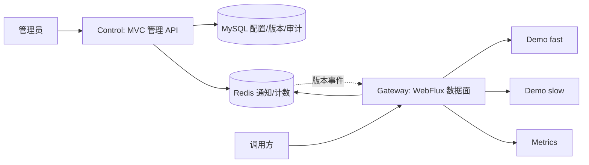

# FlowGate 阶段 0 — 上游源码审计、改造清单与架构决策

> **性质**：只读静态源码审计 + 面向新业务的架构核对，供项目负责人/Codex 审阅；不表示设计已批准或功能已经实现。
>
> 日期：2026-11-04；审计上游：[`java-up-up/hmdp-plus@03594d190275a32d151e5d8b45da24c0f4efbe14`](https://github.com/java-up-up/hmdp-plus/commit/03594d190275a32d151e5d8b45da24c0f4efbe14)（2026-10-27）；目标仓库起始时为空，默认分支 main。
>
> **方向修正（优先级最高）**：2026-11-04 用户明确要求 **“改造为 FlowGate 自身的业务内容，尽量保留原技术实现、降低学习成本”**。因此早期规划中的“长期保留点评商户/秒杀/订单作为主要下游”以及此前“在 Plus 前加 Gateway”的建议**已失效**。历史交接文件仍可参考其技术目标、协作要求、性能验收方法，但业务边界以本次新决定为准。总体蓝图见 [README](../README.md)。

## 一、审计口径与结论

| 标识 | 含义 |
|---|---|
| **[源码确认]** | 已读取对应仓库文件/方法/脚本，可说明它在代码中怎样实现 |
| **[文档宣称]** | 上游 README 叙述，但本次未验证完整运行效果 |
| **[尚未验证]** | 未执行 Maven 构建、应用启动、真实 Redis/Kafka/MySQL、自动化测试、网络或压测 |

**总体结论**：Plus 是 Spring Boot 3.5.4 / Java 17 的 Maven 多模块项目，能够提供大量有价值的**MVC 管理端、缓存、Redis Lua、锁、Kafka、幂等与监控实现参考**。它不是可直接启动的 FlowGate，也未包含动态网关/治理配置面。Gateway 采用独立 Spring Cloud Gateway WebFlux 运行时，**不能把原 Servlet、同步 Redis/Redisson/JDBC 框架整包依赖到网关**。Control 则可利用原 MVC/数据库开发习惯，逐步将原商户/券/订单领域替换为 API/路由/策略/版本/审计领域。

## 二、上游模块事实与依赖

[根 POM](https://github.com/java-up-up/hmdp-plus/blob/03594d190275a32d151e5d8b45da24c0f4efbe14/pom.xml) 中聚合模块：`hmdp-common`、`hmdp-sharding`、`hmdp-core-service`、`hmdp-redisson-framework`、`hmdp-redis-tool-framework`、`hmdp-id-generator-framework`、`hmdp-mq-framework`、`hmdp-parameter`。另有 `hmdp-vue3`、`sql` 目录（非根 Maven 聚合模块）。

```text
hmdp-core-service (唯一现成 Spring Boot MVC 主业务进程)
 ├─ hmdp-sharding ── hmdp-common
 ├─ hmdp-redis-framework ── hmdp-redis-common-framework
 ├─ hmdp-redis-rate-limit-framework ── hmdp-redis-framework
 ├─ hmdp-service-lock / bloom-filter / repeat-execute-limit / delay-queue
 ├─ hmdp-id-generator-framework
 ├─ hmdp-mq-producer-framework / hmdp-mq-consumer-framework
 ├─ hmdp-parameter
 └─ MyBatis-Plus / Spring MVC / Spring Kafka / Actuator / Micrometer
```

- [核心 POM](https://github.com/java-up-up/hmdp-plus/blob/03594d190275a32d151e5d8b45da24c0f4efbe14/hmdp-core-service/pom.xml) **[源码确认]**：`spring-boot-starter-web`、MyBatis-Plus、ShardingSphere、Spring Kafka、Actuator、Prometheus registry，以及上述内部模块。不是 WebFlux 应用。
- [Redis 框架 POM](https://github.com/java-up-up/hmdp-plus/blob/03594d190275a32d151e5d8b45da24c0f4efbe14/hmdp-redis-tool-framework/hmdp-redis-framework/pom.xml) **[源码确认]**：带 `spring-boot-starter-web` 和 `spring-boot-starter-data-redis`；Redis 封装用 `StringRedisTemplate`，同步调用。
- [MQ 框架 POM](https://github.com/java-up-up/hmdp-plus/blob/03594d190275a32d151e5d8b45da24c0f4efbe14/hmdp-mq-framework/pom.xml) **[源码确认]**：common、producer、consumer 三个子模块。
- [Redisson 框架聚合](https://github.com/java-up-up/hmdp-plus/blob/03594d190275a32d151e5d8b45da24c0f4efbe14/hmdp-redisson-framework/pom.xml) **[源码确认]**：分布式锁、Bloom Filter、重复执行限制、延迟队列等子模块。
- [应用配置](https://github.com/java-up-up/hmdp-plus/blob/03594d190275a32d151e5d8b45da24c0f4efbe14/hmdp-core-service/src/main/resources/application.yml) **[源码确认]**：默认 MVC 服务端口 8085、Redis、Kafka、ShardingSphere JDBC、Prometheus endpoint。其 [ShardingSphere 配置](https://github.com/java-up-up/hmdp-plus/blob/03594d190275a32d151e5d8b45da24c0f4efbe14/hmdp-core-service/src/main/resources/shardingsphere.yaml) 定义 **ds_0、ds_1**；仓库包含 `sql/hmdp_0.sql` 和 `sql/hmdp_1.sql`。没有发现现成 Docker Compose / CI 工作流，**不等于已证实无法运行**。
- [LICENSE](https://github.com/java-up-up/hmdp-plus/blob/03594d190275a32d151e5d8b45da24c0f4efbe14/LICENSE) **[源码确认]**：Apache License 2.0。未来真正复制/改造源码时保留许可、版权及必要 NOTICE/修改说明。

## 三、已经读到的实现证据（不等于运行验证）

| 能力 / 类与路径 | 源码证据 | 对 FlowGate 的价值 |
|---|---|---|
| [`ShopController`](https://github.com/java-up-up/hmdp-plus/blob/03594d190275a32d151e5d8b45da24c0f4efbe14/hmdp-core-service/src/main/java/org/javaup/controller/ShopController.java)、[`ShopServiceImpl`](https://github.com/java-up-up/hmdp-plus/blob/03594d190275a32d151e5d8b45da24c0f4efbe14/hmdp-core-service/src/main/java/org/javaup/service/impl/ShopServiceImpl.java) | **[源码确认]** `GET /shop/{id}` → `queryByIdV4` → Redis/布隆过滤器/空值缓存/Redisson 双检锁/MyBatis；V1–V3 在当前调用处被注释 | 参考热点缓存和防击穿模式；**不必保留商户表/商户 API** |
| [`VoucherOrderController`](https://github.com/java-up-up/hmdp-plus/blob/03594d190275a32d151e5d8b45da24c0f4efbe14/hmdp-core-service/src/main/java/org/javaup/controller/VoucherOrderController.java) | **[源码确认]** `/voucher-order/seckill/token/{id}` 与 `/voucher-order/seckill/{id}` 分别触发 `RateLimitHandler.execute` 和一次性业务令牌检查 | 区分入口流控与业务资格；**不迁移秒杀接口作为核心业务** |
| [`RedisRateLimitHandler`](https://github.com/java-up-up/hmdp-plus/blob/03594d190275a32d151e5d8b45da24c0f4efbe14/hmdp-redis-tool-framework/hmdp-redis-rate-limit-framework/src/main/java/org/javaup/execute/RedisRateLimitHandler.java) | **[源码确认]** 按 IP/用户/券 ID 构造键、调用滑动窗口或令牌桶 Lua，并支持白名单与惩罚策略；依赖 `ServletRequestAttributes` 获取请求 IP | **重用算法/错误模型思路，WebFlux 端重写请求上下文与非阻塞 Redis 调用** |
| [`tokenBucket.lua`](https://github.com/java-up-up/hmdp-plus/blob/03594d190275a32d151e5d8b45da24c0f4efbe14/hmdp-redis-tool-framework/hmdp-redis-rate-limit-framework/src/main/resources/lua/tokenBucket.lua)、[`rateLimitSliding.lua`](https://github.com/java-up-up/hmdp-plus/blob/03594d190275a32d151e5d8b45da24c0f4efbe14/hmdp-redis-tool-framework/hmdp-redis-rate-limit-framework/src/main/resources/lua/rateLimitSliding.lua) | **[源码确认]** Redis `TIME`、原子令牌补充或 ZSET 窗口计数，返回 IP/用户拒绝码 | 参考计数逻辑；按服务/路由/调用方维度重新设计键、作用域和 TTL |
| [`SeckillAccessTokenServiceImpl`](https://github.com/java-up-up/hmdp-plus/blob/03594d190275a32d151e5d8b45da24c0f4efbe14/hmdp-redis-tool-framework/hmdp-redis-rate-limit-framework/src/main/java/org/javaup/service/impl/SeckillAccessTokenServiceImpl.java)、[`seckill_access_token.lua`](https://github.com/java-up-up/hmdp-plus/blob/03594d190275a32d151e5d8b45da24c0f4efbe14/hmdp-redis-tool-framework/hmdp-redis-rate-limit-framework/src/main/resources/lua/seckill_access_token.lua) | **[源码确认]** 短 TTL 一次性令牌，Lua 比较后 `DEL`；当前令牌签发有明文日志 | 可参考短期凭证/一次性管理操作思路，**不能把业务秒杀令牌当成平台登录 Token** |
| [`UserServiceImpl`](https://github.com/java-up-up/hmdp-plus/blob/03594d190275a32d151e5d8b45da24c0f4efbe14/hmdp-core-service/src/main/java/org/javaup/service/impl/UserServiceImpl.java)、[`RefreshTokenInterceptor`](https://github.com/java-up-up/hmdp-plus/blob/03594d190275a32d151e5d8b45da24c0f4efbe14/hmdp-core-service/src/main/java/org/javaup/utils/RefreshTokenInterceptor.java)、[`UserHolder`](https://github.com/java-up-up/hmdp-plus/blob/03594d190275a32d151e5d8b45da24c0f4efbe14/hmdp-core-service/src/main/java/org/javaup/utils/UserHolder.java) | **[源码确认]** 登录产生随机 opaque Token → Redis Hash → MVC 拦截器恢复用户到 `ThreadLocal` 并刷新 TTL | 控制面可参考 Redis opaque Token；Gateway 需要独立响应式鉴权实现，用户上下文放 exchange/Reactor Context |
| [`MvcConfig`](https://github.com/java-up-up/hmdp-plus/blob/03594d190275a32d151e5d8b45da24c0f4efbe14/hmdp-core-service/src/main/java/org/javaup/config/MvcConfig.java) | **[源码确认]** 通过 Servlet `HandlerInterceptor` 登录校验；整个 `/shop/**`、`/voucher/**` 被排除，包括写接口 | **不可照搬白名单**；FlowGate 按明确的管理/数据权限和 HTTP Method 做授权 |
| [`VoucherOrderServiceImpl`](https://github.com/java-up-up/hmdp-plus/blob/03594d190275a32d151e5d8b45da24c0f4efbe14/hmdp-core-service/src/main/java/org/javaup/service/impl/VoucherOrderServiceImpl.java)、[`seckillVoucher.lua`](https://github.com/java-up-up/hmdp-plus/blob/03594d190275a32d151e5d8b45da24c0f4efbe14/hmdp-core-service/src/main/resources/lua/seckillVoucher.lua) | **[源码确认]** 当前 `seckillVoucher()` 走 V2；Lua 原子校验时间/库存/用户集合，记录流水；之后 Kafka 异步发消息；旧 Redis Stream 代码存在但非生效主线 | 参考 Lua 原子性与异步解耦设计，**不能按名字重用库存与订单语义** |
| [`SeckillVoucherProducer`](https://github.com/java-up-up/hmdp-plus/blob/03594d190275a32d151e5d8b45da24c0f4efbe14/hmdp-core-service/src/main/java/org/javaup/kafka/producer/SeckillVoucherProducer.java)、[`SeckillVoucherConsumer`](https://github.com/java-up-up/hmdp-plus/blob/03594d190275a32d151e5d8b45da24c0f4efbe14/hmdp-core-service/src/main/java/org/javaup/kafka/consumer/SeckillVoucherConsumer.java)、[`AbstractProducerHandler`](https://github.com/java-up-up/hmdp-plus/blob/03594d190275a32d151e5d8b45da24c0f4efbe14/hmdp-mq-framework/hmdp-mq-producer-framework/src/main/java/org/javaup/AbstractProducerHandler.java) | **[源码确认]** `CompletableFuture` 发送、成功/失败回调、手动 ACK、业务落库；发/消费失败关联 Redis 回滚 | 可参考可靠消息、去重和重试，但控制面优先事务性 DB 审计，不在网关 HTTP 热路径引 Kafka |
| [`RedisVoucherData`](https://github.com/java-up-up/hmdp-plus/blob/03594d190275a32d151e5d8b45da24c0f4efbe14/hmdp-core-service/src/main/java/org/javaup/kafka/redis/RedisVoucherData.java)、[`ReconciliationTaskServiceImpl`](https://github.com/java-up-up/hmdp-plus/blob/03594d190275a32d151e5d8b45da24c0f4efbe14/hmdp-core-service/src/main/java/org/javaup/service/impl/ReconciliationTaskServiceImpl.java) | **[源码确认]** Lua 回滚重试与失败日志、对账方法；[`seckillVoucherRollBack.lua`](https://github.com/java-up-up/hmdp-plus/blob/03594d190275a32d151e5d8b45da24c0f4efbe14/hmdp-core-service/src/main/resources/lua/seckillVoucherRollBack.lua) 会删除库存键 | 可借鉴失败恢复和版本对账思路，**不是网关可直接复用的恢复算法** |
| [`SeckillVoucherLocalCache`](https://github.com/java-up-up/hmdp-plus/blob/03594d190275a32d151e5d8b45da24c0f4efbe14/hmdp-core-service/src/main/java/org/javaup/cache/SeckillVoucherLocalCache.java)、[`SeckillVoucherCacheInvalidationPublisher`](https://github.com/java-up-up/hmdp-plus/blob/03594d190275a32d151e5d8b45da24c0f4efbe14/hmdp-core-service/src/main/java/org/javaup/cache/SeckillVoucherCacheInvalidationPublisher.java) | **[源码确认]** Caffeine 本地缓存、Redis 删除和 Kafka 缓存失效通知 | 可参考本地快照+通知模式，但规则必须带版本/校验/补拉，不能把消息到达等同一致性 |
| [`RepeatExecuteLimitAspect`](https://github.com/java-up-up/hmdp-plus/blob/03594d190275a32d151e5d8b45da24c0f4efbe14/hmdp-redisson-framework/hmdp-redisson-service-framework/hmdp-repeat-execute-limit-framework/src/main/java/org/javaup/repeatexecutelimit/aspect/RepeatExecuteLimitAspect.java) | **[源码确认]** 本地锁 + Redisson 锁 + 防重复标记 | 控制面可参考幂等；规则发布优先采用 DB 唯一约束/版本 CAS，不额外依赖分布式锁 |
| [`WebExceptionAdvice`](https://github.com/java-up-up/hmdp-plus/blob/03594d190275a32d151e5d8b45da24c0f4efbe14/hmdp-core-service/src/main/java/org/javaup/config/WebExceptionAdvice.java)、[`Result`](https://github.com/java-up-up/hmdp-plus/blob/03594d190275a32d151e5d8b45da24c0f4efbe14/hmdp-core-service/src/main/java/org/javaup/dto/Result.java) | **[源码确认]** 业务异常包装 `Result.fail`，多数方法没有显式设置 HTTP 4xx/5xx | FlowGate 要保留 HTTP 错误语义，不能以业务 JSON 失败率代替真实 HTTP 错误率 |
| [Actuator/Micrometer POM](https://github.com/java-up-up/hmdp-plus/blob/03594d190275a32d151e5d8b45da24c0f4efbe14/hmdp-core-service/pom.xml) | **[源码确认]** 包含 Actuator + Prometheus registry，代码也有业务 counter | 可复用指标开发习惯，Gateway 必须有独立请求/限流/熔断指标，标签限制基数 |

**[文档宣称而未充分验证]**：上游 README 提到可靠 Outbox、本地消息表、自动补偿、高并发收益与完整监控闭环；本次静态阅读看到 Kafka 回调、回滚、日志、对账等具体实现，但**没有证明**其端到端 exactly-once、一致性无遗漏、定时修复实际触发或压测收益。不要在 FlowGate 文档中把宣传结论改写成已验收事实。

## 四、明确复用、重构、淘汰边界

| 对象 | 处理方式 | 理由 / 下一步 |
|---|---|---|
| Java 17 / Boot 3.5.x / Maven 聚合结构 | **延用/校验** | 降低迁移成本；阶段 1 需实际依赖解析 |
| MyBatis-Plus、MVC Controller/Service 模式 | **控制面选择性复用** | 改写领域对象为 API/Route/Policy/Release/Audit；无需迁移原 Shop/Order 表 |
| Redis Key、缓存工具、Lua 算法 | **按用途改造** | 业务语义重构；Gateway 调用使用 reactive Redis |
| Caffeine 缓存 | **复用思路，可用库** | 规则使用不可变快照/原子替换优先；初期不强行加复杂缓存框架 |
| `hmdp-redis-rate-limit-framework` 整包 | **不直接依赖 Gateway** | Servlet `RequestContextHolder` + 同步 Redis，与 Reactor 热路径不匹配 |
| MVC `LoginInterceptor`、`RefreshTokenInterceptor`、`UserHolder` | **控制面重构；Gateway 重写** | Servlet/ThreadLocal 模型不适用 WebFlux，白名单不安全 |
| Redisson 锁与幂等切面 | **控制面按需复用** | 不进 Gateway event loop；优先 DB 版本/唯一约束 |
| Kafka 生产/消费封装 | **保留源码参考；条件引入** | 没有真正异步审计/任务需求时不增加组件 |
| ID 生成 | **按真实唯一 ID 需求评估** | 管理表可用数据库 ID/UUID，不必强制复用 Snowflake |
| ShardingSphere JDBC 与双库表结构 | **不直接搬入新控制面** | 原分片服务于点评数据，控制面可简单 MySQL；需保留源码和许可参考 |
| 商户、博客、关注、优惠券、秒杀、订单、原 Vue 页面 | **不作为 FlowGate 交付模块** | 原业务已被新定位取代 |
| Gateway、策略发布、版本同步、非阻塞鉴权、熔断等 | **新增 FlowGate 自身能力** | 上游无等价可直接迁移的网关业务实现 |

**迁移策略**：不要把整个旧工程原样搬到 FlowGate 的 `main` 再大规模删改；优先在阶段分支按模块选择性导入经审计可复用代码。必要时用上游 SHA、提交记录和文件路径保留可追溯性。任何代码复制前检查许可证与配置内容。

## 五、关键安全/正确性风险（均未运行复现）

| 等级 | 事实 / 风险 | 需要的措施 |
|---|---|---|
| **高** | [`MvcConfig`](https://github.com/java-up-up/hmdp-plus/blob/03594d190275a32d151e5d8b45da24c0f4efbe14/hmdp-core-service/src/main/java/org/javaup/config/MvcConfig.java) 排除整个 `/shop/**` 与 `/voucher/**`，其中还有 POST/PUT 修改接口 | 重新建基于资源与方法的精确授权；管理接口与公共 API 分离 |
| **高** | [`UserServiceImpl`](https://github.com/java-up-up/hmdp-plus/blob/03594d190275a32d151e5d8b45da24c0f4efbe14/hmdp-core-service/src/main/java/org/javaup/service/impl/UserServiceImpl.java) 演示验证码出现在日志/返回；[`SeckillAccessTokenServiceImpl`](https://github.com/java-up-up/hmdp-plus/blob/03594d190275a32d151e5d8b45da24c0f4efbe14/hmdp-redis-tool-framework/hmdp-redis-rate-limit-framework/src/main/java/org/javaup/service/impl/SeckillAccessTokenServiceImpl.java) 记录原始令牌 | 不复制原有凭证输出/日志行为；管理员凭证、API Token 永不入日志 |
| **高** | [`RedisRateLimitHandler`](https://github.com/java-up-up/hmdp-plus/blob/03594d190275a32d151e5d8b45da24c0f4efbe14/hmdp-redis-tool-framework/hmdp-redis-rate-limit-framework/src/main/java/org/javaup/execute/RedisRateLimitHandler.java) 读取最左侧 `X-Forwarded-For` / `X-Real-IP` | 只采信可信代理，过滤伪造 Header |
| **高** | 动态上游 URL 带 SSRF、内网访问、绕过管理面与权限校验风险 | 精确协议/域名/IP 段/端口允许列表；禁止任意 `file:`/本地地址/元数据地址；限制管理权限 |
| **高** | [`RedisCacheImpl`](https://github.com/java-up-up/hmdp-plus/blob/03594d190275a32d151e5d8b45da24c0f4efbe14/hmdp-redis-tool-framework/hmdp-redis-framework/src/main/java/org/javaup/redis/RedisCacheImpl.java) 同步 Redis；Redisson/JDBC 亦同步 | 数据面不在 Netty event loop 调用；保留控制面同步代码 |
| **中高** | [`tokenBucket.lua`](https://github.com/java-up-up/hmdp-plus/blob/03594d190275a32d151e5d8b45da24c0f4efbe14/hmdp-redis-tool-framework/hmdp-redis-rate-limit-framework/src/main/resources/lua/tokenBucket.lua) 先扣 IP 令牌，再扣用户令牌；用户拒绝时 IP 令牌可能已经被扣减 | FlowGate 需明确“拒绝是否计入其他维度额度”，不能未经说明原样复制 |
| **中高** | [`seckillVoucherRollBack.lua`](https://github.com/java-up-up/hmdp-plus/blob/03594d190275a32d151e5d8b45da24c0f4efbe14/hmdp-core-service/src/main/resources/lua/seckillVoucherRollBack.lua) 通过删除库存键交给后续重建；消费延迟/失败回滚时序复杂 | 原有业务机制不等于新平台的规则回滚机制；新规则采用版本化发布 |
| **中** | [`VoucherOrderServiceImpl`](https://github.com/java-up-up/hmdp-plus/blob/03594d190275a32d151e5d8b45da24c0f4efbe14/hmdp-core-service/src/main/java/org/javaup/service/impl/VoucherOrderServiceImpl.java) 发送 Kafka 异步消息后返回订单 ID；投递/消费/落库有不同成功阶段 | 设计 FlowGate 时区分“配置受理/发布/各节点生效”；不能把受理等于最终成功 |
| **中** | [`Result`](https://github.com/java-up-up/hmdp-plus/blob/03594d190275a32d151e5d8b45da24c0f4efbe14/hmdp-core-service/src/main/java/org/javaup/dto/Result.java) 用 body 的 success/errorMsg 表达错误，未规定 HTTP 状态 | 明确 401/403/429/502/503/504 和指标含义 |
| **中** | 原 `shardingsphere.yaml` 涉及数据库连接配置；项目面向公开 GitHub | 不照搬真实密码/私网地址，使用脱敏示例及本地环境变量 |

## 六、整体目标架构（审核用）



### 核心领域与职责

1. **API/service 目录**：API ID、所属逻辑服务、HTTP 方法、匹配路径、暴露状态、是否需授权。路由不是任意转发的字符串。
2. **路由与绑定**：Route 定义转发目标/前缀/谓词；Policy 定义作用域/参数/失败模式；Binding 定义匹配与冲突决策。
3. **策略及控制**：草稿校验 → 乐观锁/版本冲突检查 → 持久化发布 → 生成带 checksum 的只读快照 → 通知 Gateway → 各节点确认/观测生效版本。旧版本可回滚。Redis 通知只加速，不应是唯一可信来源。
4. **认证和授权**：平台管理员与 API 调用方是不同角色；P0 只配置受控演示 API，随后优先复用随机 opaque Token + Redis Session 的原理，Gateway 非阻塞校验、控制面使用 MVC 对等逻辑。API Key/OAuth2 在需求明确后考虑。
5. **速率与并发**：按全局/服务/路由/用户等作用域进行令牌桶/窗口控制；在途并发在请求结束/失败/取消/超时都释放。单机限并发和多实例全局限并发不同，不声称前者全局有效。
6. **热点隔离**：选择普通快速查询及可控慢/重载测试 API；对热点路由施加自身预算/并发上限，观察普通接口的 P95/P99 和拒绝比。若两者共享进程/线程池而无资源隔离，必须注明实验局限，不虚报完全隔离。
7. **可观测**：gateway 请求总量、限流/并发拒绝、上游 5xx、超时/熔断、P50/P95/P99、路由与策略版本、CPU/内存、下游负载；标签使用 routeId、policyType、outcome 等有限枚举，绝不使用用户 ID/路径原始参数作为高基数标签。
8. **故障模式**：控制面不可用时继续服务已验证快照；Redis 限流不可用时按管理 API/普通公开读等接口风险区别 fail-closed / fail-open 并记录指标，不能一个兜底规则覆盖全部路由。首次启动没有有效快照时不可默认开放任意动态目标。

### 阶段 1 最小闭环（不是现在编码）

```text
GET /api/demo/fast/{id}   -> Gateway 静态路由 -> MVC Demo fast
GET /api/demo/slow?delayMs=100 -> Gateway 静态路由 -> MVC Demo slow
                                -> Trace ID -> HTTP 响应与基础指标
```

具体路径是候选契约；部署最初只需 **Gateway + 最小 MVC Demo** 两个进程。控制面可先是一个轻量框架/骨架或与 Demo 同进程，后续再分离；若合并，必须严格禁止通过网关转发到 `/admin/**`。此阶段不需要点评业务、订单表或 Kafka；**不意味着将来可以宣称 Kafka、缓存/幂等已经复用成功**。其后的阶段 2 才增加安全管理、动态规则和版本回滚，阶段 3 再完善 Redis 限速/并发治理。

## 七、拟定 ADR：待负责人/Codex 确认

### ADR-001：Plus 技术的重构方法

- **方案 A（推荐，未批准）**：独立 `flowgate-gateway`（WebFlux），按需将 Plus 的 MVC/MyBatis-Plus/缓存/幂等类选择性改造成 `flowgate-control`；另有轻量 `flowgate-demo`。
- 方案 B：完整复制 Plus，再一次性删除点评领域，风险是分片依赖、自动配置、路径/包名耦合导致迁移工作量大。
- 方案 C：完全重写所有代码，学习与开发成本高，浪费已有技术积累。
- **取舍**：A 避免无意义的保留和大规模重构，但抽取时需逐类管理传递依赖、版权与测试。
- **验证**：Gateway 无 Servlet/JDBC/MVC 依赖；新控制面不依赖点评表；简单 Demo 可通过网关访问。

### ADR-002：身份模型

- **方案 A（推荐，未批准）**：首版管理端与 API 调用方使用单一体系的随机 opaque Token + Redis 映射，区分 role/scope，控制面 MVC 校验，网关用 reactive Redis 校验；避免复用短信验证码演示安全缺陷。
- 方案 B：JWT 自校验；减少每请求 Redis 依赖，但撤销/权限实时性和密钥轮换复杂，不能无理由引入。
- 方案 C：完整 OAuth2 / Keycloak；面向企业对接时有价值，当前范围过重。
- **注意**：P0 静态代理可先只暴露明确允许的测试 API；完整令牌验证在阶段 2。不能靠不受信的 `X-User-Id` 头实现鉴权。

### ADR-003：动态策略发布与限流存储

- **方案 A（推荐，未批准）**：DB 是权威配置存储；发布产生不可变版本快照；Gateway 原子替换本地快照；Redis Pub/Sub 或其他轻量通知仅用于加速，启动/漏通知通过定期拉取对账；分布式速率控制使用非阻塞 Redis Lua。
- 方案 B：Gateway 每请求直接读取 DB/控制面配置；高并发热路径耦合、故障放大，不推荐。
- 方案 C：直接使用 Nacos/Sentinel 等集中治理套件；能够更快获得部分能力，但增加生态与学习成本，不满足当前“最少依赖、体现独立设计贡献”的偏好。
- **取舍**：版本快照有传播延迟，需要定义生效语义、回滚和节点版本观测；跨节点全局并发许可还需租约与故障恢复方案，不能与 Redis QPS 限速混为一谈。

### 阶段 0 审核点

- [ ] 确认“替换点评业务、复用技术实现”作为唯一目标口径。
- [ ] 确认以网关 + MVC 控制面 + 最小 Demo 为总体边界，不保留完整 Plus 业务。
- [ ] 确认 ADR-001/002/003 或给出修改建议。
- [ ] 确认阶段 1 只实施最小路由/指标主线，评审通过前不扩展高级治理。

## 八、尚未完成的验证与阶段纪律

**[尚未验证]**：
- 整体 Maven 编译和各模块单测、依赖冲突（旧工程的自动配置等）、新工程实际 Boot/Gateway 版本解析。
- Redis Lua 在多维规则、超时、并发、高冲突及可选 Redis Cluster 下的正确性。
- Kafka/Outbox/补偿完整实现或可靠性；不可复制上游 README 的吞吐/一致性宣传数字。
- Control/Gateway 运行、双 MySQL ShardingSphere 原服务可启动性。
- 规则热更新、一致性传播、多实例失联/恢复、调用方身份及 SSRF 测试。
- 原始直连、只经网关、开启治理三种状态的 P50/P95/P99、429、5xx、CPU/内存、Redis 开销与下游负载。

**后续阶段开工前**：冻结已批准的 ADR、选择具体依赖版本、检查 Apache-2.0 许可与代码归属、脱敏配置；阶段 1 才可建立功能代码，先证明简单主线。每阶段以检查清单和 Codex 审核为停止门槛。

## 九、源码/官方资料索引

- [上游仓库（审计 SHA）](https://github.com/java-up-up/hmdp-plus/tree/03594d190275a32d151e5d8b45da24c0f4efbe14)
- [上游 README（宣传说明，不代表完成验证）](https://github.com/java-up-up/hmdp-plus/blob/03594d190275a32d151e5d8b45da24c0f4efbe14/README.md)
- [上游 LICENSE](https://github.com/java-up-up/hmdp-plus/blob/03594d190275a32d151e5d8b45da24c0f4efbe14/LICENSE)
- [Spring Cloud Boot 兼容矩阵](https://spring.io/projects/spring-cloud/)：Boot 3.5.x ↔ Cloud 2025.0.x
- [Gateway Server WebFlux 4.3 引入文档](https://docs.spring.io/spring-cloud-gateway/reference/4.3/spring-cloud-gateway-server-webflux/starter.html)：`spring-cloud-starter-gateway-server-webflux`；需 Netty/WebFlux，不能按传统 Servlet WAR 应用方式部署。
- [Spring Cloud 2025.0 迁移说明](https://github.com/spring-cloud/spring-cloud-release/wiki/Spring-Cloud-2025.0-Release-Notes)：新 starter 命名和 `spring.cloud.gateway.server.webflux.*` 属性前缀。

---

**本轮阶段 0 仅提交以上两份设计/审计文档；不改业务源码、不运行服务、不执行测试。**